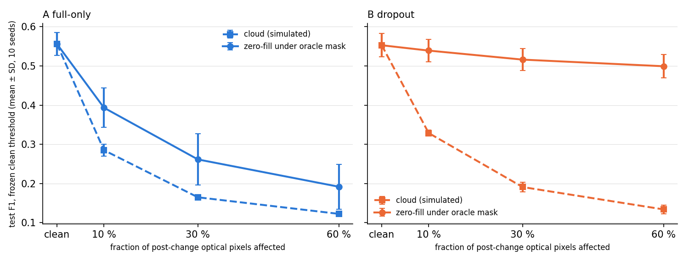

# Step 4A: oracle-mask zero-fill (evaluation only)

Protocol: `PHASE4A_PREREGISTRATION.md`, written before any Step 4A test evaluation. The tables at the end are generated by
`analyze_phase4a.py` (`phase4a/tables.md`) and pasted here unchanged. **V** marks a finding supported under the
pre-registered rule; **H** marks an interpretation.



## 1. Integrity

- **Checkpoints and test evaluation:** the 20 Phase 2 checkpoints were used unchanged, with one test evaluation per checkpoint and condition.
- **Anchors** passed for every checkpoint:
  - `clean` and cloud test counts (pooled, inside the mask and outside it) equal the stored Phase 3 counts exactly;
  - the clean validation argmax equals the stored threshold.
- **Smoke test:** the validation-only smoke test ran before the pre-registration. No deviations from the pre-registration.
- **Phase 3 audit:** `audit_p3.py` re-derived the Phase 3 report independently from raw counts: <!-- P3_AUDIT -->

## 2. Primary result (frozen clean threshold; Holm over 6)

- **V:** zero-filling the corrupted pixels instead of showing cloud values improves F1 for **both** arms at every level.
  All 6 tests are Holm p < 0.05, and z > c in 10/10 seeds.
- **The size of the gain differs completely between the arms:**
  - **B (dropout)** recovers 94%, 90% and 87% of the F1 lost to clouds at 10%, 30% and 60%. Mean F1 is 0.539, 0.516 and 0.499, against 0.553 clean.
    The false-alarm rate inside the mask goes back to its clean value (≈ 0.05), and spill-over outside the mask disappears.
  - **A (full-only)** recovers only 40%, 25% and 16%. A reads zero-filled regions as change too: about half of the
    zero-filled pixels become false alarms (false-alarm rate inside the mask ≈ 0.51).
- **Secondary:** under zero-fill, B > A by +0.146, +0.255 and +0.307 F1 (10/10 seeds; Holm-significant at every threshold rule).

## 3. Interpretation (H)

- **Suggested, not isolated:** cloud-valued optical inputs appear to contribute substantially to the Phase 3 degradation.
  With oracle-mask zero-filling, B recovered most of its lost F1, and A recovered much less. B's F1 at 60% cover
  (0.499) is even above its F1 with the whole post image missing (0.478). This experiment does not isolate every
  possible cause, and it says nothing about real cloud conditions. It shows only that zero-filling the known corrupted pixels
  helps a great deal relative to this particular simulated corruption.
- **The gain depends on the training strategy.** The same masked input helps the full-only model far less. This suggests that
  explicit handling of missing optical regions, together with modality-dropout training, merits further investigation.
- **Recall inside the mask drops** for B (≈ 0.73 → 0.55–0.61). Under a cloud, B relies on SAR and the pre-change
  image, and it detects fewer changes there. The remaining F1 gap is consistent with lost evidence rather than false alarms.
- **Step 4 decision:** the evidence does **not** call for a new architecture yet. The cheap remedy helps substantially when the mask is known (oracle).
  The open question is **how much of the gain survives a realistic cloud mask** (missed clouds, thin edges, shadows),
  and whether training with spatial partial masks (Step 4B) closes the remaining gap and removes the oracle dependence.

## 4. Limitations

- **The mask is an oracle.** It marks exactly the corrupted pixels, so this result is an upper bound. A real cloud detector
  misses thin edges and shadows, and B reads unmasked cloud pixels as change (Phase 3).
- **The corruption is the simulated Phase 3 corruption:** opaque clouds, one spectrum, no shadows, post-change date only.
- **Zero is a fill value, not a learned "missing" token.** B treats it as missing only because Phase 2 training showed it zero-filled whole images.
- **The 10 seeds are training replicates** on the same 10 test cities. They are not independent geographic samples.

## 5. Next (to be pre-registered separately)

- **4A-bis (evaluation only):** replace the oracle mask with a realistic one, either a dilated or eroded oracle, or a simple
  spectral cloud test applied to the corrupted image. This measures how quickly the gain decays with mask errors.
- **4B (training):** spatial partial-dropout training, using random masks shaped like the catalogue masks and zero-filled during
  training, compared with `p2_dropout` on clean / cloud / zero-fill. The comparison is paired by seed, with its own pre-registration.

## 6. Reproduction

```bash
.venv/Scripts/python.exe audit_p3.py        # Phase 3 report audit
.venv/Scripts/python.exe eval_phase4a.py    # 20 checkpoints x 7 conditions, anchors enforced
.venv/Scripts/python.exe analyze_phase4a.py # summary.json, tables.md, curves.png
.venv/Scripts/python.exe build_phase4a_report.py
```

## 7. Generated tables (`phase4a/tables.md`)

<!-- TABLES -->
