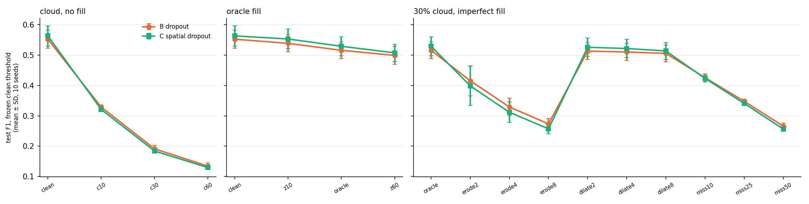

# Step 4B: spatial partial-dropout training (arm C) vs whole-modality dropout (arm B)

Protocol: `PHASE4B_PREREGISTRATION.md`, written 2026-10-22 13:57 IST and committed in `25fe13b`, before the first
`p4b_spatial` training run (14:04). The tables in section 9 are generated by the registered `analyze_phase4b.py`
(`phase4b/tables.md`) and pasted here unchanged. **V** marks a result under the pre-registered rule; **H** marks an
interpretation. Every number in this report is filled in from `phase4b/summary.json` by `build_phase4b_report.py`, which
also refuses to build if a qualitative claim made below is not supported by the results.



## 1. Integrity and deviations

- **Gates before training** (`logs/robust/p4b_train.sh`): the spatial = 0 parity run reproduced `p2_dropout_seed1`
  bit-for-bit, the validation-only smoke test passed (21 checks, 0 failed), and all 33 pre-registered sha256 hashes
  matched. The hashes were checked again after the analysis: unchanged.
- **Training:** seeds 1–10 trained once each, sequentially, with the frozen code (log `logs/robust/p4b_train.log`,
  2026-10-22 14:04–15:29 IST). No run crashed, was restarted or was excluded. Wall-clock seconds per seed:
  359, 358, 903, 358, 358, 359, 358, 359, 1283, 358. Seeds 3 and 9 took longer; the cause was not identified. Training is deterministic with a fixed
  step count, so wall-clock time does not affect the results.
- **Test evaluation:** each C checkpoint was evaluated on the test cities once (`eval_phase4b.py`, 15:29–15:44 IST).
  10/10 runs passed every anchor: the clean validation argmax equals the stored threshold, the clean test
  counts equal the training-time `metrics.json` at the selected and at the 0.5 threshold, and the inside + outside
  counts equal the pooled counts. B was not retrained or re-evaluated; its stored Step 4A-bis counts and exploratory-addendum
  counts were reused, as registered.
- **Analysis:** `analyze_phase4b.py` ran once (15:44 IST, log `logs/robust/p4b_analyze.log`), with its registered hash.
- **Independent audit:** `audit_p4b.py` (written before training) recomputes every family from the raw `.npz` counts
  and `metrics.json` with numpy/scipy, independently of the analysis code, and checks this report's primary table.
  **432 checks, 0 failed**
- **Deviations and notes, reported:**
  1. **Test F1 was printed during the run.** As for B, `train_spatial.py` prints the Phase 2 test F1 at the end of each
     training run, and `eval_phase4b.py` prints per-seed test F1 for six conditions. This was pre-specified (§6, §9).
     Nothing was stopped, selected or changed after these prints. In an interim chat status the end-of-training numbers
     were wrongly called validation F1; they are test F1 at each run's validation-selected threshold.
  2. **Condition count wording.** The pre-registration (§6) says "33 Step 4A-bis conditions" but lists clean, 3 no-fill,
     3 oracle and 27 imperfect-mask conditions, which is 34. All 34 listed conditions were evaluated and analysed (7 primary,
     27 secondary), as in Step 4A-bis. This is a counting error in the text; no condition was added or dropped.
  3. No other deviation. No setting was changed after any test output existed.
- **Wilcoxon resolution:** with n = 10 the smallest exact two-sided Wilcoxon p is 0.0020. The paired t-test is the
  registered primary test.

## 2. Primary result: C − B test F1 at the frozen clean threshold, Holm over 7

| condition | B F1 | C F1 | mean Δ (C − B) | 95% CI | d_z | C > B | Holm p (t) | Holm p (Wilcoxon) | label |
|---|---|---|---|---|---|---|---|---|---|
| clean | 0.553 ± 0.030 | 0.564 ± 0.034 | +0.011 | [-0.024, +0.046] | +0.22 | 7/10 | 1.0e+00 | 1.0000 | no detectable difference |
| z10 | 0.539 ± 0.028 | 0.553 ± 0.033 | +0.014 | [-0.019, +0.048] | +0.31 | 7/10 | 1.0e+00 | 1.0000 | no detectable difference |
| z30 | 0.516 ± 0.028 | 0.529 ± 0.032 | +0.013 | [-0.020, +0.047] | +0.28 | 6/10 | 1.0e+00 | 1.0000 | no detectable difference |
| z60 | 0.499 ± 0.030 | 0.508 ± 0.028 | +0.009 | [-0.024, +0.041] | +0.19 | 6/10 | 1.0e+00 | 1.0000 | no detectable difference |
| c30__erode4 | 0.329 ± 0.029 | 0.312 ± 0.034 | -0.018 | [-0.050, +0.015] | -0.39 | 2/10 | 1.0e+00 | 1.0000 | no detectable difference |
| c30__dilate4 | 0.511 ± 0.028 | 0.522 ± 0.030 | +0.011 | [-0.021, +0.043] | +0.26 | 6/10 | 1.0e+00 | 1.0000 | no detectable difference |
| c30__miss25 | 0.348 ± 0.007 | 0.341 ± 0.006 | -0.007 | [-0.015, +0.001] | -0.63 | 3/10 | 5.5e-01 | 0.5879 | no detectable difference |

- **V:** all 7 primary conditions are labelled **no detectable difference** under the pre-specified rule. The smallest Holm
  p-value is above 0.5, and every mean difference is smaller than 0.02 F1 in magnitude.
- **V (H3):** substantial clean regression (mean clean Δ < −0.02): **no**. C's clean F1 is 0.564 vs
  B's 0.553.
- **Sensitivity (pre-registered):** with 10 pairs, effects below about 1.0–1.4 SD of the paired differences
  (roughly 0.04–0.07 F1 here) can be missed. These results do not show that C and B are equivalent. They show that any
  difference on these conditions is smaller than this study can detect.

## 3. Secondary results (each its own Holm family, descriptive)

- **Other 27 Step 4A-bis conditions:** 0 of 27 are significantly better for C and 0 are
  significantly worse after Holm. Some unadjusted p-values are below 0.05 (e.g. c30__miss50 -0.009,
  c60__erode8 -0.021), but none survive correction (Holm p 0.73, 0.85).
- **Phase 2 conditions at each run's validation-selected threshold:** full +0.011 (Holm p 0.58); no_o2 -0.017 (Holm p 0.58); no_opt -0.028 (Holm p 0.14); o2_copy -0.039 (Holm p 0.14). C is lower than B on the whole-modality
  conditions `no_opt` and `o2_copy`; neither survives Holm. C saw `no_o2` and `no_opt` half as often as B in training
  (pre-registered limitation, §2 of the pre-registration).
- **Selected steps:** B [1125, 350, 1075, 825, 650, 1000, 500, 1525, 1700, 1025]; C [1400, 525, 1100, 1500, 575, 475, 950, 650, 1875, 750]. **Frozen clean thresholds:** B [0.89, 0.87, 0.97, 0.92, 0.93, 0.97, 0.66, 0.84, 0.89, 0.79]; C [0.68, 0.5, 0.94, 0.77, 0.8, 0.97, 0.84, 0.92, 0.65, 0.86].

## 4. Descriptive results (no tests)

- **Clean operating point:** precision B 0.466 ± 0.041, C 0.501 ± 0.077; recall B 0.682 ± 0.032,
  C 0.662 ± 0.059; false-alarm rate B 0.043 ± 0.007, C 0.038 ± 0.015. C's precision
  and recall vary more over seeds than B's.
- **Inside / outside the true cloud mask M, 30% cloud** (B from the Step 4A-bis exploratory addendum, same function and partition):

  | condition | FAR in M (B / C) | recall in M (B / C) | F1 outside M (B / C) | FAR outside M (B / C) |
  |---|---|---|---|---|
  | cloud, no fill (c30) | 0.961 / 0.994 | 0.983 / 0.998 | 0.450 / 0.434 | 0.075 / 0.081 |
  | oracle zero-fill (z30) | 0.050 / 0.040 | 0.598 / 0.542 | 0.537 / 0.552 | 0.045 / 0.038 |
  | erode4 | 0.289 / 0.322 | 0.720 / 0.708 | 0.457 / 0.449 | 0.073 / 0.075 |
  | dilate4 | 0.045 / 0.039 | 0.584 / 0.530 | 0.524 / 0.543 | 0.046 / 0.038 |
  | miss25 | 0.276 / 0.275 | 0.720 / 0.688 | 0.501 / 0.501 | 0.055 / 0.053 |

  Where cloud-valued pixels reach either model unmasked, almost all of them are called change. C does this at least as
  often as B (FAR in M under no fill: 0.994 vs 0.961).

## 5. Interpretation (H)

- **Training with cloud-shaped zero-fill did not measurably change robustness.** Under oracle zero-fill (H1) the
  differences are small and positive (z10–z60) but well inside the noise. Under imperfect masks (H2) they are small:
  negative for erode4 and miss25, positive for dilate4. Spatial dropout does not reduce the Step 4A-bis failure, which the pre-registration expected (§1, H2): C
  never sees cloud-valued pixels in training, and the failure is cloud-valued pixels reaching the model.
- **Exploratory pattern, not a test (the conditions share models and test pixels and are not independent):** across all
  34 conditions, C − B is negative in 19 of the 21 conditions where cloud-valued pixels reach the model (no fill,
  erosion, missed clouds; Δ -0.022 to +0.008), and positive in 12 of the 13 conditions where the post-change
  image is clean or zero-filled under cloud (clean, oracle, dilation; Δ -0.000 to +0.014). If real, this would mean that C
  is slightly better when the mask is complete and slightly worse when it is not. The differences are around 0.01 F1, below
  what 10 seeds can resolve, and this pattern should not be reported as a finding.
- **Exposure confound.** C differs from B in two ways: it adds spatial dropout and it halves whole-image dropout. The C − B
  comparison cannot separate the two. The lower Phase 2 whole-modality F1 is what halved whole-image dropout would predict.
- **Clean cost.** No clean regression is detectable; the mean clean difference is slightly positive.

## 6. Decision under the pre-specified guidance (§8 of the pre-registration)

The result falls under **"No detectable difference, or C worse, on the imperfect-mask conditions"**. The pre-specified
reading is that the residual failure is cloud-valued pixels reaching the model, which zero-fill training does not
address. The pre-registered next steps, each to be pre-registered separately, are:

1. A cloud detector biased toward recall (over-masking). Step 4A-bis supports this: at 30% cloud, dilation by up to 8 px cost B
   at most 0.010 F1, whereas under-masking cost 0.090–0.250.
2. Training that also shows cloud-valued corruption, or an explicit validity-mask input channel. The validity channel is the
   minimal architecture change.

C is not recommended over B: it gives no detectable robustness gain and is weaker, though not significantly, on whole-modality
dropout. B remains the reference model. No outcome of this step establishes robustness to real clouds.

## 7. Limitations

- **Simulated corruption.** The clouds are real Sentinel-2 Cloud Mask Catalogue shapes filled with a single simulated opaque
  cloud spectrum. This is not equivalent to real cloudy acquisitions (thin cloud, haze, shadow, sensor and atmospheric effects).
- **Zero is the fill value used here,** applied to standardised inputs; it is not intrinsically a missing-data token.
- **Seeds are not geography.** The 10 seeds are training replicates evaluated on the same 10 official OSCD test cities. They
  measure training variability, not generalisation to new regions.
- **Exposure confound** (section 5). C − B does not isolate spatial dropout.
- **Power.** Effects below roughly 0.04–0.07 F1 can be missed.
- **Mask bank.** Training masks come from 153 catalogue scenes (mean cloud fraction 0.48), disjoint from every scene used
  for validation or test masks. They are cloud shapes only, without spectral cloud content.
- **Operating point.** Primary results use each run's frozen clean-validation threshold. Thresholds vary widely between
  seeds (section 3).

## 8. Reproduction

```bash
.venv/Scripts/python.exe build_spatial_mask_bank.py        # once; refuses to overwrite
.venv/Scripts/python.exe smoke_phase4b.py                  # validation only
bash logs/robust/p4b_parity.sh                             # spatial = 0 parity with p2_dropout_seed1
bash logs/robust/p4b_train.sh > logs/robust/p4b_train.log  # gates, 10 seeds, eval_phase4b.py, analyze_phase4b.py
.venv/Scripts/python.exe audit_p4b.py
.venv/Scripts/python.exe build_phase4b_report.py
.venv/Scripts/python.exe audit_p4b.py                      # re-run: checks this report's primary table
```

## 9. Generated tables (`phase4b/tables.md`)

### PRIMARY: paired C − B test F1, frozen clean threshold, Holm over 7

| condition | B F1 | C F1 | mean Δ (C−B) | 95% CI | d_z | C > B | t p | Holm p (t) | Wilcoxon p | Holm p (W) |
|---|---|---|---|---|---|---|---|---|---|---|
| clean | 0.553 ± 0.030 | 0.564 ± 0.034 | +0.011 | [-0.024, +0.046] | +0.22 | 7/10 | 0.4963 | 1.0000 | 0.4316 | 1.0000 |
| z10 | 0.539 ± 0.028 | 0.553 ± 0.033 | +0.014 | [-0.019, +0.048] | +0.31 | 7/10 | 0.3598 | 1.0000 | 0.3223 | 1.0000 |
| z30 | 0.516 ± 0.028 | 0.529 ± 0.032 | +0.013 | [-0.020, +0.047] | +0.28 | 6/10 | 0.3910 | 1.0000 | 0.4316 | 1.0000 |
| z60 | 0.499 ± 0.030 | 0.508 ± 0.028 | +0.009 | [-0.024, +0.041] | +0.19 | 6/10 | 0.5665 | 1.0000 | 0.6250 | 1.0000 |
| c30__erode4 | 0.329 ± 0.029 | 0.312 ± 0.034 | -0.018 | [-0.050, +0.015] | -0.39 | 2/10 | 0.2494 | 1.0000 | 0.2324 | 1.0000 |
| c30__dilate4 | 0.511 ± 0.028 | 0.522 ± 0.030 | +0.011 | [-0.021, +0.043] | +0.26 | 6/10 | 0.4401 | 1.0000 | 0.4316 | 1.0000 |
| c30__miss25 | 0.348 ± 0.007 | 0.341 ± 0.006 | -0.007 | [-0.015, +0.001] | -0.63 | 3/10 | 0.0790 | 0.5533 | 0.0840 | 0.5879 |

Pre-specified labels: clean: **no detectable difference**; z10: **no detectable difference**; z30: **no detectable difference**; z60: **no detectable difference**; c30__erode4: **no detectable difference**; c30__dilate4: **no detectable difference**; c30__miss25: **no detectable difference**. Substantial clean regression (mean Δ < −0.02): **no**.

### Primary conditions: F1 / precision / recall / IoU / false-alarm rate at the frozen clean threshold (mean ± SD)

| arm | condition | F1 | precision | recall | IoU | false-alarm rate |
|---|---|---|---|---|---|---|
| B dropout | clean | 0.553 ± 0.030 | 0.466 ± 0.041 | 0.682 ± 0.032 | 0.382 ± 0.028 | 0.043 ± 0.007 |
| B dropout | z10 | 0.539 ± 0.028 | 0.453 ± 0.038 | 0.669 ± 0.031 | 0.369 ± 0.026 | 0.045 ± 0.007 |
| B dropout | z30 | 0.516 ± 0.028 | 0.432 ± 0.036 | 0.643 ± 0.030 | 0.348 ± 0.025 | 0.047 ± 0.007 |
| B dropout | z60 | 0.499 ± 0.030 | 0.426 ± 0.040 | 0.606 ± 0.031 | 0.333 ± 0.026 | 0.045 ± 0.008 |
| B dropout | c30__erode4 | 0.329 ± 0.029 | 0.218 ± 0.028 | 0.688 ± 0.036 | 0.197 ± 0.021 | 0.138 ± 0.026 |
| B dropout | c30__dilate4 | 0.511 ± 0.028 | 0.430 ± 0.037 | 0.631 ± 0.029 | 0.343 ± 0.025 | 0.046 ± 0.007 |
| B dropout | c30__miss25 | 0.348 ± 0.007 | 0.234 ± 0.007 | 0.680 ± 0.034 | 0.211 ± 0.005 | 0.122 ± 0.009 |
| C spatial dropout | clean | 0.564 ± 0.034 | 0.501 ± 0.077 | 0.662 ± 0.059 | 0.393 ± 0.033 | 0.038 ± 0.015 |
| C spatial dropout | z10 | 0.553 ± 0.033 | 0.495 ± 0.078 | 0.647 ± 0.063 | 0.383 ± 0.031 | 0.038 ± 0.015 |
| C spatial dropout | z30 | 0.529 ± 0.032 | 0.485 ± 0.086 | 0.608 ± 0.073 | 0.360 ± 0.029 | 0.039 ± 0.017 |
| C spatial dropout | z60 | 0.508 ± 0.028 | 0.483 ± 0.094 | 0.567 ± 0.088 | 0.341 ± 0.025 | 0.037 ± 0.020 |
| C spatial dropout | c30__erode4 | 0.312 ± 0.034 | 0.205 ± 0.037 | 0.677 ± 0.067 | 0.185 ± 0.024 | 0.149 ± 0.038 |
| C spatial dropout | c30__dilate4 | 0.522 ± 0.030 | 0.483 ± 0.087 | 0.594 ± 0.077 | 0.354 ± 0.027 | 0.038 ± 0.018 |
| C spatial dropout | c30__miss25 | 0.341 ± 0.006 | 0.231 ± 0.009 | 0.657 ± 0.064 | 0.206 ± 0.005 | 0.120 ± 0.017 |

### Descriptive: 30% cloud, inside / outside the true cloud mask M, frozen clean threshold (mean ± SD; no tests)

| arm | condition | F1 in M | recall in M | FAR in M | F1 outside M | recall outside M | FAR outside M |
|---|---|---|---|---|---|---|---|
| B dropout | clean@c30 | 0.567 ± 0.036 | 0.731 ± 0.027 | 0.044 ± 0.008 | 0.547 ± 0.028 | 0.662 ± 0.034 | 0.043 ± 0.007 |
| B dropout | c30 | 0.096 ± 0.007 | 0.983 ± 0.047 | 0.961 ± 0.106 | 0.450 ± 0.033 | 0.676 ± 0.041 | 0.075 ± 0.017 |
| B dropout | z30 | 0.468 ± 0.040 | 0.598 ± 0.035 | 0.050 ± 0.013 | 0.537 ± 0.026 | 0.661 ± 0.033 | 0.045 ± 0.006 |
| B dropout | c30__erode2 | 0.309 ± 0.066 | 0.665 ± 0.028 | 0.145 ± 0.048 | 0.484 ± 0.036 | 0.674 ± 0.040 | 0.063 ± 0.015 |
| B dropout | c30__erode4 | 0.199 ± 0.023 | 0.720 ± 0.029 | 0.289 ± 0.049 | 0.457 ± 0.037 | 0.676 ± 0.041 | 0.073 ± 0.019 |
| B dropout | c30__erode8 | 0.149 ± 0.012 | 0.791 ± 0.027 | 0.460 ± 0.053 | 0.450 ± 0.035 | 0.676 ± 0.041 | 0.075 ± 0.018 |
| B dropout | c30__dilate2 | 0.474 ± 0.039 | 0.589 ± 0.036 | 0.047 ± 0.013 | 0.530 ± 0.026 | 0.657 ± 0.033 | 0.046 ± 0.006 |
| B dropout | c30__dilate4 | 0.478 ± 0.037 | 0.584 ± 0.037 | 0.045 ± 0.012 | 0.524 ± 0.026 | 0.650 ± 0.032 | 0.046 ± 0.007 |
| B dropout | c30__dilate8 | 0.481 ± 0.036 | 0.581 ± 0.038 | 0.044 ± 0.012 | 0.516 ± 0.026 | 0.633 ± 0.030 | 0.046 ± 0.006 |
| B dropout | c30__miss10 | 0.293 ± 0.011 | 0.640 ± 0.034 | 0.141 ± 0.013 | 0.517 ± 0.020 | 0.662 ± 0.035 | 0.050 ± 0.006 |
| B dropout | c30__miss25 | 0.204 ± 0.006 | 0.720 ± 0.035 | 0.276 ± 0.022 | 0.501 ± 0.018 | 0.664 ± 0.037 | 0.055 ± 0.007 |
| B dropout | c30__miss50 | 0.137 ± 0.008 | 0.791 ± 0.035 | 0.505 ± 0.049 | 0.479 ± 0.023 | 0.667 ± 0.037 | 0.063 ± 0.011 |
| C spatial dropout | clean@c30 | 0.580 ± 0.039 | 0.715 ± 0.062 | 0.040 ± 0.016 | 0.556 ± 0.033 | 0.641 ± 0.058 | 0.038 ± 0.014 |
| C spatial dropout | c30 | 0.094 ± 0.001 | 0.998 ± 0.003 | 0.994 ± 0.009 | 0.434 ± 0.044 | 0.667 ± 0.058 | 0.081 ± 0.025 |
| C spatial dropout | z30 | 0.473 ± 0.033 | 0.542 ± 0.115 | 0.040 ± 0.026 | 0.552 ± 0.032 | 0.634 ± 0.063 | 0.038 ± 0.015 |
| C spatial dropout | c30__erode2 | 0.279 ± 0.072 | 0.633 ± 0.116 | 0.169 ± 0.080 | 0.483 ± 0.048 | 0.657 ± 0.061 | 0.062 ± 0.023 |
| C spatial dropout | c30__erode4 | 0.180 ± 0.018 | 0.708 ± 0.100 | 0.322 ± 0.075 | 0.449 ± 0.046 | 0.665 ± 0.059 | 0.075 ± 0.024 |
| C spatial dropout | c30__erode8 | 0.138 ± 0.007 | 0.790 ± 0.071 | 0.500 ± 0.057 | 0.434 ± 0.043 | 0.668 ± 0.058 | 0.081 ± 0.024 |
| C spatial dropout | c30__dilate2 | 0.470 ± 0.030 | 0.533 ± 0.115 | 0.039 ± 0.026 | 0.548 ± 0.031 | 0.628 ± 0.065 | 0.038 ± 0.015 |
| C spatial dropout | c30__dilate4 | 0.469 ± 0.029 | 0.530 ± 0.115 | 0.039 ± 0.025 | 0.543 ± 0.030 | 0.619 ± 0.067 | 0.038 ± 0.015 |
| C spatial dropout | c30__dilate8 | 0.469 ± 0.029 | 0.528 ± 0.115 | 0.038 ± 0.025 | 0.531 ± 0.028 | 0.597 ± 0.070 | 0.037 ± 0.016 |
| C spatial dropout | c30__miss10 | 0.279 ± 0.018 | 0.591 ± 0.106 | 0.135 ± 0.023 | 0.522 ± 0.025 | 0.638 ± 0.063 | 0.046 ± 0.015 |
| C spatial dropout | c30__miss25 | 0.195 ± 0.011 | 0.688 ± 0.080 | 0.275 ± 0.019 | 0.501 ± 0.026 | 0.644 ± 0.062 | 0.053 ± 0.016 |
| C spatial dropout | c30__miss50 | 0.131 ± 0.005 | 0.777 ± 0.052 | 0.517 ± 0.016 | 0.471 ± 0.033 | 0.651 ± 0.060 | 0.063 ± 0.019 |

### Secondary: other 4A-bis conditions, frozen clean threshold (own Holm family)

| condition | B F1 | C F1 | mean Δ (C−B) | 95% CI | d_z | C > B | t p | Holm p (t) | Wilcoxon p | Holm p (W) |
|---|---|---|---|---|---|---|---|---|---|---|
| c10 | 0.329 ± 0.008 | 0.321 ± 0.006 | -0.008 | [-0.015, -0.001] | -0.81 | 1/10 | 0.0299 | 0.7267 | 0.0371 | 0.9277 |
| c30 | 0.191 ± 0.012 | 0.184 ± 0.005 | -0.007 | [-0.016, +0.002] | -0.59 | 2/10 | 0.0947 | 1.0000 | 0.0840 | 1.0000 |
| c60 | 0.134 ± 0.011 | 0.129 ± 0.002 | -0.005 | [-0.013, +0.003] | -0.44 | 2/10 | 0.1957 | 1.0000 | 0.0840 | 1.0000 |
| c10__erode2 | 0.489 ± 0.031 | 0.485 ± 0.039 | -0.005 | [-0.045, +0.036] | -0.08 | 3/10 | 0.8020 | 1.0000 | 0.6250 | 1.0000 |
| c10__erode4 | 0.435 ± 0.020 | 0.426 ± 0.028 | -0.009 | [-0.038, +0.019] | -0.24 | 2/10 | 0.4743 | 1.0000 | 0.2324 | 1.0000 |
| c10__erode8 | 0.392 ± 0.012 | 0.380 ± 0.015 | -0.012 | [-0.028, +0.004] | -0.53 | 2/10 | 0.1275 | 1.0000 | 0.0840 | 1.0000 |
| c10__dilate2 | 0.538 ± 0.028 | 0.553 ± 0.033 | +0.014 | [-0.019, +0.048] | +0.30 | 7/10 | 0.3635 | 1.0000 | 0.3750 | 1.0000 |
| c10__dilate4 | 0.538 ± 0.029 | 0.551 ± 0.032 | +0.014 | [-0.020, +0.047] | +0.29 | 7/10 | 0.3791 | 1.0000 | 0.4316 | 1.0000 |
| c10__dilate8 | 0.536 ± 0.029 | 0.549 ± 0.032 | +0.012 | [-0.021, +0.046] | +0.27 | 7/10 | 0.4236 | 1.0000 | 0.4316 | 1.0000 |
| c10__miss10 | 0.507 ± 0.021 | 0.514 ± 0.024 | +0.008 | [-0.019, +0.034] | +0.21 | 7/10 | 0.5276 | 1.0000 | 0.5566 | 1.0000 |
| c10__miss25 | 0.460 ± 0.012 | 0.461 ± 0.016 | +0.002 | [-0.016, +0.020] | +0.07 | 7/10 | 0.8405 | 1.0000 | 0.6250 | 1.0000 |
| c10__miss50 | 0.403 ± 0.007 | 0.400 ± 0.009 | -0.003 | [-0.014, +0.007] | -0.23 | 5/10 | 0.4781 | 1.0000 | 0.7695 | 1.0000 |
| c30__erode2 | 0.416 ± 0.050 | 0.399 ± 0.065 | -0.017 | [-0.078, +0.045] | -0.20 | 4/10 | 0.5527 | 1.0000 | 0.4922 | 1.0000 |
| c30__erode8 | 0.273 ± 0.018 | 0.257 ± 0.016 | -0.016 | [-0.034, +0.002] | -0.64 | 2/10 | 0.0726 | 1.0000 | 0.1055 | 1.0000 |
| c30__dilate2 | 0.513 ± 0.028 | 0.526 ± 0.031 | +0.013 | [-0.020, +0.045] | +0.27 | 6/10 | 0.4071 | 1.0000 | 0.4316 | 1.0000 |
| c30__dilate8 | 0.506 ± 0.028 | 0.514 ± 0.028 | +0.008 | [-0.023, +0.039] | +0.19 | 6/10 | 0.5692 | 1.0000 | 0.4922 | 1.0000 |
| c30__miss10 | 0.426 ± 0.013 | 0.423 ± 0.011 | -0.003 | [-0.018, +0.013] | -0.12 | 4/10 | 0.7066 | 1.0000 | 0.6953 | 1.0000 |
| c30__miss50 | 0.266 ± 0.010 | 0.256 ± 0.006 | -0.009 | [-0.018, -0.001] | -0.82 | 2/10 | 0.0291 | 0.7267 | 0.0371 | 0.9277 |
| c60__erode2 | 0.406 ± 0.048 | 0.386 ± 0.059 | -0.019 | [-0.078, +0.039] | -0.24 | 5/10 | 0.4699 | 1.0000 | 0.6250 | 1.0000 |
| c60__erode4 | 0.321 ± 0.031 | 0.299 ± 0.033 | -0.022 | [-0.054, +0.011] | -0.47 | 2/10 | 0.1718 | 1.0000 | 0.1934 | 1.0000 |
| c60__erode8 | 0.260 ± 0.021 | 0.239 ± 0.017 | -0.021 | [-0.040, -0.002] | -0.77 | 2/10 | 0.0368 | 0.8468 | 0.0371 | 0.9277 |
| c60__dilate2 | 0.498 ± 0.030 | 0.504 ± 0.028 | +0.006 | [-0.026, +0.039] | +0.14 | 5/10 | 0.6669 | 1.0000 | 0.7695 | 1.0000 |
| c60__dilate4 | 0.496 ± 0.030 | 0.500 ± 0.027 | +0.004 | [-0.028, +0.036] | +0.09 | 5/10 | 0.7849 | 1.0000 | 0.9219 | 1.0000 |
| c60__dilate8 | 0.492 ± 0.030 | 0.492 ± 0.026 | -0.000 | [-0.032, +0.032] | -0.00 | 4/10 | 0.9943 | 1.0000 | 0.9219 | 1.0000 |
| c60__miss10 | 0.356 ± 0.008 | 0.345 ± 0.009 | -0.011 | [-0.021, -0.002] | -0.87 | 2/10 | 0.0225 | 0.5848 | 0.0273 | 0.7109 |
| c60__miss25 | 0.259 ± 0.014 | 0.246 ± 0.010 | -0.013 | [-0.023, -0.003] | -0.96 | 1/10 | 0.0144 | 0.3877 | 0.0137 | 0.3691 |
| c60__miss50 | 0.184 ± 0.012 | 0.174 ± 0.008 | -0.010 | [-0.019, -0.000] | -0.74 | 1/10 | 0.0443 | 0.9752 | 0.0371 | 0.9277 |

### Secondary: Phase 2 conditions at each run's validation-selected threshold (own Holm family)

| condition | B F1 | C F1 | mean Δ (C−B) | 95% CI | d_z | C > B | t p | Holm p (t) | Wilcoxon p | Holm p (W) |
|---|---|---|---|---|---|---|---|---|---|---|
| full | 0.553 ± 0.030 | 0.564 ± 0.034 | +0.011 | [-0.024, +0.046] | +0.22 | 7/10 | 0.4963 | 0.5832 | 0.4316 | 0.5508 |
| no_o2 | 0.431 ± 0.034 | 0.413 ± 0.037 | -0.017 | [-0.052, +0.018] | -0.35 | 4/10 | 0.2916 | 0.5832 | 0.2754 | 0.5508 |
| no_opt | 0.440 ± 0.027 | 0.412 ± 0.034 | -0.028 | [-0.053, -0.002] | -0.78 | 2/10 | 0.0352 | 0.1410 | 0.0488 | 0.1953 |
| o2_copy | 0.438 ± 0.038 | 0.399 ± 0.036 | -0.039 | [-0.078, -0.000] | -0.72 | 3/10 | 0.0481 | 0.1443 | 0.0488 | 0.1953 |

### Phase 2 conditions, precision / recall / IoU at the validation-selected threshold (mean ± SD)

| arm | condition | precision | recall | IoU |
|---|---|---|---|---|
| B dropout | full | 0.466 ± 0.041 | 0.682 ± 0.032 | 0.382 ± 0.028 |
| B dropout | no_o2 | 0.328 ± 0.049 | 0.643 ± 0.045 | 0.275 ± 0.028 |
| B dropout | no_opt | 0.348 ± 0.036 | 0.606 ± 0.051 | 0.283 ± 0.023 |
| B dropout | o2_copy | 0.347 ± 0.058 | 0.609 ± 0.051 | 0.281 ± 0.031 |
| C spatial dropout | full | 0.501 ± 0.077 | 0.662 ± 0.059 | 0.393 ± 0.033 |
| C spatial dropout | no_o2 | 0.307 ± 0.044 | 0.642 ± 0.035 | 0.261 ± 0.030 |
| C spatial dropout | no_opt | 0.309 ± 0.040 | 0.627 ± 0.031 | 0.260 ± 0.027 |
| C spatial dropout | o2_copy | 0.315 ± 0.088 | 0.608 ± 0.104 | 0.249 ± 0.028 |

Selected checkpoint steps: B dropout [1125, 350, 1075, 825, 650, 1000, 500, 1525, 1700, 1025]; C spatial dropout [1400, 525, 1100, 1500, 575, 475, 950, 650, 1875, 750]

### Per-seed test F1 at the frozen clean threshold, primary conditions

| seed | clean B | clean C | z10 B | z10 C | z30 B | z30 C | z60 B | z60 C | c30__erode4 B | c30__erode4 C | c30__dilate4 B | c30__dilate4 C | c30__miss25 B | c30__miss25 C |
|---|---|---|---|---|---|---|---|---|---|---|---|---|---|---|
| 1 | 0.482 | 0.552 | 0.471 | 0.543 | 0.454 | 0.514 | 0.434 | 0.497 | 0.370 | 0.343 | 0.448 | 0.507 | 0.349 | 0.345 |
| 2 | 0.540 | 0.560 | 0.530 | 0.544 | 0.512 | 0.504 | 0.502 | 0.483 | 0.326 | 0.296 | 0.508 | 0.497 | 0.348 | 0.338 |
| 3 | 0.554 | 0.605 | 0.546 | 0.591 | 0.535 | 0.568 | 0.530 | 0.532 | 0.299 | 0.280 | 0.532 | 0.556 | 0.347 | 0.337 |
| 4 | 0.549 | 0.581 | 0.534 | 0.574 | 0.499 | 0.553 | 0.478 | 0.531 | 0.343 | 0.289 | 0.492 | 0.545 | 0.350 | 0.351 |
| 5 | 0.579 | 0.531 | 0.569 | 0.524 | 0.550 | 0.507 | 0.532 | 0.490 | 0.366 | 0.278 | 0.544 | 0.503 | 0.360 | 0.331 |
| 6 | 0.563 | 0.547 | 0.550 | 0.538 | 0.531 | 0.521 | 0.508 | 0.501 | 0.343 | 0.341 | 0.525 | 0.516 | 0.352 | 0.333 |
| 7 | 0.541 | 0.551 | 0.527 | 0.544 | 0.511 | 0.534 | 0.502 | 0.520 | 0.349 | 0.304 | 0.508 | 0.530 | 0.355 | 0.346 |
| 8 | 0.592 | 0.504 | 0.575 | 0.496 | 0.548 | 0.473 | 0.527 | 0.458 | 0.295 | 0.328 | 0.540 | 0.468 | 0.346 | 0.343 |
| 9 | 0.568 | 0.613 | 0.547 | 0.603 | 0.506 | 0.574 | 0.485 | 0.556 | 0.299 | 0.282 | 0.500 | 0.565 | 0.335 | 0.343 |
| 10 | 0.560 | 0.590 | 0.541 | 0.576 | 0.513 | 0.546 | 0.493 | 0.508 | 0.303 | 0.376 | 0.508 | 0.532 | 0.338 | 0.344 |

