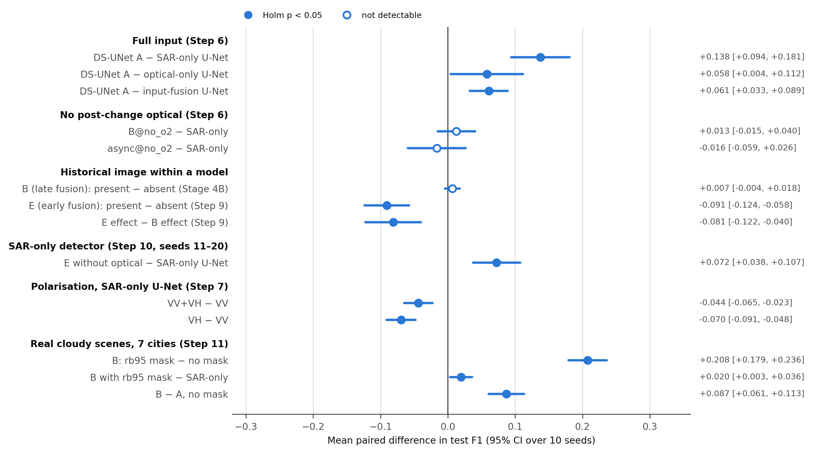
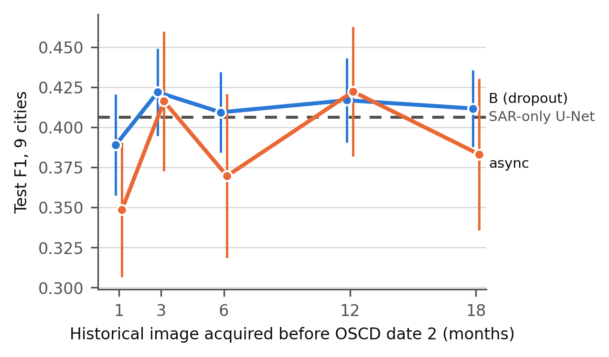

# Multimodal Satellite Change Detection for Urban Development and Environmental Monitoring

**Manish Y. M.**\
*Polaris School of Technology, Medhavi Skills University*\
manishym946@gmail.com

---

## Abstract

When the post-change Sentinel-2 image is missing or cloudy, a SAR–optical change detector must work from Sentinel-1
and, at best, an older optical image. We test whether that historical image helps, on the 10 test cities of the OSCD
urban change benchmark, with the official dual-stream U-Net (DS-UNet), U-Net baselines, 10 training seeds per model,
validation-only selection and a pre-registration written before each test evaluation. In DS-UNet trained with modality
dropout, whose optical stream meets SAR only at the last layer, the historical image made no detectable difference (ΔF1 +0.007, 95% CI
[−0.004, +0.018]). In an early-fusion U-Net trained with modality dropout, where it can condition the SAR features, it
lowered F1 (−0.091; replicated on 10 new seeds, −0.116) by raising false alarms. The same early-fusion model given no
optical input scored above a U-Net trained on SAR alone (+0.072 on new seeds), an effect concentrated in one city. The
image's acquisition time (1–18 months) showed no detectable linear trend. On real cloudy scenes for 7 cities, a model
trained without dropout fell far below SAR alone (−0.275), while the dropout model with cloud pixels masked recovered
most of the loss (+0.208) and scored slightly above SAR alone (+0.020); discarding the cloudy image did at least as well
as masking it. Results concern one benchmark, few cities and one training recipe.

**Keywords:** change detection, SAR–optical fusion, Sentinel-1, Sentinel-2, missing modality, modality dropout,
historical optical imagery, cloud cover, OSCD, pre-registration

---

## 1. Introduction

Optical satellite images carry the spectral detail that makes urban change easy to recognise, but on the date a change
must be assessed they are often unusable because clouds cover part or all of the scene. Synthetic aperture radar (SAR)
is unaffected by cloud, which motivates SAR–optical fusion for change detection [1]. Most fusion models are trained and
evaluated with SAR and optical images at both dates. When the post-change optical image is missing, an older,
cloud-free optical image is often available, and Song et al. [2] used one as semantic context for a SAR-based detector
of construction-ready bare land, reporting that its usefulness falls as it ages. Methods for a partly missing optical
modality either reconstruct the missing features [12] or train with the modality randomly removed [11]. Whether a
historical optical image adds change evidence to bitemporal SAR, and how a model trained for missing optical data
behaves on real clouds, have not been measured on a public change detection benchmark.

We address five questions:

- **RQ1:** Does historical Sentinel-2 imagery improve Sentinel-1 change detection when the post-change optical image is
  unavailable?
- **RQ2:** How does the time between the historical image and the post-change date affect it?
- **RQ3:** Does a second polarisation (VH with VV) improve SAR change detection or reduce false alarms?
- **RQ4:** How do the models that work without the post-change optical image compare with SAR-only, optical-only,
  input-fusion and dual-stream models?
- **RQ5:** Under which temporal and land-cover conditions does the historical image help most?

We answer them in a measurement study on OSCD [3] enriched with Sentinel-1, using the official DS-UNet code [1], not a
new method. Our findings are:

- **(i) The historical image does not help, and where it can interact with SAR it hurts.** In DS-UNet with modality
  dropout, adding it changed F1 by +0.007 (not detectable). Because DS-UNet fuses the streams only at the last layer,
  we also trained an early-fusion model in which the historical image enters the same encoder as SAR: there it lowered
  F1 by 0.091 through false alarms, and the loss replicated on new seeds. The null in DS-UNet is therefore not an
  artefact of late fusion.
- **(ii) Training with optical data and then removing it gave a better SAR-only detector** than training on SAR alone
  (+0.072, confirmed on new seeds), although the gain is concentrated in one test city.
- **(iii) Missing and cloudy are different failures.** A dropout-trained model handles a missing post-change image but
  reads unmasked cloud as change, so for it a cloudy image is worse than none; zero-filling the cloud pixels recovers
  most of the loss, and on real scenes discarding the cloudy image did at least as well as masking it. A model trained
  only with full input fails in both cases and, on real clouds, falls far below SAR alone.
- **(iv) Acquisition timing and polarisation:** no detectable linear trend over 1–18 months, with a confounded 1-month
  low; for SAR alone, adding VH to VV lowered F1.

Because OSCD is small and seed variance alone can reverse benchmark rankings [17], every result uses 10 paired training
seeds and Holm-corrected tests [4]; every checkpoint and threshold is selected on validation cities only; and a
pre-registration with code hashes was written before each test evaluation (committed to version control from Step 4B on).
Analyses chosen after results were seen are labelled exploratory.

## 2. Related Work

**SAR–optical change detection.** Siamese fully convolutional networks established bitemporal change detection on optical
images [5], with U-Net [6] variants as common backbones; reviews [7] cover the field. Hafner et al. [1] fuse Sentinel-1 VV
and Sentinel-2 in a dual-stream U-Net with decision-level fusion and report that it beats unimodal U-Nets and input-level
fusion on OSCD enriched with Sentinel-1. Ebel et al. [8] fuse co-registered Sentinel-1 and Sentinel-2 in Siamese networks,
Saha et al. [9] study self-supervised change detection across sensors, and DSNUNet [10] combines Sentinel-1 and
Sentinel-2 for forest change. These methods assume both modalities at the dates compared. Heterogeneous change detection
instead compares an optical image at one date with a SAR image at the other, for example by coupling or translating the
two image domains [25], [26], and multimodal optical–SAR datasets now support all-weather damage assessment [27]. In our
setting SAR is available at both dates and the historical optical image is auxiliary.

**Historical optical guidance.** Song et al. [2] monitor construction-ready bare land in Guangzhou with Sentinel-1 VH
change screening and a historical cloud-free Sentinel-2 image. Varying the image's age (1, 3, 6 and 12 months before the
target date) lowered F1 from 83.99% to 78.31%; these gap results report no repeated runs. In their framework the
historical image is a semantic prior for land cover at the target date. In our bitemporal setting it fills the
pre-change slot, where an image that already shows the change hides it, so the expected sign of a timing effect differs
and our results are not a replication.

**Missing modalities and clouds.** Modality dropout was introduced for gesture recognition [11]. Hafner and Ban [12]
reconstruct optical features from SAR for multi-temporal urban mapping with a partly missing optical modality; on samples
with missing optical data their model beats zero-fill (F1 0.327 against 0.233) but falls slightly short of a SAR-only
model (0.348). SAR-guided cloud removal reconstructs cloud-free Sentinel-2 images [13], and SEN12MS-CR-TS provides real
cloudy Sentinel-1/2 time series [28]. Real cloud masks are available in the Sentinel-2 Cloud Mask Catalogue [14];
operational detectors such as s2cloudless [15] are imperfect, and an intercomparison of cloud-masking algorithms documents
large differences between methods [16]. Masking detected cloud and treating it as missing data is standard practice; we
measure how its errors interact with a dropout-trained change detector.

**Evaluation practice.** Variance from data sampling, initialisation and hyperparameters can change benchmark
conclusions [17]; Appendix A shows a ranking reversal on OSCD under a weaker protocol.

## 3. Data and Methods

### 3.1 Data and split

**OSCD.** OSCD [3] provides 24 bitemporal Sentinel-2 L1C image pairs with pixel-level urban change labels. We use the 13
bands, divided by 10000 and clipped to [0, 1]. Ten of the 14 official training cities are used for training, the other 4
(aguasclaras, beihai, bercy, paris) for validation, and the 10 official test cities (brasilia, montpellier, norcia, rio,
saclay_w, valencia, dubai, lasvegas, milano, chongqing) for testing. Test cities never enter training or validation, which
is asserted in code. Change prevalence on the test cities is 0.052; labelling every pixel as change gives F1 0.098.

**Sentinel-1.** VV rasters released with DS-UNet [1] (3-month means before date 1 and after date 2), resized to the label
grid by cubic interpolation; training samples an orbit at random and evaluation uses the first listed orbit. For RQ3 we
exported VV and VH from Google Earth Engine [18] with DS-UNet's own recipe (VH range [−30, 0] dB, fixed before download);
the exported VV equals the released raster pixel for pixel in all 102 files. Las Vegas has no VH at date 1 on its
evaluated orbit, so the RQ3 analysis uses 9 test cities. Date-1 windows hold fewer scenes than date-2 windows in 22 of 23
test-city orbits (median 6 against 14 VV scenes), so date-1 means are noisier.

**Historical Sentinel-2 images (RQ2).** For each city, one Sentinel-2 L1C scene at each target date 2 − g, g ∈ {1, 3, 6,
12, 18} months, and one at OSCD's own date-1 day as a control of the processing chain. Rule, fixed before any model saw a
scene: within ±45 days of the target, full coverage required, the day nearest the target with city-box cloud fraction
≤ 0.02, else the clearest day. The primary set is the 9 test cities whose scene has cloud fraction ≤ 0.10 at every gap
(Chongqing excluded). Alignment against OSCD's own date-1 bands gives median band correlation 0.940 and median shift 0.27
px. At 1–12 months no primary city's image precedes OSCD date 1; at 18 months, 4 of the 9 do.

**Real cloudy scenes (Step 11).** For each test city, the full-coverage Sentinel-2 L1C day within ±30 days of OSCD date 2
whose city-box cloud fraction (s2cloudless probability ≥ 40) lies in [0.05, 0.70], nearest to date 2; Montpellier, Rio and
Las Vegas had none and contribute their nearest scene with cloud ≥ 0.90 ("overcast"). Each city also has OSCD's own date-2
day as a control. The rule was applied to stored cloud fractions before download; the scenes and their cloud fractions are listed in the Step 11 pre-registration.

**Land cover.** ESA WorldCover 2020 v100 [19] on the label grid (nearest neighbour). It post-dates OSCD date 2 and is used
as a stratification, not as a label; OSCD has no labels separating urban from agricultural or seasonal change.

### 3.2 Models and training recipe

The network and loss are the official DS-UNet files (`networks.DualStreamUNet`, topology [64, 128, 256, 512];
`jaccard_like_loss`) loaded at run time from commit 8bfa4be [1]. In DS-UNet the SAR and optical streams are separate
U-Nets that meet only at a final 1×1 convolution over their concatenated features, so the optical stream never sees SAR.
The U-Net baselines are DS-UNet's single-stream U-Net with the same recipe. Training: Adam, learning rate 5e-5, weight
decay 5e-4, batch 64, 32×32 importance crops, flips and 90° rotations, 2500 steps, validation every 25 steps. The step
budget was chosen on validation score only (390 steps: 0.354; 1000: 0.382; 2500: 0.405). Training runs with cuDNN
determinism (PyTorch 2.5.1+cu124, one RTX 4060 laptop GPU). Arms with the same seed share the generator that draws
cities, crops, augmentations and input conditions; contrasts between arms are paired by seed. As a reference, the
official 390-step protocol on all 14 training cities gives test F1 0.557 ± 0.035, below the published 0.600 [1]; our
conclusions concern differences between arms under one shared protocol.

### 3.3 Arms

A missing optical image is represented by zeros in its channels. Conditions: `full`; `no_o2` (post-change optical zero,
pre-change optical image present: the historical-image setting); `no_opt` (both optical dates zero: SAR only).

| arm | network | training conditions | step |
|---|---|---|---|
| A | DS-UNet | full input | Phase 2 |
| B | DS-UNet | full 0.50; `no_o2` 0.25; `no_opt` 0.25 (modality dropout) | Phase 2 |
| C | DS-UNet | full 0.50; post-change optical zero under a cloud-shaped mask 0.25; `no_o2` 0.125; `no_opt` 0.125 | Step 4B |
| async | DS-UNet | `no_o2` only | Step 6 |
| SAR-only, optical-only, input fusion | U-Net | full input | Step 6 |
| E | U-Net, VV and optical stacked at the input | as B (modality dropout) | Step 9 (seeds 1–10), Step 10 (seeds 11–20) |
| VH, VV+VH | U-Net and DS-UNet | full input | Step 7 |

Each arm is trained with seeds 1–10, and E and the SAR-only U-Net again with seeds 11–20 (Step 10). In `no_o2` the
historical image is OSCD's own date-1 image or, for RQ2, one of the historical scenes in the pre-change slot. E is the
early-fusion counterpart of B: in E the historical image enters the same encoder as SAR, so it can condition the SAR
features.

**Selection (validation cities only).** Checkpoint: the step with the highest mean validation F1 over the conditions the
arm trains on. Threshold: the validation-F1 argmax over {0, 0.01, …, 1} for each input condition, frozen and applied
unchanged on test. Where a model is evaluated on inputs it has no threshold for (clouds, §5), its frozen full-input
threshold is used.

### 3.4 Statistics and integrity

F1, precision, recall and false-alarm rate (FP / (FP + TN)) are computed from pixel counts pooled over the analysed test
cities. Each step has pre-specified families of paired comparisons over seeds (two-sided paired t-test, Holm
correction [4]), reported with the mean difference, its 95% CI, d_z and the number of seeds with a positive difference; a
Wilcoxon test is computed alongside. Labels such as "higher" require Holm p < 0.05; otherwise "no detectable difference",
which is not evidence of equivalence. With 10 pairs the minimum detectable effect at 80% power is about 1.00–1.22 SD of
the paired differences, depending on the family. Intervals describe variation across training seeds on fixed test cities,
not across cities; §4.7 examines city variability (exploratory).

**Pre-specification.** Each step's pre-registration (hypotheses, primary family, decision rule, SHA-256 hashes of code,
inputs and checkpoints) was written before its first test evaluation; for Steps 4B–11 it was committed to version
control first, and from Step 9 on a gate script refused to run unless the committed file and every hash were unchanged.
These are repository files, not public registrations. "Step 4B" is the spatial-dropout arm C of the robustness study;
"Stage 4B" is a later, separate evaluation of B with and without the historical image. Evaluations enforce anchors, for example that re-evaluated test
counts equal stored ones exactly. Audit scripts written with the same AI assistant recompute the statistics of Phases 2–8
(Appendix D). Analyses added after results were seen are labelled exploratory; one of them (§4.3) was then tested on new
seeds as a registered hypothesis.

Figure 1 summarises the registered primary contrasts of the study.

## 4. Results

### 4.1 RQ4: comparison with SAR-only, optical-only, conventional fusion and dual-stream approaches

Full input, test F1 at the validation-selected threshold, 10 test cities (Step 6; primary family A − each baseline, Holm
over 3):

| arm | F1 | precision | recall | IoU | false-alarm rate |
|---|---|---|---|---|---|
| DS-UNet A | 0.556 ± 0.029 | 0.568 ± 0.071 | 0.562 ± 0.090 | 0.385 ± 0.028 | 0.025 ± 0.013 |
| DS-UNet B (modality dropout) | 0.553 ± 0.030 | 0.466 ± 0.041 | 0.682 ± 0.032 | 0.382 ± 0.028 | 0.043 ± 0.007 |
| SAR-only U-Net | 0.418 ± 0.043 | 0.312 ± 0.051 | 0.648 ± 0.027 | 0.265 ± 0.035 | 0.081 ± 0.020 |
| optical-only U-Net | 0.498 ± 0.056 | 0.588 ± 0.080 | 0.451 ± 0.101 | 0.333 ± 0.048 | 0.019 ± 0.012 |
| input-fusion U-Net | 0.495 ± 0.026 | 0.556 ± 0.063 | 0.452 ± 0.047 | 0.329 ± 0.023 | 0.020 ± 0.006 |

| contrast | mean Δ | 95% CI | d_z | Δ > 0 | Holm p | label |
|---|---|---|---|---|---|---|
| A − SAR-only | +0.138 | [+0.094, +0.181] | +2.26 | 10/10 | 1.6e-04 | DS-UNet better |
| A − optical-only | +0.058 | [+0.004, +0.112] | +0.77 | 8/10 | 0.0370 | DS-UNet better |
| A − input fusion | +0.061 | [+0.033, +0.089] | +1.54 | 9/10 | 0.0017 | DS-UNet better |

Across training seeds, the dual-stream design scores above all three U-Net baselines, in line with Hafner et al. [1].
Input fusion is not distinguishable from optical alone (Δ −0.003, 95% CI [−0.045, +0.039]). The recipe and step budget
were chosen on arm A, the baselines were not tuned separately, and the selected thresholds of the optical-only and
input-fusion U-Nets reach 0.99 or above in several seeds, which suggests poorly scaled outputs. In the exploratory city
resampling (§4.7), A's lead over SAR-only is concentrated in Las Vegas and not established beyond these cities.

**Without the post-change image.** B and async without the post-change image are not detectably different from the
SAR-only U-Net (+0.013, −0.016; registered, §4.2) and, in an exploratory comparison, score below the optical-only,
input-fusion and DS-UNet models that have that image.

### 4.2 RQ1: the historical image, with late and with early fusion

**Against SAR alone (Step 6).** Setting `no_o2` against the SAR-only U-Net, 10 test cities (primary family, Holm over 2):

| contrast | F1 | mean Δ | 95% CI | d_z | Δ > 0 | Holm p | label |
|---|---|---|---|---|---|---|---|
| B@no_o2 − SAR-only | 0.431 ± 0.034 | +0.013 | [−0.015, +0.040] | +0.33 | 6/10 | 0.6576 | no detectable difference |
| async@no_o2 − SAR-only | 0.402 ± 0.059 | −0.016 | [−0.059, +0.026] | −0.27 | 5/10 | 0.6576 | no detectable difference |

The F1 column is the first term; the SAR-only U-Net scores 0.418 ± 0.043. Neither model is detectably better than SAR
alone. The companion study (Appendix A) had reported a margin for its missing-optical model under a weaker protocol; under
the shared protocol it does not survive.

**Within the late-fusion model (Stage 4B).** At B's frozen full-input threshold, the threshold used for every corrupted
input in §5, B without the post-change image scores above the SAR-only U-Net (+0.060). Stage 4B decomposes this margin
by evaluating B with the historical image present and absent (both optical slots zero):

**Table 4.** B at its frozen full-input threshold, 10 test cities (Stage 4B; primary: present − absent, single test;
other rows descriptive).

| contrast | mean Δ | 95% CI | d_z | Δ > 0 | p | label |
|---|---|---|---|---|---|---|
| B: image present − absent | +0.007 | [−0.004, +0.018] | +0.44 | 7/10 | 0.198 | no detectable difference |
| B, image present − SAR-only | +0.060 | [+0.026, +0.094] | +1.27 | 8/10 | 0.00303 | (descriptive) |
| B, image absent − SAR-only | +0.053 | [+0.022, +0.085] | +1.20 | 9/10 | 0.00415 | (descriptive) |

The historical image contributes no detectable F1 (it raises recall by 0.018, Holm p 0.030, with no detectable change in
precision). B's margin over the SAR-only U-Net comes from B itself: with no optical input at all it already scores 0.053
above it. At B's own `no_o2` threshold the within-B contrast is also not detectable (+0.002). Stage 4B was registered
after the within-B contrast had been seen at two other thresholds, which its pre-registration states.

**With early fusion (Step 9).** DS-UNet's late fusion lets the historical image add only a SAR-independent term to each
pixel's score. To test whether that explains the null, we trained E, a U-Net with VV and the 13 optical bands stacked at
the input, with B's dropout mixture (validation-selected thresholds per condition, as Step 6):

**Table 5.** Step 9, E against B and the baselines, 10 test cities (primary family Holm over 2; secondary families Holm
over 2 each).

| contrast | mean Δ | 95% CI | d_z | Δ > 0 | Holm p | label |
|---|---|---|---|---|---|---|
| E: image present − absent | −0.091 | [−0.124, −0.058] | −1.96 | 0/10 | 0.0003 | lower with the image |
| (E present − absent) − (B present − absent) | −0.081 | [−0.122, −0.040] | −1.41 | 2/10 | 0.0016 | early fusion lower |
| E@no_o2 − SAR-only | −0.019 | [−0.072, +0.034] | −0.26 | 5/10 | 0.4383 | no detectable difference |
| E@no_o2 − B@no_o2 | −0.032 | [−0.068, +0.005] | −0.63 | 2/10 | 0.1590 | no detectable difference |
| E@full − input fusion | +0.040 | [+0.006, +0.074] | +0.85 | 9/10 | 0.0496 | E higher |
| E@full − A | −0.021 | [−0.055, +0.013] | −0.44 | 3/10 | 0.2012 | no detectable difference |

In E the historical image lowers F1 by 0.091 (0.399 ± 0.039 with it, 0.490 ± 0.010 without it), in every seed, and the
difference from its effect in B is detectable. It does so through false alarms (exploratory): precision falls by 0.133
(95% CI [−0.195, −0.071]) and the false-alarm rate rises by 0.041, with no detectable change in recall. This pattern is consistent with the network reading an optical
image at date 1 next to zeros at date 2 as change, although dropout training showed it this input in a quarter of its
samples; we did not test the mechanism directly. On 10 new seeds (Step 10, Table 6) the loss
replicates (−0.116). On full input E is not detectably different from A and scores above the full-input-only
input-fusion U-Net (Holm p 0.0496).

**Answer to RQ1.** On OSCD, historical Sentinel-2 imagery did not improve Sentinel-1 VV change detection without the
post-change optical image. In the late-fusion DS-UNet it made no detectable difference (95% CI [−0.004, +0.018] at the
full-input threshold); in an early-fusion U-Net, where it can condition the SAR features, it lowered F1 by raising false
alarms. The DS-UNet null is therefore not explained by late fusion alone. Effects below about 1.22 SD of the paired
differences can be missed, and the Sentinel-1 inputs are 3-month means.

### 4.3 A dropout-trained network as a SAR-only detector

Table 5's model E, evaluated with both optical slots zero, scored above the SAR-only U-Net on seeds 1–10 (+0.072, 95% CI
[+0.045, +0.099], 10/10; exploratory, chosen after the results were seen). We registered this as the primary hypothesis
of Step 10 and retrained E and the SAR-only U-Net on seeds 11–20, which no arm had used:

**Table 6.** Step 10, seeds 11–20, 10 test cities (primary: single test; secondary: Holm over 2).

| contrast | mean Δ | 95% CI | d_z | Δ > 0 | Holm p | label |
|---|---|---|---|---|---|---|
| E@no_opt − SAR-only | +0.072 | [+0.038, +0.107] | +1.48 | 10/10 | 0.0011 | E without optical higher |
| E: image present − absent | −0.116 | [−0.145, −0.086] | −2.76 | 0/10 | 2.2e-05 | lower with the image |
| E@no_opt − SAR-only, threshold 0.5 | +0.109 | [+0.070, +0.148] | +2.00 | 10/10 | 1.4e-04 | E without optical higher |

The gain replicates over training seeds (E 0.495 ± 0.012, SAR-only 0.423 ± 0.045) and holds at a fixed threshold, so it
is not only a threshold effect. B, trained with the same mixture but late fusion, shows a smaller gain without optical
input (+0.022 at its `no_opt` threshold, 95% CI [−0.003, +0.048], exploratory). The new seeds replicate training, not
cities: in the exploratory city analysis the gain is concentrated in Las Vegas (+0.157 in that city); without it the
pooled gain is +0.028, it stays positive with any one city left out (+0.028 to +0.082), and only 5 of 10 cities share its
sign. The mechanism, for example regularisation by the optical inputs during training, was not tested.

### 4.4 RQ2: acquisition timing of the historical optical image

Under OSCD's label definition (change between two fixed dates), varying the image's timing varies two things at once: its
age and how much of the labelled change it may already show, because every image at 1–12 months post-dates OSCD date 1.
B, setting `no_o2`, test F1 at the frozen `no_o2` threshold, 9 primary cities (Step 8):

| arm | OSCD date 1 | Earth Engine date 1 | 1 month | 3 months | 6 months | 12 months | 18 months |
|---|---|---|---|---|---|---|---|
| B dropout | 0.420 ± 0.039 | 0.420 ± 0.039 | 0.389 ± 0.044 | 0.422 ± 0.038 | 0.409 ± 0.035 | 0.417 ± 0.037 | 0.412 ± 0.033 |
| async | 0.405 ± 0.067 | 0.407 ± 0.066 | 0.349 ± 0.059 | 0.416 ± 0.061 | 0.370 ± 0.072 | 0.422 ± 0.057 | 0.383 ± 0.066 |

**Primary test:** the per-seed least-squares slope of B's F1 against the gap has mean +0.0083 F1 per year (95% CI
[−0.0021, +0.0187]), t-test p 0.105: **no detectable linear trend**. Against SAR alone (0.406 ± 0.048 on these cities),
B shows no detectable difference at any timing. **Exploratory:** the timings do differ (Friedman p 0.00062 for B), with the
1-month image lowest for both models; B's 1-month deficit relative to OSCD's date-1 image comes mostly from Saclay and is
not established when cities are resampled (95% CI [−0.116, +0.003]). Each timing has one scene per city, so scene
properties are not replicated by seeds. In Stage 4B's descriptive comparison, no timing scored detectably above B without any
optical input (largest difference +0.004), and the 1-month image scored below it (−0.029, uncorrected p 0.041).

**Answer to RQ2.** No detectable linear trend of F1 with acquisition time over 1–18 months, and no timing at which the
image beats SAR alone. The low 1-month score is consistent with the image already showing part of the change, but this
was not measured, so the design does not isolate image age. Separating age from the labelled change requires labels dated
at the historical image. The decline reported by Song et al. [2] concerns a different role of the image and is not tested
here.

### 4.5 RQ3: VV and VH polarisation

Full input, test F1 at the frozen threshold, 9 test cities with VH at both dates (Step 7):

| arm | F1 | precision | recall | IoU | false-alarm rate |
|---|---|---|---|---|---|
| SAR-only U-Net, VV | 0.452 ± 0.011 | 0.367 ± 0.017 | 0.590 ± 0.029 | 0.292 ± 0.009 | 0.049 ± 0.005 |
| SAR-only U-Net, VH | 0.383 ± 0.029 | 0.346 ± 0.048 | 0.442 ± 0.069 | 0.237 ± 0.022 | 0.042 ± 0.016 |
| SAR-only U-Net, VV+VH | 0.408 ± 0.031 | 0.405 ± 0.040 | 0.424 ± 0.081 | 0.257 ± 0.024 | 0.031 ± 0.010 |
| DS-UNet, VV | 0.501 ± 0.024 | 0.523 ± 0.067 | 0.500 ± 0.089 | 0.335 ± 0.021 | 0.024 ± 0.013 |
| DS-UNet, VH | 0.484 ± 0.043 | 0.511 ± 0.030 | 0.462 ± 0.061 | 0.320 ± 0.036 | 0.021 ± 0.002 |
| DS-UNet, VV+VH | 0.511 ± 0.019 | 0.571 ± 0.029 | 0.465 ± 0.036 | 0.344 ± 0.017 | 0.017 ± 0.003 |

| contrast | mean Δ | 95% CI | d_z | Δ > 0 | Holm p | label |
|---|---|---|---|---|---|---|
| SAR-only: VV+VH − VV | −0.044 | [−0.065, −0.023] | −1.49 | 1/10 | 0.0011 | VV+VH lower |
| SAR-only: VH − VV | −0.070 | [−0.091, −0.048] | −2.32 | 0/10 | 8.8e-05 | VH lower |
| DS-UNet: VV+VH − VV | +0.010 | [−0.016, +0.036] | +0.27 | 7/10 | 0.4125 | no detectable difference |
| DS-UNet: VH − VV | −0.017 | [−0.039, +0.004] | −0.59 | 3/10 | 0.1925 | no detectable difference |

The first two rows are the primary family, the last two a secondary family. By land-cover class, the SAR-only VV+VH model
has lower false-alarm rates than VV in four classes but lower recall in every class (0.424 against 0.590 overall): it
flags less change everywhere, a shift of operating point, not evidence that VH separates urban development from
pseudo-change. Including Las Vegas, whose VH band at date 1 is empty, the VV+VH SAR-only model drops to F1 0.224 ± 0.032.

**Answer to RQ3.** For the SAR-only U-Net, adding VH to VV lowered F1 and VH alone lowered it more; with optical input,
polarisation made no detectable difference. These are results for 3-month mean backscatter whose date-1 means average fewer
scenes, and OSCD has no labels for the cause of a false alarm.

### 4.6 RQ5: conditions in which historical optical information helps

False-alarm rate by WorldCover class, B with OSCD's date-1 image minus the SAR-only U-Net, 9 primary cities (Step 8; Holm
over the 7 classes with ≥ 1% of the pixels):

| class | pixel share | mean Δ | 95% CI | Δ > 0 | Holm p | label |
|---|---|---|---|---|---|---|
| tree cover | 15.6% | −0.001 | [−0.003, −0.000] | 3/10 | 0.0973 | no detectable difference |
| shrubland | 1.3% | −0.006 | [−0.010, −0.003] | 1/10 | 0.0127 | B lower |
| grassland | 7.7% | +0.002 | [−0.002, +0.006] | 5/10 | 0.9703 | no detectable difference |
| cropland | 8.0% | −0.015 | [−0.034, +0.004] | 2/10 | 0.5354 | no detectable difference |
| built-up | 40.6% | −0.004 | [−0.015, +0.008] | 4/10 | 0.9804 | no detectable difference |
| bare | 24.6% | −0.025 | [−0.077, +0.027] | 4/10 | 0.9703 | no detectable difference |
| water | 1.7% | +0.001 | [−0.008, +0.011] | 4/10 | 0.9804 | no detectable difference |

The one detectable difference, in shrubland (1.3% of pixels), is between two networks. Within B (Stage 4B), the historical
image does not detectably change shrubland false alarms (Holm p 0.28), so that difference cannot be attributed to the
image. Within B the image lowers the tree-cover false-alarm rate by 0.002 (Holm p 0.005) and raises recall in tree cover
and built-up areas (+0.020 each); these effects are small.

**Answer to RQ5.** Within the tested conditions (1–18 month timings, seven land-cover classes, OSCD urban change), we
found no condition in which the historical image gives a material benefit.

### 4.7 Test cities and training seeds (exploratory)

Per-city counts at the same frozen thresholds; the first interval resamples seeds, the second resamples test cities and
then seeds (two-stage percentile bootstrap, 10000 replicates). Dubai, Las Vegas and Chongqing hold 77% of the change
pixels.

| contrast | cities | mean Δ | 95% CI, seeds | SE, seeds | SE, cities | cities with same sign | 95% CI, cities and seeds | Δ, one city left out |
|---|---|---|---|---|---|---|---|---|
| A (full input) − SAR-only | 10 | +0.138 | [+0.094, +0.181] | 0.019 | 0.087 | 6/10 | [−0.022, +0.246] | +0.049 to +0.156 |
| B@no_o2, own threshold − SAR-only | 10 | +0.013 | [−0.015, +0.040] | 0.012 | 0.004 | 6/10 | [−0.019, +0.043] | +0.009 to +0.014 |
| async@no_o2 − SAR-only | 10 | −0.016 | [−0.059, +0.026] | 0.019 | 0.039 | 7/10 | [−0.095, +0.047] | −0.055 to −0.001 |
| B@no_o2, clean threshold − SAR-only | 10 | +0.060 | [+0.026, +0.094] | 0.015 | 0.037 | 6/10 | [+0.007, +0.117] | +0.024 to +0.073 |
| B: 1-month − OSCD date-1 image | 9 | −0.031 | [−0.056, −0.005] | 0.011 | 0.026 | 5/9 | [−0.116, +0.003] | −0.043 to −0.008 |

For four of the five contrasts, resampling cities adds more uncertainty than resampling seeds. DS-UNet's lead over the
SAR-only U-Net is concentrated in Las Vegas (without it +0.049) and its city-and-seed interval includes zero; this shows
that ten cities do not establish the lead beyond them, not that it is absent. Las Vegas also carries most of the Step 10
gain (§4.3): with 10 cities of very unequal size, a single large desert city can drive pooled differences.

## 5. Missing, synthetic-cloud and real-cloud post-change images

RQ1 assumes that the post-change optical image is unavailable; in practice it is often present but cloudy. All corruptions
below act on the post-change Sentinel-2 image only, and models use their frozen full-input threshold (a deployed model
does not know the cloud level). Zero is the fill value used here, not an intrinsic missing-data token.

### 5.1 Whole-modality dropout handles a missing image at no detectable full-input cost (Phase 2)

Test F1 at the validation-selected threshold (mean ± SD over 10 seeds; primary family B − A, Holm over 4):

| condition | A full-only | B dropout | Δ (B − A) | 95% CI | B > A | Holm p |
|---|---|---|---|---|---|---|
| full | 0.556 ± 0.029 | 0.553 ± 0.030 | −0.003 | [−0.037, +0.031] | 5/10 | 0.8449 |
| post optical missing (`no_o2`) | 0.190 ± 0.068 | 0.431 ± 0.034 | +0.241 | [+0.176, +0.305] | 10/10 | 5.8e-05 |
| copy-forward (`o2_copy`) | 0.314 ± 0.034 | 0.438 ± 0.038 | +0.124 | [+0.087, +0.160] | 10/10 | 9.5e-05 |
| no optical (`no_opt`) | 0.397 ± 0.106 | 0.440 ± 0.027 | +0.043 | [−0.036, +0.123] | 5/10 | 0.4964 |

B is better with the post-change image missing or replaced by the pre-change image. On full input there is no detectable
cost, although losses up to 0.037 F1 are compatible with the data; at a fixed threshold of 0.5, B is lower (−0.086), so
the dropout model needs its threshold chosen on validation data.

### 5.2 Partial synthetic cloud is a different failure, and dropout does not fix it (Phase 3)

Clouds are real catalogue masks [14] scaled to 10 / 30 / 60% of each city, filled with an opaque, uniform cloud spectrum.
Test F1 at the frozen clean threshold (B − A, Holm over 4):

| condition | A full-only | B dropout | Δ (B − A) | Holm p | B > A |
|---|---|---|---|---|---|
| clean | 0.556 ± 0.029 | 0.553 ± 0.030 | | | |
| c10 | 0.285 ± 0.015 | 0.329 ± 0.008 | +0.044 | 9.6e-05 | 10/10 |
| c30 | 0.165 ± 0.007 | 0.191 ± 0.012 | +0.026 | 0.0010 | 10/10 |
| c60 | 0.123 ± 0.002 | 0.134 ± 0.011 | +0.011 | 0.0144 | 10/10 |
| missing | 0.142 ± 0.050 | 0.478 ± 0.030 | +0.336 | 9.5e-08 | 10/10 |

For B, a partly cloudy post-change image is far worse than none (0.329 at 10% cover against 0.478 missing): almost every
pixel under a cloud is predicted as change (false-alarm rate inside the mask 0.96–1.00), and false alarms spill into
nearby clear pixels. Dropout taught B to ignore zero-filled optical input, not cloud-valued input.

### 5.3 Zero-filling under the cloud recovers most of the loss, mainly for the dropout model (Step 4A)

| arm | level | F1 cloud | F1 zero-fill | Δ | recovery of the cloud loss |
|---|---|---|---|---|---|
| A | 10% | 0.285 | 0.393 | +0.108 | 0.403 ± 0.189 |
| A | 30% | 0.165 | 0.261 | +0.097 | 0.249 ± 0.168 |
| A | 60% | 0.123 | 0.192 | +0.069 | 0.161 ± 0.132 |
| B | 10% | 0.329 | 0.539 | +0.210 | 0.939 ± 0.016 |
| B | 30% | 0.191 | 0.516 | +0.325 | 0.899 ± 0.033 |
| B | 60% | 0.134 | 0.499 | +0.365 | 0.872 ± 0.041 |

With the true mask, zero-fill returns B's in-mask false-alarm rate to its clean value; A reads the zero-filled region as
change too. The remedy works well only together with dropout training.

### 5.4 Mask errors, spatial dropout and a real detector on composites (Steps 4A-bis–5)

Four further steps, detailed in Appendix E, qualify §5.3. With synthetic mask errors at 30% cover (Table E1), over-masking
is almost free for B (masking 21% of the clear pixels costs 0.010 F1) while under-masking is expensive (missing a quarter of
the cloud costs 0.168). Training with cloud-shaped zero masks (arm C, Table E2) gave no detectable gain over B in any of 7
primary comparisons. Dilating an under-masking mask repairs missed cloud edges but not missed whole clouds (Table E3). With
real catalogue cloud pixels pasted into the post-change images and masked by s2cloudless at operating points chosen on
validation composites (Table E4), the recall-biased point rb95 beat the most accurate point at 30% and 60% cover, but it
does so by masking 0.596–0.673 of the clear pixels, so its gain is consistent with B falling back on SAR and the pre-change
image rather than with good cloud localisation.

### 5.5 Real cloudy scenes (Step 11)

Step 11 evaluates the frozen A, B and SAR-only models on the real scenes of §3.1, masked by s2cloudless at Step 5's frozen
operating points. Before any change model saw a scene, the detector outputs showed that rb99 masks essentially the whole
image and that rb95 masks 0.10–0.98 of the clear control scenes, so the registered analysis compares masking with
discarding the image.

**Table 7.** Step 11, 7 partly cloudy cities (city-box cloud 0.08–0.68; scenes 3–15 days from OSCD date 2), F1 at the
frozen full-input thresholds (primary family Holm over 3; secondary Holm over 4).

| contrast | mean Δ | 95% CI | d_z | Δ > 0 | Holm p | label |
|---|---|---|---|---|---|---|
| B: rb95 mask − no mask | +0.208 | [+0.179, +0.236] | +5.22 | 10/10 | 1.5e-07 | higher with the mask |
| B with rb95 mask − SAR-only | +0.020 | [+0.003, +0.036] | +0.86 | 9/10 | 0.0242 | B higher |
| B − A, no mask | +0.087 | [+0.061, +0.113] | +2.36 | 10/10 | 7.6e-05 | B higher |
| B: bal mask − no mask | +0.209 | [+0.182, +0.236] | +5.54 | 10/10 | 8.7e-08 | higher with the mask |
| B: rb95 mask − image discarded | −0.007 | [−0.012, −0.002] | −0.94 | 2/10 | 0.0200 | lower with the mask |
| A, no mask − SAR-only | −0.275 | [−0.291, −0.259] | −12.55 | 0/10 | 8.2e-11 | A lower |
| B: Earth Engine control − OSCD image | −0.002 | [−0.003, −0.001] | −1.03 | 1/10 | 0.0200 | control lower |

**Table 8.** Step 11, test F1 on the 7 partly cloudy cities (mean ± SD over 10 seeds; descriptive).

| post-change input | A full-only | B dropout |
|---|---|---|
| OSCD image (clear) | 0.488 ± 0.030 | 0.527 ± 0.021 |
| Earth Engine control (clear, same day) | 0.481 ± 0.028 | 0.525 ± 0.021 |
| real cloudy scene, no mask | 0.162 ± 0.015 | 0.248 ± 0.041 |
| real cloudy scene, bal mask | 0.164 ± 0.053 | 0.457 ± 0.033 |
| real cloudy scene, rb95 mask | 0.133 ± 0.045 | 0.456 ± 0.016 |
| image discarded | 0.133 ± 0.056 | 0.463 ± 0.011 |

The SAR-only U-Net, which ignores optical input, scores 0.436 ± 0.011 on these cities. Real cloud reproduces the synthetic
result: passed through unmasked, it drops A far below SAR alone and B to 0.248. With cloud pixels zero-filled, B recovers
most of the loss and scores slightly above the SAR-only fallback, a margin that stays positive with any one city left out
(+0.010 to +0.022). Masking did not beat discarding the image (−0.007), and B with the image discarded also scored above
SAR-only (+0.026, exploratory). On the 3 overcast cities and on all 10, the three primary contrasts have the same sign and
are detectable (for example, B with the rb95 mask − SAR-only +0.091 and +0.056). The processing control differs from
OSCD's own image by −0.002. Each city has one real scene, cloud cover is not controlled, and the Las Vegas "overcast"
scene is probably bright desert flagged by the detector rather than opaque cloud.

## 6. Discussion

**What the historical image does.** Without the post-change optical image, the post-change information comes from SAR, and
we found no added change evidence in the pre-change optical image. The early-fusion experiment rules out the most obvious
explanation of the DS-UNet null, that late fusion cannot use the image: given the chance to condition the SAR features,
the image hurt. The rise in false alarms suggests that, in a bitemporal input, an optical image at date 1 next to zeros at
date 2 looks like change, and that dropout training did not remove this reading. A model that uses historical imagery as Song et al. [2] do, as a separate semantic
prior rather than as one date of a pair, may behave differently; our results bear on the common practice of filling the
pre-change slot of a bitemporal model.

**What dropout training does.** Modality dropout made two models usable without the post-change image. With no optical input, the early-fusion model
scored detectably above a U-Net trained on SAR alone, replicated on new seeds; the late-fusion B scored above it too, but
not detectably (+0.022, 95% CI [−0.003, +0.048]). Training with optical inputs that are sometimes removed may act as a regulariser or as a form of
cross-modal supervision of the SAR pathway; we did not test the mechanism, and the gain is concentrated in Las Vegas.

**Missing and cloudy are different problems.** A model trained only with full input reads cloud, or zero-filled cloud, as
change; on real scenes it fell 0.275 below SAR alone. A dropout-trained model turns the cloud problem back into the
missing-data problem once cloud pixels are zero-filled, and the outcome then depends on the direction of the mask error:
over-masking is cheap, under-masking is expensive. On real scenes the detector's recall-biased masks removed most of the
image, and discarding the image did at least as well. For this configuration the practical rule is: train with modality dropout,
and when cloud is detected over the scene, drop the post-change optical image rather than pass it through.

**Polarisation and operating point.** For SAR alone, VV gave the highest F1 on OSCD and VH made the model more
conservative; a missing VH acquisition nearly halved the VV+VH model's pooled F1. Dropout-trained and U-Net baseline models
shift their output probabilities and need thresholds chosen on validation data, and the threshold rule can change a
comparison (B's margin over SAR-only is +0.013 at its `no_o2` threshold and +0.060 at its full-input threshold).
Deployments should select thresholds on held-out data from the target region.

## 7. Limitations

- **One benchmark, few cities.** Results use 9 or 10 OSCD test cities and 4 validation cities. Seeds measure training
  variability on fixed cities; several effects (A's lead over SAR-only, the Step 10 gain) are concentrated in Las Vegas.
- **Power.** Effects below about 1.00–1.22 SD of the paired differences can be missed; nulls are not equivalence.
- **No pseudo-change labels.** RQ3 and RQ5 are answered through false-alarm rates by land-cover class, a stratification
  rather than a label of the cause.
- **Temporal-gap confound.** Image age is confounded with how much labelled change the image shows; one scene per city and
  timing.
- **Architectures and recipe.** Two fusion designs (late-fusion DS-UNet, early-fusion U-Net), one recipe tuned on DS-UNet,
  untuned baselines with thresholds near the top of the grid; reconstruction- or attention-based models [2, 12] may differ.
- **SAR input.** 3-month mean backscatter; date-1 means average fewer scenes.
- **Clouds.** Synthetic and composite clouds are opaque and shadowless; the real-cloud test has one scene per city, 3–15
  days from the label date, uncontrolled cover and one detector.
- **Internal pre-registration.** Pre-registrations are repository files; Stage 4B followed partial unblinding, the Step 10
  hypothesis came from Step 9's results, and the same AI assistant wrote analysis code, audits and simulated reviews.

## 8. Conclusion

Under one multi-seed protocol on OSCD: (RQ1) a historical optical image did not improve SAR change detection without the
post-change optical image, making no detectable difference in a late-fusion DS-UNet and lowering F1 in an early-fusion
U-Net; (RQ2) its acquisition time over 1–18 months showed no detectable linear trend, with a confounded 1-month low; (RQ3)
adding VH lowered F1 for the SAR-only U-Net; (RQ4) without the post-change image neither B nor async was detectably better than SAR
alone in the registered comparison at per-condition thresholds (B's margin at its full-input threshold comes from B
itself, not the historical image), while with full input DS-UNet scored highest across seeds, a lead concentrated in one
city; (RQ5) no land-cover or timing condition showed a material benefit. Modality dropout gave a SAR-only detector better
than SAR-only training (early fusion, concentrated in one city). On real clouds, a dropout-trained model with the cloud
masked scored slightly above SAR alone (registered), discarding the cloudy image did at least as well, and a model trained
only on full input fell far below SAR alone. Whether historical imagery helps as a separate semantic
prior, with labels dated to separate age from change, or on other benchmarks, remains open.

## Declarations

**Data availability.** OSCD [3] and the Cloud Mask Catalogue [14] are public; the Sentinel-1 VV rasters are from the public
DS-UNet repository [1]; Sentinel-1, Sentinel-2 (historical and real-cloud scenes) and ESA WorldCover [19] were exported from
Google Earth Engine [18] with the scripts in the project repository. Code, pre-registrations, run files, analysis tables,
audits and reports are public at
https://github.com/Manishym956/Multimodal-Satellite-Change-Detection-for-Urban-Development-and-Environmental-Monitoring
(branch `main`; code under the GNU GPL, version 2 or later). Checkpoints, downloaded scenes and raw count arrays are not in the repository because of their size; they
are identified by SHA-256 hashes in the pre-registrations and `experiments/robust/ARTIFACT_SHA256_*.txt` and are available
from the author on request.

**Ethics.** The study uses public satellite imagery and labels only; no human participants or personal data are involved.

**Author contributions (CRediT).** [author: to be agreed with the mentor. Draft: Manish Y. M.: conceptualization,
methodology, software, investigation, formal analysis, data curation, visualization, writing (original draft and editing);
Soumen Mukherjee: supervision, writing (review).]

**Conflict of interest.** [author: confirm.] The author declares no conflict of interest.

**Funding.** [author: confirm.] No external funding.

**Use of AI tools.** An AI assistant (Claude, Anthropic) helped write analysis and evaluation code, audit scripts, report
builders and figures, and drafted parts of the text. All results come from the code and outputs in the repository; the
author checked and is responsible for the content. The same assistant ran the pre-submission integrity checks and simulated
peer review, so those checks are not independent of the drafting.

## References

[1] Hafner, S., Nascetti, A., Azizpour, H., & Ban, Y. (2022). Sentinel-1 and Sentinel-2 data fusion for urban change detection using a dual stream U-Net. *IEEE Geoscience and Remote Sensing Letters, 19*, 1–5. https://doi.org/10.1109/LGRS.2021.3119856

[2] Song, W., Lv, Q., Ding, Z., Hong, S., & Qi, Z. (2026). A dual-modal framework integrating SAR-based change screening and optical-scene-informed identification for high-frequency monitoring of construction-ready bare land. *Remote Sensing, 18*(8), 1103. https://doi.org/10.3390/rs18081103

[3] Caye Daudt, R., Le Saux, B., Boulch, A., & Gousseau, Y. (2018). Urban change detection for multispectral earth observation using convolutional neural networks. In *Proc. IEEE IGARSS*, 2115–2118. https://doi.org/10.1109/IGARSS.2018.8518015

[4] Holm, S. (1979). A simple sequentially rejective multiple test procedure. *Scandinavian Journal of Statistics, 6*(2), 65–70. https://www.jstor.org/stable/4615733

[5] Caye Daudt, R., Le Saux, B., & Boulch, A. (2018). Fully convolutional siamese networks for change detection. In *Proc. IEEE ICIP*, 4063–4067. https://doi.org/10.1109/ICIP.2018.8451652

[6] Ronneberger, O., Fischer, P., & Brox, T. (2015). U-Net: Convolutional networks for biomedical image segmentation. In *MICCAI*, LNCS 9351, 234–241. https://doi.org/10.1007/978-3-319-24574-4_28

[7] Shafique, A., Cao, G., Khan, Z., Asad, M., & Aslam, M. (2022). Deep learning-based change detection in remote sensing images: A review. *Remote Sensing, 14*(4), 871. https://doi.org/10.3390/rs14040871

[8] Ebel, P., Saha, S., & Zhu, X. X. (2021). Fusing multi-modal data for supervised change detection. *International Archives of the Photogrammetry, Remote Sensing and Spatial Information Sciences, XLIII-B3-2021*, 243–249. https://doi.org/10.5194/isprs-archives-XLIII-B3-2021-243-2021

[9] Saha, S., Ebel, P., & Zhu, X. X. (2022). Self-supervised multisensor change detection. *IEEE Transactions on Geoscience and Remote Sensing, 60*, 4405710. https://doi.org/10.1109/TGRS.2021.3109957

[10] Jiang, J., Xing, Y., Wei, W., Yan, E., Xiang, J., & Mo, D. (2022). DSNUNet: An improved forest change detection network by combining Sentinel-1 and Sentinel-2 images. *Remote Sensing, 14*(19), 5046. https://doi.org/10.3390/rs14195046

[11] Neverova, N., Wolf, C., Taylor, G. W., & Nebout, F. (2016). ModDrop: Adaptive multi-modal gesture recognition. *IEEE Transactions on Pattern Analysis and Machine Intelligence, 38*(8), 1692–1706. https://doi.org/10.1109/TPAMI.2015.2461544

[12] Hafner, S., & Ban, Y. (2023). Multi-modal deep learning for multi-temporal urban mapping with a partly missing optical modality. In *Proc. IEEE IGARSS*, 6843–6846. https://doi.org/10.1109/IGARSS52108.2023.10281626

[13] Ebel, P., Meraner, A., Schmitt, M., & Zhu, X. X. (2021). Multisensor data fusion for cloud removal in global and all-season Sentinel-2 imagery. *IEEE Transactions on Geoscience and Remote Sensing, 59*(7), 5866–5878. https://doi.org/10.1109/TGRS.2020.3024744

[14] Francis, A., Mrziglod, J., Sidiropoulos, P., & Muller, J.-P. (2020). Sentinel-2 Cloud Mask Catalogue (Version 1). Zenodo. https://doi.org/10.5281/zenodo.4172871

[15] Sinergise EO research team (2024). s2cloudless: Sentinel Hub's cloud detector for Sentinel-2 imagery (Version 1.7.3) [Software]. https://github.com/sentinel-hub/sentinel2-cloud-detector

[16] Skakun, S., Wevers, J., Brockmann, C., Doxani, G., Aleksandrov, M., Batič, M., Frantz, D., Gascon, F., Gómez-Chova, L., Hagolle, O., López-Puigdollers, D., Louis, J., Lubej, M., Mateo-García, G., Osman, J., Peressutti, D., Pflug, B., Puc, J., Richter, R., Roger, J.-C., Scaramuzza, P., Vermote, E., Vesel, N., Zupanc, A., & Žust, L. (2022). Cloud Mask Intercomparison eXercise (CMIX): An evaluation of cloud masking algorithms for Landsat 8 and Sentinel-2. *Remote Sensing of Environment, 274*, 112990. https://doi.org/10.1016/j.rse.2022.112990

[17] Bouthillier, X., Delaunay, P., Bronzi, M., Trofimov, A., Nichyporuk, B., Szeto, J., et al. (2021). Accounting for variance in machine learning benchmarks. In *Proceedings of Machine Learning and Systems (MLSys), 3*.

[18] Gorelick, N., Hancher, M., Dixon, M., Ilyushchenko, S., Thau, D., & Moore, R. (2017). Google Earth Engine: Planetary-scale geospatial analysis for everyone. *Remote Sensing of Environment, 202*, 18–27. https://doi.org/10.1016/j.rse.2017.06.031

[19] Zanaga, D., et al. (2021). ESA WorldCover 10 m 2020 v100. Zenodo. https://doi.org/10.5281/zenodo.5571936

[20] Dosovitskiy, A., Beyer, L., Kolesnikov, A., Weissenborn, D., Zhai, X., Unterthiner, T., et al. (2021). An image is worth 16×16 words: Transformers for image recognition at scale. In *International Conference on Learning Representations (ICLR)*.

[21] Bandara, W. G. C., & Patel, V. M. (2022). A transformer-based Siamese network for change detection. In *Proc. IEEE IGARSS*, 207–210. https://doi.org/10.1109/IGARSS46834.2022.9883686

[22] Chen, H., Qi, Z., & Shi, Z. (2022). Remote sensing image change detection with transformers. *IEEE Transactions on Geoscience and Remote Sensing, 60*, 1–14. https://doi.org/10.1109/TGRS.2021.3095166

[23] Van Etten, A., Hogan, D., Martinez Manso, J., Shermeyer, J., Weir, N., & Lewis, R. (2021). The multi-temporal urban development SpaceNet dataset. In *Proc. IEEE/CVF CVPR*, 6398–6407. https://doi.org/10.1109/CVPR46437.2021.00633

[24] Schmitt, M., Hughes, L. H., Qiu, C., & Zhu, X. X. (2019). SEN12MS – A curated dataset of georeferenced multi-spectral Sentinel-1/2 imagery for deep learning and data fusion. *ISPRS Annals of the Photogrammetry, Remote Sensing and Spatial Information Sciences, IV-2/W7*, 153–160. https://doi.org/10.5194/isprs-annals-IV-2-W7-153-2019

[25] Liu, J., Gong, M., Qin, K., & Zhang, P. (2018). A deep convolutional coupling network for change detection based on heterogeneous optical and radar images. *IEEE Transactions on Neural Networks and Learning Systems, 29*(3), 545–559. https://doi.org/10.1109/TNNLS.2016.2636227

[26] Luppino, L. T., Kampffmeyer, M., Bianchi, F. M., Moser, G., Serpico, S. B., Jenssen, R., & Anfinsen, S. N. (2022). Deep image translation with an affinity-based change prior for unsupervised multimodal change detection. *IEEE Transactions on Geoscience and Remote Sensing, 60*, 1–22. https://doi.org/10.1109/TGRS.2021.3056196

[27] Chen, H., Song, J., Dietrich, O., Broni-Bediako, C., Xuan, W., Wang, J., et al. (2025). BRIGHT: A globally distributed multimodal building damage assessment dataset with very-high-resolution for all-weather disaster response. *Earth System Science Data, 17*(11), 6217–6253. https://doi.org/10.5194/essd-17-6217-2025

[28] Ebel, P., Xu, Y., Schmitt, M., & Zhu, X. X. (2022). SEN12MS-CR-TS: A remote-sensing data set for multimodal multitemporal cloud removal. *IEEE Transactions on Geoscience and Remote Sensing, 60*, 1–14. https://doi.org/10.1109/TGRS.2022.3146246

---

## Appendix A: Preliminary study under a simpler protocol

Before the shared protocol of §3, a preliminary study trained re-implemented models with a simpler recipe (BCE loss, Adam
1e-4, 50 epochs, no augmentation or importance sampling, threshold 0.5) and 3–5 seeds per model on the same split. Its
dual-stream model is a re-implementation, not the official DS-UNet; its missing-optical models are dual-stream networks
trained without the post-change optical image (dropping those channels, "clean", or zero-filling them, "naive"); and it
includes two lightweight Transformers [20] (1.16–1.36M parameters), motivated by Transformer change detectors [21, 22]. Its
results are superseded by §4 and are reported for completeness.

**Table A1: OSCD test results of the preliminary study (10 test cities, τ = 0.5; mean ± sample SD over n seeds)**

| Model | Loss | n | F1 | Precision | Recall | IoU | FAR |
|---|---|---|---|---|---|---|---|
| SAR-only U-Net | pw=1 | 5 | 0.241 ± 0.101 | 0.221 ± 0.152 | 0.342 ± 0.074 | 0.140 ± 0.065 | 0.112 ± 0.106 |
| Optical-only U-Net | pw=1 | 3 | 0.204 ± 0.055 | 0.393 ± 0.176 | 0.167 ± 0.101 | 0.114 ± 0.035 | 0.021 ± 0.022 |
| Early Fusion U-Net | pw=1 | 3 | 0.376 ± 0.022 | 0.343 ± 0.081 | 0.439 ± 0.070 | 0.232 ± 0.017 | 0.050 ± 0.021 |
| Sync Dual-Stream CNN | pw=1 | 5 | 0.459 ± 0.061 | 0.420 ± 0.079 | 0.518 ± 0.074 | 0.299 ± 0.051 | 0.041 ± 0.017 |
| Naive Missing-Optical CNN | pw=1 | 3 | 0.297 ± 0.089 | 0.307 ± 0.132 | 0.324 ± 0.141 | 0.177 ± 0.061 | 0.047 ± 0.035 |
| Clean Missing-Optical CNN | pw=1 | 5 | 0.309 ± 0.095 | 0.428 ± 0.154 | 0.254 ± 0.075 | 0.186 ± 0.066 | 0.023 ± 0.019 |
| Transformer Self-Attn (original) | pw=41 | 3 | 0.199 ± 0.048 | 0.117 ± 0.029 | 0.679 ± 0.178 | 0.111 ± 0.030 | 0.283 ± 0.070 |
| Transformer Cross-Attn (original) | pw=41 | 3 | 0.275 ± 0.124 | 0.190 ± 0.103 | 0.632 ± 0.116 | 0.163 ± 0.080 | 0.240 ± 0.255 |
| Transformer Cross-Attn (pw=1) | pw=1 | 3 | 0.088 ± 0.012 | 0.053 ± 0.001 | 0.408 ± 0.348 | 0.046 ± 0.007 | 0.399 ± 0.345 |
| Transformer Self-Attn (tuned, wd=1e-4) | pw=41 | 3 | 0.212 ± 0.024 | 0.125 ± 0.017 | 0.695 ± 0.018 | 0.118 ± 0.015 | 0.269 ± 0.047 |
| Transformer Cross-Attn (tuned, wd=1e-4) | pw=41 | 3 | 0.231 ± 0.065 | 0.142 ± 0.048 | 0.723 ± 0.168 | 0.131 ± 0.041 | 0.285 ± 0.201 |

*pw = BCE pos_weight. "Original" Transformers use weight decay 0; "tuned" use weight decay 1e-4 selected on validation F1.*

**Table A2: Pairwise F1 comparisons of the preliminary study (two-sided Welch t-test, Holm over 6)**

| Comparison (F1) | Δ mean | n | p (Welch) | p (Holm) |
|---|---|---|---|---|
| Sync dual-stream − Clean missing-optical | +0.150 | 5 vs 5 | 0.022 | 0.109 |
| Clean missing-optical − SAR-only | +0.069 | 5 vs 5 | 0.302 | 0.604 |
| Sync dual-stream − SAR-only | +0.218 | 5 vs 5 | 0.005 | 0.030 |
| Sync dual-stream − Early fusion | +0.083 | 5 vs 3 | 0.037 | 0.148 |
| Clean − Naive missing-optical | +0.012 | 5 vs 3 | 0.865 | 0.865 |
| Transformer Cross-Attn pw=41 − pw=1 | +0.186 | 3 vs 3 | 0.119 | 0.358 |

Three findings carry over as context. First, **seed variance changes the ranking**: seed-to-seed SDs of 0.06–0.12 F1 were
common, and the first seed alone ranked the clean missing-optical model (0.412) above the synchronous model (0.387), the
opposite of the five-seed mean; this motivated the 10-seed design of §3. Second, under this weaker recipe every baseline
scored far lower than under the shared protocol (SAR-only 0.241 against 0.418 in Step 6), so its RQ1 margin (0.309 against
0.241, not significant) is not evidence. Third, the cross-attention Transformer reached unimodal-CNN-level F1 only with strong
class reweighting (pw=41) and collapsed to predicting no change with pw=1; with one small design per attention type, this is
a finding about these models under this recipe, not about Transformers in general.

Table A1 uses τ = 0.5. Table A3 also reports each Transformer run at its own threshold. That threshold was the argmax of
pooled validation F1 on the 4 validation cities, over a grid from 0.05 to 0.8 refined near the peak, and no test score
selected a threshold. For the original checkpoints, only seed 42 was re-evaluated this way.

**Table A3: Transformers at validation-selected thresholds (OSCD, 10 test cities; mean ± sample SD over n seeds)**

| Model | n | Selected τ (seeds 42 / 43 / 44) | F1 at τ = 0.5 | F1 | Precision | Recall | IoU | FAR |
|---|---|---|---|---|---|---|---|---|
| Transformer Self-Attn (original, seed 42) | 1 | 0.6125 | 0.162 | 0.156 | 0.096 | 0.406 | 0.085 | 0.207 |
| Transformer Self-Attn (tuned, wd=1e-4) | 3 | 0.4375 / 0.4875 / 0.575 | 0.212 ± 0.024 | 0.213 ± 0.011 | 0.127 ± 0.006 | 0.669 ± 0.093 | 0.119 ± 0.007 | 0.251 ± 0.032 |
| Transformer Cross-Attn (original, seed 42) | 1 | 0.5625 | 0.356 | 0.385 | 0.321 | 0.481 | 0.238 | 0.055 |
| Transformer Cross-Attn (tuned, wd=1e-4) | 3 | 0.525 / 0.575 / 0.725 | 0.231 ± 0.065 | 0.280 ± 0.040 | 0.187 ± 0.034 | 0.563 ± 0.023 | 0.163 ± 0.028 | 0.136 ± 0.022 |

*F1, precision, recall, IoU and FAR are at the selected τ. Original-checkpoint rows are seed 42 only, so they differ from
the 3-seed means in Table A1.*

Selecting the threshold on validation data raised the tuned cross-attention model's mean test F1 from 0.231 to 0.280,
mostly by cutting false alarms (FAR 0.285 to 0.136). It left self-attention essentially unchanged (0.212 to 0.213). The
selected thresholds varied widely between seeds (0.525–0.725 for cross-attention), and with n = 3 none of these
differences is tested for significance. The best Transformer result here (0.385, original cross-attention, one seed)
remains below every model in §4.1 (lowest: SAR-only U-Net, 0.418), though under a different training recipe.

## Appendix B: SEN12-MT note

The preliminary study also trained models on one 21-month SAR–optical interval of a pre-packaged Sentinel-1/2 archive
over SpaceNet 7 [23] sites (distinct from SEN12MS [24]), with proxy labels from building footprints and 4 test sites; all
models scored F1 0.08–0.11 with one seed. The archive's provenance and metadata could not be verified, so these results are
not used. RQ2 is answered by Step 8 on OSCD (§4.3).

## Appendix C: Deviations and gaps

1. **Phase 2 step budget.** A 1000-step budget was first proposed after the test F1 of a 3-seed step sweep had been viewed. That
   choice was discarded and the budget re-chosen on validation score (2500 steps). Seeds 1–3 of A share the configuration of a
   sweep run whose test F1 had been seen; they were retrained from scratch, reproduced identically, and no Phase 2 decision
   used them.
2. **Phase 3 masks.** The first mask build used an absolute cloud-fraction tolerance, which could nearly double a small cloud;
   the masks were rebuilt with a relative tolerance before any model saw a mask. A missing `model.eval()` in the Phase 3
   evaluation script was fixed after a validation-only smoke test, before any test evaluation.
3. **Steps 4A and 4A-bis.** Both pre-registrations cite a validation-only smoke test for which no log exists. In Step 4A-bis,
   the evaluation printed per-seed test F1 while running; the analysis crashed on its final console print and was re-run
   unchanged; two source files hashed in every run file were missing from the pre-registration's hash table (unchanged since
   Phase 3). Inside/outside-mask metrics and IoU were added as a labelled exploratory addendum.
4. **Phase 3 report wording.** `PHASE3_REPORT.md` calls the all-change F1 the "change prevalence"; the prevalence is 0.052. The
   correction is in `experiments/robust/PHASE3_REPORT_ERRATA.md`.
5. **Step 4B.** Test F1 was printed at the end of each training run, as pre-specified. The pre-registration says "33"
   evaluation conditions but lists 34; all 34 were evaluated.
6. **Step 5S.** The validation smoke test's script was not committed, so the smoke test cannot be re-run from the repository.
7. **Step 5.** The scene pools were redesigned before any composite was built (arm C reported as flagged); the composite build
   was interrupted twice and resumed (89 files verified, not byte for byte); a float32/float64 comparison in an export check
   was corrected. The rb99 operating point uses the pre-specified fallback.
8. **Step 6.** No deviation. The machine slept once during training (about 21:04–21:29 IST); the runs were suspended, not
   restarted, and all 40 finished. We did not check separately that the pause left the weights unchanged.
9. **Steps 7 and 8 (one deviation, `0e49c87`).** The Step 7 and Step 8 evaluators lacked `model.eval()` and cuDNN determinism.
   This was found when Step 8's anchor failed on its first checkpoint, diagnosed on validation cities only, and fixed with the
   author's approval before any Step 7 or Step 8 result was saved or read; nothing else changed.
10. **Steps 7 and 8, interruption.** Both were stopped by the author on 2026-10-23 and resumed the next day. Step 8 was re-run
    from scratch and reproduced the 16 files of the interrupted run byte for byte; in Step 7, 5 completed runs were kept and the
    interrupted run was retrained from scratch. That retrain was checked only against the interrupted log's last line: at
    step 1925 its loss (−0.2677) and validation score (0.1623) match to the four decimals the log keeps. Weights were not
    compared, so this is not a bit-identity check.
11. **Error maps.** The selection rule was committed (`afa354e`) before the script first ran; no deviation.
12. **Revision analyses (2026-11-02).** After a simulated peer review of the manuscript, the exploratory analyses of
    §3.4 were added. They were chosen after all results were known, read only stored counts and are not pre-registered;
    no registered analysis or result was changed.
13. **Stage 4B (post-review evaluation).** Registered after the within-B contrast had been seen at B's own `no_o2`
    threshold and at 0.5; only the clean-threshold, per-city and land-cover counts were unseen. The report generator
    reuses the column header "Δ (present − absent)" for its descriptive rows, which are other contrasts; the paper's
    Table 4 labels them correctly.
14. **Line endings (found before Step 9).** Git (`core.autocrlf=true`) had rewritten some committed files with CRLF line
    endings, so their on-disk hashes no longer matched earlier pre-registrations although their content did.
    `train_rrd.py`, `verify_prereg_hashes.py` and `smoke_phase6.py` were restored from the commit before Step 9; three
    files that Steps 9–11 do not use were left with CRLF endings.
15. **Step 9.** E was added after the Stage 3 review named late fusion as an alternative explanation of the RQ1 null; the
    comparison of E without optical input against the SAR-only U-Net was chosen after Step 9's results were seen and was
    then tested on new seeds as Step 10's registered primary hypothesis.
16. **Step 10.** The first smoke-test run failed on a JSON type error in the analysis (a numpy integer), fixed before the
    logged run; the smoke test used only already-reported seed 1–10 runs and printed no metric.
17. **Step 11.** The cloud detector was run on the real scenes before the pre-registration was written, as in Step 5; its
    masked fractions are stated there and led to rb99 being reported descriptively. The smoke test evaluated seed 1 into a
    deleted temporary folder without reading any metric. The Las Vegas scene chosen by the "overcast" rule is probably
    bright desert flagged by the detector; it was kept as the fixed rule selected it.
18. **Steps 9–11, report labels.** The generated reports print labels such as "higher/lower higher"; the paper's labels
    are derived from the same sign and Holm p-value.

## Appendix D: Reproducibility

Each step's pre-registration, report and audit are in `experiments/robust/`: Phases 2–5 (commits `eead015`, `25fe13b`,
`5dfaa17`, `cde5434`, `3c5d85a`, `f56ba71`, `d9e29ff`, `5f5be9c`, `3ed2fb7`); Step 6 (pre-registration `5476ffe`, results
`2c74a73`); Step 7 (`1ff4251`, `6374275`); Step 8 (`7989248`, `f50d73b`); evaluator deviation `0e49c87`; error maps
(`afa354e`, `b49bd87`); Stage 4B (`260c9b2`, `experiments/robust/stage4b/`); Step 9 (`2a4cf09`, `step9/`); Step 10
(`4c721d8`, `step10/`); Step 11 (`50d3d3d`, `realcloud/`). Each pre-registration's hash table can be re-verified with
`verify_prereg_hashes.py`. Repeat training was checked twice and gave bit-identical weights. Audit scripts recompute every
reported statistic from raw counts: Phase 2, 579 checks; Phase 3, 167; Step 4A-bis, 1338; Step 4B, 432; Step 5S, 826;
Step 5, 731; Step 6, 1046; Step 7, 994; Step 8, 235; all with 0 failures (Step 4A has no audit of its own). Stage 4B and
Steps 9–11 have no separate audit script: their evaluations enforce anchors (for example, Step 11 reproduces Step 5's
stored clean test counts exactly at all 101 thresholds, and Step 10's per-city counts sum to the counts stored at
training), and their analyses recompute every rate from stored counts. The exploratory re-analysis is in
`experiments/robust/stage4/`, the exploratory contrasts quoted in §4.2–5.5 in `experiments/robust/revision/`, and every
number and table cell of this paper is checked against these files by `paper/check_final_paper_numbers.py` and
`paper/check_final_paper_tables.py`.

## Appendix E: Synthetic and composite cloud details (Steps 4A-bis–5)

**Table E1. Step 4A-bis: imperfect masks.** For B at 30% cover, each imperfect mask against the oracle mask (Holm over 9);
every error type costs F1 (Holm p < 0.05, worse than the oracle in 10/10 seeds):

| mask | missed cloud | over-masked clear | B F1 | Δ vs oracle | 95% CI | retained gain |
|---|---|---|---|---|---|---|
| oracle (z30) | 0 | 0 | 0.516 | | | |
| dilate2 | 0.000 | 0.051 | 0.513 | −0.003 | [−0.003, −0.002] | 0.99 |
| dilate4 | 0.000 | 0.107 | 0.511 | −0.005 | [−0.006, −0.005] | 0.98 |
| dilate8 | 0.000 | 0.214 | 0.506 | −0.010 | [−0.012, −0.009] | 0.97 |
| erode2 | 0.116 | 0.000 | 0.416 | −0.100 | [−0.141, −0.060] | 0.70 |
| erode4 | 0.232 | 0.000 | 0.329 | −0.187 | [−0.220, −0.153] | 0.43 |
| erode8 | 0.431 | 0.000 | 0.273 | −0.243 | [−0.272, −0.213] | 0.26 |
| miss10 | 0.100 | 0.000 | 0.426 | −0.090 | [−0.103, −0.077] | 0.73 |
| miss25 | 0.250 | 0.000 | 0.348 | −0.168 | [−0.188, −0.149] | 0.49 |
| miss50 | 0.500 | 0.000 | 0.266 | −0.250 | [−0.276, −0.225] | 0.23 |

Retained gain = (F1_mask − F1_cloud) / (F1_oracle − F1_cloud), computed per seed and averaged, with F1_cloud = 0.191. Over-masking is almost free for B:
masking 21% of the clear pixels costs 0.010 F1. Under-masking is expensive whatever its shape; on missed-cloud pixels, B's
false-alarm rate is 0.909–0.962 for every missed-cloud and erode4/8 variant. Over-masking does hurt the full-input model A:
its false-alarm rate on over-masked clear pixels rises from ≈ 0.024 to 0.385–0.497. An exploratory partition by the true
mask shows that a thin rim of unmasked cloud brings back the Phase 3 spill-over: for B with erode4, the false-alarm rate on
clear pixels outside the cloud is 0.073, the same as with no fill (0.075), against 0.045 with the oracle mask.

**Table E2. Step 4B: spatial dropout training.** C − B test F1 at the frozen clean threshold (Holm over 7):

| condition | B | C | Δ (C − B) | 95% CI | C > B | Holm p |
|---|---|---|---|---|---|---|
| clean | 0.553 ± 0.030 | 0.564 ± 0.034 | +0.011 | [−0.024, +0.046] | 7/10 | 1.0 |
| z10 | 0.539 ± 0.028 | 0.553 ± 0.033 | +0.014 | [−0.019, +0.048] | 7/10 | 1.0 |
| z30 | 0.516 ± 0.028 | 0.529 ± 0.032 | +0.013 | [−0.020, +0.047] | 6/10 | 1.0 |
| z60 | 0.499 ± 0.030 | 0.508 ± 0.028 | +0.009 | [−0.024, +0.041] | 6/10 | 1.0 |
| c30, erode4 | 0.329 ± 0.029 | 0.312 ± 0.034 | −0.018 | [−0.050, +0.015] | 2/10 | 1.0 |
| c30, dilate4 | 0.511 ± 0.028 | 0.522 ± 0.030 | +0.011 | [−0.021, +0.043] | 6/10 | 1.0 |
| c30, miss25 | 0.348 ± 0.007 | 0.341 ± 0.006 | −0.007 | [−0.015, +0.001] | 3/10 | 0.55 |

All 7 primary comparisons are "no detectable difference", and C shows no clean regression. C halves B's whole-image dropout,
so the contrast mixes spatial masks with less whole-image dropout; descriptively, C is lower than B on `no_opt` (−0.028) and
`o2_copy` (−0.039), and C still calls almost every unmasked cloud pixel change (false-alarm rate under the cloud with no fill
0.994, against 0.961 for B).

**Table E3. Step 5S: dilated masks.** B at 30% cover, test F1 with each under-masking mask P and with P dilated by r* = 16 px (Holm over 6), and the remaining difference from the oracle mask after dilation (secondary):

| mask | B F1, P | B F1, P dilated by r* | Δ | 95% CI | Δ > 0 | Holm p | Δ vs oracle at r* |
|---|---|---|---|---|---|---|---|
| erode2 | 0.416 ± 0.050 | 0.500 ± 0.027 | +0.085 | [+0.044, +0.125] | 10/10 | 0.0041 | −0.016 |
| erode4 | 0.329 ± 0.029 | 0.500 ± 0.027 | +0.171 | [+0.138, +0.204] | 10/10 | 4.3e-06 | −0.016 |
| erode8 | 0.273 ± 0.018 | 0.468 ± 0.020 | +0.194 | [+0.172, +0.216] | 10/10 | 6.0e-08 | −0.048 |
| miss10 | 0.426 ± 0.013 | 0.424 ± 0.015 | −0.002 | [−0.005, +0.001] | 4/10 | 0.2382 | −0.092 |
| miss25 | 0.348 ± 0.007 | 0.348 ± 0.008 | +0.000 | [−0.001, +0.002] | 5/10 | 0.7405 | −0.168 |
| miss50 | 0.266 ± 0.010 | 0.267 ± 0.011 | +0.002 | [+0.001, +0.003] | 9/10 | 0.0261 | −0.249 |

Dilation is better for all three eroded masks, with every seed improving, and afterwards they are within 0.048 F1 of the
oracle. For missed whole clouds it makes no practical difference: miss50 meets the label "dilation better" with an effect of
0.002 F1 that the Holm-corrected Wilcoxon test does not support (p 0.059). Dilation can only reach a missed cloud that lies
near a detected one. The validation score was still rising at r* = 16 px, the edge of the grid.

**Table E4. Step 5: composite clouds and a real detector.** These composites are not real cloudy acquisitions: thin cloud carries the foreign surface from its source scene, there are
no matching shadows, and the atmosphere outside the cloud is unchanged. Primary family: B, test F1 at the frozen clean
threshold, Holm over 9.

| contrast | Δ | 95% CI | Δ > 0 | Holm p | label |
|---|---|---|---|---|---|
| c10: rb95 − bal | −0.009 | [−0.019, +0.001] | 3/10 | 0.0672 | no detectable difference |
| c10: rb95 − oracle | −0.055 | [−0.065, −0.045] | 0/10 | 4.4e-06 | rb95 worse |
| c10: rb95 − cloud | +0.036 | [+0.017, +0.055] | 10/10 | 0.0056 | rb95 better |
| c30: rb95 − bal | +0.023 | [+0.008, +0.037] | 9/10 | 0.0119 | rb95 better |
| c30: rb95 − oracle | −0.053 | [−0.067, −0.039] | 0/10 | 6.7e-05 | rb95 worse |
| c30: rb95 − cloud | +0.150 | [+0.125, +0.175] | 10/10 | 2.1e-06 | rb95 better |
| c60: rb95 − bal | +0.057 | [+0.037, +0.078] | 10/10 | 5.6e-04 | rb95 better |
| c60: rb95 − oracle | −0.020 | [−0.024, −0.016] | 0/10 | 6.8e-06 | rb95 worse |
| c60: rb95 − cloud | +0.257 | [+0.223, +0.291] | 10/10 | 3.4e-07 | rb95 better |

**Detector masks on the test composites and B's mean test F1 (descriptive).** Cloud recall and the fraction of clear pixels masked
are computed against the true mask with no change model; rb99 is the flagged fallback mask.

| level | rb95 cloud recall | rb95 clear masked | bal cloud recall | bal clear masked | B cloud | B bal | B rb95 | B rb99 | B oracle | rb95 retained gain |
|---|---|---|---|---|---|---|---|---|---|---|
| c10 | 0.892 | 0.596 | 0.532 | 0.069 | 0.447 | 0.492 | 0.483 | 0.478 | 0.538 | 0.35 ± 0.21 |
| c30 | 0.837 | 0.615 | 0.555 | 0.087 | 0.315 | 0.442 | 0.465 | 0.478 | 0.518 | 0.74 ± 0.06 |
| c60 | 0.963 | 0.673 | 0.747 | 0.094 | 0.217 | 0.417 | 0.474 | 0.478 | 0.494 | 0.93 ± 0.02 |

The recall-biased mask beats the most accurate one at 30% and 60% cover and beats no fill at every level, but stays below
the oracle mask. It retains 0.740 of the oracle gain at 30% cover, just below the pre-specified 0.75, so no pre-specified
decision branch applies exactly. Three results qualify the gain: the detector misses more cloud on test than on validation
(11–16% of test cloud pixels reach the model at 10% and 30% cover); rb95 reaches its recall by masking 0.596–0.673 of the
clear pixels and costs B 0.054 F1 on clean images; and rb99, which masks almost the whole post-change image, gives 0.478 at
every level, above rb95 at 30% cover. The gain over bal is therefore consistent with B falling back on SAR and the
pre-change image, not evidence that the detector locates cloud well. For A, rb95 is worse than bal at every level (−0.148,
−0.083, −0.032; Holm p < 0.05).

**Table E5. SAR-only fallback rule on composite clouds (exploratory).** A simpler operational rule is to use A when the post-change optical image is available and clear, and the SAR-only U-Net
otherwise. The SAR-only score (0.418 ± 0.043) does not depend on the optical image, so it is the same at every cloud
level. Mean difference B − SAR-only in test F1 with its 95% CI over seeds, B at its frozen clean threshold on Step 5's
composite clouds, by cloud mask:

| cloud cover | no mask | bal | rb95 | rb99 | oracle |
|---|---|---|---|---|---|
| c10 | +0.029 [−0.004, +0.062] | +0.074 [+0.041, +0.108] | +0.065 [+0.032, +0.098] | +0.060 [+0.026, +0.094] | +0.120 [+0.086, +0.154] |
| c30 | −0.103 [−0.137, −0.070] | +0.024 [−0.010, +0.058] | +0.047 [+0.014, +0.079] | +0.059 [+0.026, +0.093] | +0.099 [+0.067, +0.132] |
| c60 | −0.202 [−0.236, −0.167] | −0.001 [−0.036, +0.033] | +0.056 [+0.023, +0.088] | +0.060 [+0.026, +0.094] | +0.076 [+0.043, +0.109] |

When the post-change image is available and clear, the rule uses A: B is not detectably different in F1 (−0.003) but has
lower precision (−0.101, 95% CI [−0.161, −0.041]), higher recall (+0.120) and a higher false-alarm rate (+0.018). When
the image is missing, the rule uses SAR-only, which B does not detectably beat at its registered threshold (+0.013). On
composite clouds without a mask, B is below the SAR-only fallback at 30% and 60% cover; with the recall-biased detector
mask rb95 it is above it at every level, and with rb99, which discards almost the whole post-change image, by +0.059 to
+0.060. Because rb99 nearly removes the image, much of B's advantage here is the clean-threshold margin of §4.2 rather
than information from the masked image. These comparisons use composites, not real cloudy acquisitions, and were made
after the results were known.
