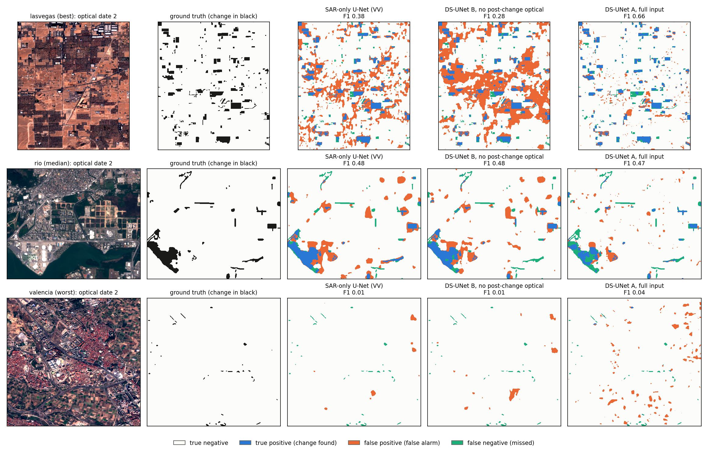
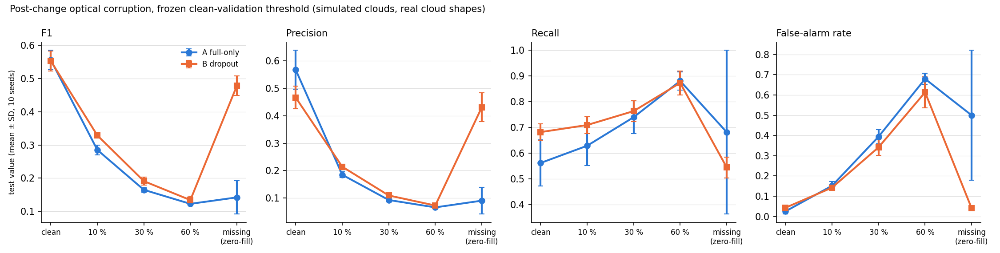
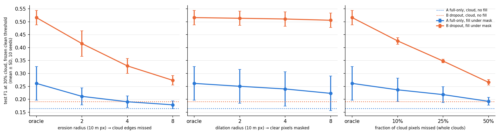
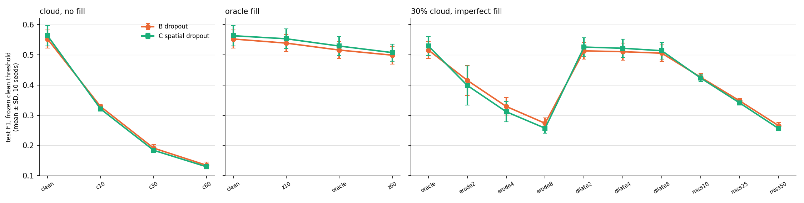

# Does Historical Optical Imagery Improve SAR-Based Change Detection When Post-Change Optical Data Are Unavailable? A Multi-Seed Evaluation on OSCD

**Manish Y. M.**
*Polaris School of Technology, Medhavi Skills University*
manishym946@gmail.com

---

## Abstract

Synthetic aperture radar (SAR)–optical change detectors are usually trained and tested with Sentinel-1 and Sentinel-2
images at both dates, but the post-change optical image is often missing or cloudy. We ask whether a historical
(pre-change) Sentinel-2 image improves Sentinel-1 change detection in that case. On the 10 test cities of the OSCD urban
change benchmark, we evaluate the official dual-stream U-Net (DS-UNet) and U-Net baselines with 10 training seeds per
model, validation-only selection and an internal pre-registration for each step. Within a modality-dropout DS-UNet,
removing the historical image made no detectable difference (ΔF1 −0.010, 95% CI [−0.026, +0.007]), and at their
registered thresholds neither this model nor one trained only with SAR and the historical image was detectably better
than a SAR-only U-Net. The registered test found no detectable linear trend with the image's acquisition time, 1 to 18
months before the post-change date (p = 0.105); an unplanned analysis found that the timings differ, with the 1-month
image lowest, an effect concentrated in one city and confounded with change already visible in that image. With full
input, DS-UNet scored above all U-Net baselines across training seeds, but in an exploratory resampling of the test
cities its lead over the SAR-only U-Net was concentrated in one city and not established. For the SAR-only U-Net, adding VH to VV lowered F1. With composite clouds, masking and
zero-filling cloud pixels let the dropout model score above a SAR-only fallback. All results concern one benchmark, one
architecture family and one training recipe, and undetected differences are not evidence of no effect.

**Keywords:** change detection, SAR–optical fusion, Sentinel-1, Sentinel-2, missing modality, historical optical imagery,
temporal gap, polarisation, cloud cover, OSCD, pre-registration, reproducibility

---

## 1. Introduction

Optical satellite images carry the spectral and semantic information that makes urban change easy to recognise, but they
are often unusable on the date a change must be assessed, because clouds cover part or all of the scene. Synthetic aperture
radar (SAR) is unaffected by cloud, which motivates SAR–optical fusion for change detection [1]. Most fusion models,
however, are trained and evaluated with SAR and optical images at both dates. Song et al. [2] showed that, for one change
type in one region, historical optical images can stand in for the missing post-change image as semantic context for a
SAR-based detector, and that their usefulness falls as they age. Whether this holds for urban change on a public benchmark,
whether a second SAR polarisation helps, and where historical optical imagery reduces false alarms, are open.

We address five questions, fixed before the experiments:

- **RQ1:** Can historical Sentinel-2 optical information improve Sentinel-1 SAR-based change detection when synchronous
  post-change optical imagery is unavailable?
- **RQ2:** How does the temporal gap between historical optical imagery and the target SAR observation affect change
  detection performance?
- **RQ3:** Can additional SAR information, particularly VV and VH polarization, improve discrimination between meaningful
  urban development and environmental or agricultural pseudo-changes?
- **RQ4:** How does the proposed asynchronous multimodal approach compare with SAR-only, optical-only, conventional fusion
  and dual-stream approaches?
- **RQ5:** Under what temporal and environmental conditions does historical optical information provide the greatest
  benefit?

We answer them in a measurement study, with the official DS-UNet code [1] on OSCD [3] enriched with Sentinel-1, not with
a new method. In short, for OSCD under one protocol: RQ1, the historical optical image gives no detectable gain, either
within the dropout DS-UNet or over a SAR-only U-Net; RQ2, there is no detectable linear trend with the image's
acquisition time, while an unplanned analysis shows the 1-month image scoring lowest, confounded with change the image
may already show; RQ3, adding VH gives no detectable gain, and for SAR alone it lowers F1; RQ4, without the post-change
optical image the asynchronous models are not detectably better than SAR alone and score below every baseline that has
that image, while with full input the dual-stream design scores highest across training seeds; RQ5, the historical image
changes false alarms detectably in only one small land-cover class. A robustness study (§5) separates a missing from a
partly cloudy post-change image and compares cloud masking with a SAR-only fallback rule.

**Contributions.** (i) A within-model test of historical optical imagery for SAR change detection when the post-change
optical image is missing: in a dual-stream network trained to tolerate the missing image, the historical image adds no
detectable F1 on OSCD, and a margin reported under a weaker protocol (Appendix A) does not survive. (ii) A test of
acquisition timing that states what OSCD's two-date labels allow: no detectable linear trend, a 1-month low that is
confounded and concentrated in one city, and no basis for comparison with the decline reported by Song et al. [2], whose
historical image plays a different role. (iii) A separation of the *missing* and *partly cloudy* post-change cases on
synthetic and composite clouds, with the asymmetric cost of cloud-mask errors, a real-detector test and a comparison
with a SAR-only fallback rule. (iv) An exploratory check of how sensitive each conclusion is to the test cities, alongside
the training-seed uncertainty.

Because OSCD is small (24 cities) and seed variance alone can change benchmark conclusions [17], every result uses 10
paired training seeds, 95% confidence intervals and Holm-corrected tests [4]; every checkpoint and threshold is selected
on validation cities only. Analyses added after all results had been seen are labelled exploratory (§3.4).

## 2. Related Work

**SAR–optical change detection.** Siamese fully convolutional networks established bitemporal change detection on optical
images [5], with U-Net [6] variants as common backbones; reviews [7] cover the field. Hafner et al. [1] fuse Sentinel-1 VV
and Sentinel-2 in a dual-stream U-Net with decision-level fusion and report that it beats unimodal U-Nets and input-level
fusion on OSCD enriched with Sentinel-1; their released rasters and download notebook use VV. Ebel et al.
[8] fuse co-registered Sentinel-1 and Sentinel-2 in Siamese networks for supervised change detection, Saha et al. [9] study
self-supervised change detection across different sensors, and DSNUNet [10] combines Sentinel-1 and Sentinel-2 for forest
change. These methods assume both modalities at the dates compared. Heterogeneous change detection instead compares an optical
image at one date with a SAR image at the other, for example by coupling or translating the two image domains [25],
[26], and multimodal optical–SAR datasets now support all-weather damage assessment [27]. Our setting differs: SAR is
available at both dates, and the historical optical image is auxiliary rather than the only pre-change source.

**Historical optical guidance and temporal gap.** Song et al. [2] monitor construction-ready bare land in Guangzhou with
Sentinel-1 VH change screening and a historical cloud-free Sentinel-2 image instead of a synchronous one. Varying the
age of that image (1, 3, 6 and 12 months before the target date) lowered F1 from 83.99% to 78.31% (their §5.4); they
chose VH over VV from backscatter physics rather than from a model ablation (§5.1). Their method comparison uses five
seeds and paired t-tests, but the gap results (their Table 4) report no repeated runs or intervals. In their framework
the historical image is a semantic prior for the land cover at the target date, so an older image is a staler
description of the target scene. In our bitemporal setting it fills the pre-change slot, where an image that already
shows the change hides it, so the expected sign of a timing effect differs. Our RQ2 and RQ3 experiments therefore
examine these findings in a different setting (urban change of all kinds, 9–10 cities on four continents, VV and VH as
3-month means, one dual-stream network with decision-level fusion) and are not replications; a different outcome does
not contradict their result.

**Missing modalities and clouds.** Modality dropout, randomly removing an input modality during training, was introduced
for gesture recognition [11]. Hafner and Ban [12] address multi-temporal urban mapping with a partly missing optical
modality by reconstructing optical features from SAR; on samples with missing optical data their model beats zero-fill (F1 0.327 against 0.233) but falls slightly short of a SAR-only model (0.348). SAR-guided cloud
removal reconstructs cloud-free Sentinel-2 images [13], and SEN12MS-CR-TS provides real cloudy Sentinel-1/2 time series [28]. Real cloud masks are available in the Sentinel-2 Cloud Mask
Catalogue [14]; operational detectors such as s2cloudless [15] are imperfect, and an intercomparison of cloud-masking
algorithms documents large differences between methods and reference datasets [16].

**Evaluation practice.** Variance from data sampling, initialisation and hyperparameters can change benchmark conclusions [17]; Appendix A shows a ranking reversal on OSCD.

## 3. Data and Methods

### 3.1 Data and split

**OSCD.** OSCD [3] provides 24 bitemporal Sentinel-2 L1C image pairs with pixel-level urban change labels. We use the 13
bands, divided by 10000 and clipped to [0, 1], and a holdout protocol: 10 of the 14 official training cities for training,
the other 4 (aguasclaras, beihai, bercy, paris) for validation, and the 10 official test cities (brasilia, montpellier,
norcia, rio, saclay_w, valencia, dubai, lasvegas, milano, chongqing) for testing. Test cities never enter training or
validation, which is asserted in code and re-checked in every run file. The change prevalence on the test cities is 0.052,
and a detector that labels every pixel as change has F1 0.098.

**Sentinel-1 VV (Steps 2–6, 8).** The VV rasters released with DS-UNet [1], one or more relative orbits per city, resized
to the label grid by cubic interpolation; training samples an orbit at random and evaluation uses the first listed orbit.

**Sentinel-1 VV and VH (Step 7).** A new Google Earth Engine [18] export of Sentinel-1 GRD (IW mode) with DS-UNet's own
recipe: the same relative orbits, the mean of the 3 months before OSCD date 1 and after date 2, low values masked,
unit-scaled and clamped; VV range [−25, 5] dB as in DS-UNet, VH range [−30, 0] dB (fixed before download). The exported VV
equals the released DS-UNet VV raster pixel for pixel in all 102 files, so the existing VV models serve as the VV arms. VH
is empty (no scene in the window) only for dubai_166_t1, lasvegas_166_t1 and lasvegas_173_t1; Las Vegas, a test city whose
evaluated orbit has no VH at date 1, is therefore excluded from the Step 7 analysis set (9 test cities). In the Earth Engine scene inventory made for the feasibility check over the same windows, the date-1 window holds fewer scenes than the date-2 window in 22 of 23 test-city orbits (median 6 against 14 VV scenes), and Dubai's orbit-130 date-1 window has one VH scene, so date-1 means are noisier; the export logs record no scene counts.

**Historical Sentinel-2 images (Step 8).** For each city, one Sentinel-2 L1C scene (COPERNICUS/S2_HARMONIZED) at OSCD's
own date-1 acquisition day (`gee_t1`, a same-date control of the processing chain) and one at each target date 2 − g,
g ∈ {1, 3, 6, 12, 18} months. Rule, fixed before any model saw a scene: within ±45 days of the target, full coverage and a
cloud-probability image required; the day nearest the target with cloud fraction ≤ 0.02 over the city box, else the
clearest day. All 144 city × date scenes exist. The primary city set is the 9 test cities whose scene has cloud fraction ≤
0.10 at every gap (Chongqing is excluded: cloud 0.977 at 3 months). An alignment control on all 24 cities against OSCD's own
date-1 bands gives median band correlation 0.940 and median shift 0.27 px, every city below 1 px. At 1–12 months no primary city's image precedes OSCD date 1; at 18 months, 4 of the 9 do. There is one scene per city and timing, so the 10 seeds do not replicate scenes.

**Land cover (Steps 7–8).** ESA WorldCover 2020 v100 [19] on the same grid, resized to the label grid by nearest
neighbour. It post-dates OSCD date 2, so "built-up" includes new construction; it is used as a stratification, not as a
label. OSCD has no labels that separate urban change from agricultural or seasonal change, so RQ3 and RQ5 are answered
through where false alarms occur by land-cover class, not why they occur.

### 3.2 Models and training recipe

The network and loss are the official DS-UNet files (`networks.DualStreamUNet`, topology [64, 128, 256, 512], decision-level
fusion by 1×1 convolution; `jaccard_like_loss`), loaded at run time from commit 8bfa4be [1]. The U-Net baselines are the
official DS-UNet single-stream U-Net with the same recipe. Training: Adam, learning rate 5e-5, weight decay 5e-4, batch 64,
32×32 importance crops (20 candidates weighted by changed pixels + 5), random flips and 90° rotations, 2500 steps,
validation every 25 steps. The step budget was chosen on validation score only (390 steps: 0.354; 1000: 0.382; 2500:
0.405; mean of 3 seeds; Appendix C, item 1). Training runs with cuDNN determinism (PyTorch 2.5.1+cu124, one RTX 4060 laptop GPU); repeat-training checks are listed
in Appendix D. In DS-UNet the SAR and optical streams are separate U-Nets: the optical stream never sees SAR, and the
two meet only at the final 1×1 convolution over their concatenated features. Arms trained with the same seed share the
seed of the generator that draws training cities, crops, augmentations and input conditions; different architectures
receive different initial weights. Contrasts between arms are paired by this seed index. As a reference point, the official 390-step protocol on all 14 training cities
gives test F1 0.557 ± 0.035 (10 seeds), below the published 0.600 [1]; we could not establish whether 0.600 is a single run
or a mean, so our conclusions concern differences between arms under one shared protocol.

### 3.3 Arms

| arm | network | input channels per date | training conditions | step |
|---|---|---|---|---|
| A | DS-UNet | VV + 13 optical | full input | Phase 2 |
| B | DS-UNet | VV + 13 optical | full 0.50; post-change optical zero (`no_o2`) 0.25; both optical dates zero (`no_opt`) 0.25 | Phase 2 |
| C | DS-UNet | VV + 13 optical | full 0.50; post-change optical zero under a cloud-shaped mask 0.25; `no_o2` 0.125; `no_opt` 0.125 | Step 4B |
| async | DS-UNet | VV + 13 optical | `no_o2` only (SAR at both dates + historical optical) | Step 6 |
| SAR-only | U-Net | VV | full input | Step 6 |
| optical-only | U-Net | 13 optical | full input | Step 6 |
| input fusion | U-Net | VV + 13 optical, stacked | full input | Step 6 |
| VH, VV+VH | U-Net and DS-UNet | VH or VV+VH (+ 13 optical for DS-UNet) | full input | Step 7 |

Each arm is trained with seeds 1–10. B and async are the two forms of the "asynchronous multimodal approach" of RQ1 and
RQ4: B is one network that serves both the full-input and the missing-post-change-optical case; async is the dedicated
alternative, trained only on SAR and the historical optical image. In the `no_o2` setting, the "historical optical image"
is OSCD's own date-1 Sentinel-2 image (Steps 6, 7) or one of the Step 8 scenes placed in the pre-change optical slot (Step 8);
the post-change optical input is zero.

**Selection (validation cities only).** Checkpoint: the step with the highest mean validation F1 over the conditions the arm
trains on. Threshold: the validation-F1 argmax over {0, 0.01, …, 1} for the selected checkpoint and input condition; it is
frozen and applied unchanged on test.

### 3.4 Statistics and integrity

F1, precision, recall, IoU and false-alarm rate (FP / (FP + TN)) are computed from pooled pixel counts over the analysed
test cities. Each step has a pre-specified primary family (Step 6 has two, for RQ4 and RQ1) of paired comparisons over seeds 1–10 (two-sided paired t-test, Holm
correction [4]), reported with the mean difference, its 95% CI, d_z, the number of seeds with a positive difference, and a
Holm-corrected Wilcoxon signed-rank test (smallest attainable p with n = 10 is 0.0020). Secondary analyses form their own
Holm families. Labels are "X better/lower" if Holm p < 0.05 with that sign, otherwise "no detectable difference"; a null is
not evidence of equivalence. With 10 pairs, the minimum detectable effect at 80% power is about 1.00 SD of the paired
differences at α = 0.05, 1.14 SD at α = 0.05/2 and 1.33 SD at α = 0.05/5. The intervals and p-values describe variation across training seeds on
fixed test cities; they do not include the sampling variability of the cities themselves; §4.6 examines that variability (exploratory).

**Pre-specification.** Phase and Step labels name the pre-registered study steps (Appendix D). For each step, a pre-registration file (hypotheses, conditions, primary family, decision rule and
sha256 hashes of code and inputs) was written before the step's first test evaluation. These are internal repository files,
not public registrations. For Steps 4B–8 the file was committed to version control before the test evaluation (Steps 6 and
7 before training); for Phases 2–4A-bis the evidence is file times and the code hashes recorded in every run file. Each
evaluation enforces anchors, for example that re-evaluated test counts equal the counts stored at training time exactly,
and a separate audit script, written with the same AI assistant as the analysis code, recomputes every reported statistic from raw counts for every step except Step 4A (check counts in Appendix D). Deviations are listed in Appendix C.

**Exploratory analyses.** Analyses added in revision, after every result had been seen, are not pre-registered and are
labelled exploratory wherever they appear: the asynchronous-arm comparisons for RQ4 (§4.1), the within-model and
threshold-rule contrasts for RQ1 (§4.2), the direct comparison of acquisition timings (§4.3), the test-city analysis
(§4.6) and the SAR-only fallback rule (§5.8). They read only stored test counts; no model was retrained or re-evaluated.
Test-city variability is estimated by a two-stage percentile bootstrap (10000 replicates; test cities resampled with
replacement, then seeds, with the same indices for both arms so the seed pairing is kept; F1 pooled over the pixels of
the resampled cities), by a city jackknife (one city left out at a time) and by unweighted per-city sign counts. With 9–10
cities of very unequal size these intervals are approximate, and percentile intervals tend to be too narrow. The
statistical method and its interpretation were checked by a separate session of the same AI assistant, which
reproduced the numbers with its own code. The script is
`experiments/robust/stage4/analyze_stage4.py`.

## 4. Results by research question

### 4.1 RQ4: comparison with SAR-only, optical-only, conventional fusion and dual-stream approaches

Full input, test F1 at the validation-selected threshold, 10 test cities (Step 6; primary family A − each baseline, Holm
over 3):

| arm | F1 | precision | recall | IoU | false-alarm rate |
|---|---|---|---|---|---|
| DS-UNet A | 0.556 ± 0.029 | 0.568 ± 0.071 | 0.562 ± 0.090 | 0.385 ± 0.028 | 0.025 ± 0.013 |
| DS-UNet B (modality dropout) | 0.553 ± 0.030 | 0.466 ± 0.041 | 0.682 ± 0.032 | 0.382 ± 0.028 | 0.043 ± 0.007 |
| SAR-only U-Net | 0.418 ± 0.043 | 0.312 ± 0.051 | 0.648 ± 0.027 | 0.265 ± 0.035 | 0.081 ± 0.020 |
| optical-only U-Net | 0.498 ± 0.056 | 0.588 ± 0.080 | 0.451 ± 0.101 | 0.333 ± 0.048 | 0.019 ± 0.012 |
| input-fusion U-Net | 0.495 ± 0.026 | 0.556 ± 0.063 | 0.452 ± 0.047 | 0.329 ± 0.023 | 0.020 ± 0.006 |

| contrast | mean Δ | 95% CI | d_z | Δ > 0 | Holm p | label |
|---|---|---|---|---|---|---|
| A − SAR-only | +0.138 | [+0.094, +0.181] | +2.26 | 10/10 | 1.6e-04 | DS-UNet better |
| A − optical-only | +0.058 | [+0.004, +0.112] | +0.77 | 8/10 | 0.0370 | DS-UNet better |
| A − input fusion | +0.061 | [+0.033, +0.089] | +1.54 | 9/10 | 0.0017 | DS-UNet better |

Across training seeds, the dual-stream design scores above all three U-Net baselines. In a secondary family, input
fusion is not distinguishable from optical alone (Δ −0.003, 95% CI [−0.045, +0.039]), and both beat SAR alone (+0.077
and +0.079, Holm p 0.0102): stacking SAR at the input gives no detectable gain over optical input, while the dual-stream
design gains detectably from SAR. The modality-dropout model B is not detectably different from A on full input (Δ
−0.003, 95% CI [−0.037, +0.031]; §5.1), but it has lower precision and a higher false-alarm rate (§5.8). Validation-
selected thresholds matter: at a fixed 0.5 threshold, full-input F1 is 0.513 for A, 0.427 for B and 0.357 for the
SAR-only U-Net. The recipe and step budget were chosen on arm A and the U-Net baselines were not tuned separately.
Across seeds and the three stored input conditions, selected thresholds are 0.99 or above in 8 of 30 cases for the
optical-only U-Net, 6 of 30 for input fusion and 6 of 30 for A, and never for B, async or the SAR-only U-Net, which
suggests poorly scaled output probabilities in the first three.

**The asynchronous approach (exploratory).** RQ4 asks about the asynchronous approach, that is, a model used without the
post-change optical image. Against the baselines with full input (Holm over 8), B without the post-change image is not
detectably different from the SAR-only U-Net (+0.013) and is below the optical-only (−0.067, Holm p 0.041), input-fusion
(−0.064, Holm p 0.015) and A (−0.125) models; async is likewise not detectably different from SAR-only (−0.016) and
below the other three (−0.096, −0.093 and −0.154). These baselines use the post-change optical image that the
asynchronous setting lacks, so the comparison measures what losing that image costs, not a like-for-like contest.

**Answer to RQ4.** Without the post-change optical image, the asynchronous models (B and async) are not detectably
better than a SAR-only U-Net and score below the optical-only, input-fusion and dual-stream models that have the
post-change image (exploratory). With full input, the dual-stream DS-UNet scores above the SAR-only, optical-only and
input-fusion U-Nets across training seeds, which agrees with Hafner et al. [1]; in the exploratory city resampling, its
lead over SAR-only is concentrated in Las Vegas and not established beyond these cities (95% CI [−0.022, +0.246]; §4.6);
the point estimate is unchanged, so this is not evidence against a lead, and the baselines were not tuned separately.

### 4.2 RQ1: historical optical without post-change optical, against SAR alone

Setting `no_o2` (SAR at both dates, OSCD's own date-1 optical image, post-change optical zero), against the SAR-only
U-Net, 10 test cities (Step 6; primary family, Holm over 2):

| contrast | F1 | mean Δ | 95% CI | d_z | Δ > 0 | Holm p | label |
|---|---|---|---|---|---|---|---|
| B@no_o2 − SAR-only | 0.431 ± 0.034 | +0.013 | [−0.015, +0.040] | +0.33 | 6/10 | 0.6576 | no detectable difference |
| async@no_o2 − SAR-only | 0.402 ± 0.059 | −0.016 | [−0.059, +0.026] | −0.27 | 5/10 | 0.6576 | no detectable difference |

The F1 column is the first term; the SAR-only U-Net scores 0.418 ± 0.043. Neither the modality-dropout model nor the model
trained only on SAR and historical optical is detectably better than SAR alone. In a secondary family, async − B at `no_o2`
(Δ −0.029) and, within B, the historical image present minus absent (Δ −0.010, 95% CI [−0.026, +0.007]) are not detectable
either. Descriptively, the async model, trained only with the historical image, scores 0.463 ± 0.028 when that image is
also removed and 0.402 ± 0.059 with it. Step 8 repeats the comparison with images of different ages (§4.3): B is never
detectably better than SAR alone, and the source control shows that the Earth Engine copy of OSCD's date-1 image gives the
same result as OSCD's own (Δ +0.000).

**Same model, with and without the historical image.** The most direct test of the historical image compares a model
with itself, with both optical inputs zero in the second case. For B at each input's own validation-selected threshold
(a Step 6 registered secondary contrast), the historical image changes F1 by −0.010 (95% CI [−0.026, +0.007], 3/10 seeds
positive); at a fixed threshold of 0.5 (exploratory), by −0.003 (95% CI [−0.025, +0.019]). For async, removing the image
raises F1 (present minus absent −0.061, 95% CI [−0.094, −0.029], 0/10; exploratory). No stored output gives B without
the historical image at the frozen clean-input threshold, so the within-B contrast at that threshold would need a new
evaluation.

**Threshold rule (exploratory).** The registered B − SAR-only contrast uses B's threshold selected on validation cities
for the `no_o2` input. At B's frozen clean-input threshold, which §5 uses for every corrupted input, the same models
give +0.060 (95% CI [+0.026, +0.094], 8/10; with test cities and seeds resampled, the percentile interval
[+0.007, +0.117] narrowly excludes zero, but a jackknife interval, [−0.030, +0.150], does not); with both models at
0.5, +0.018. This rule was compared after the results were known. The difference is between two networks; the within-B
contrast detects no effect of the historical image at the other two thresholds but has not been measured at this one,
so how much of the +0.060 comes from the image is open. The dropout DS-UNet's margin over a SAR-only U-Net depends on
how its threshold is chosen from 4 validation cities.

The companion study (Appendix A) had reported 0.309 for its missing-optical model against 0.241 for SAR alone under a
weaker protocol; under the shared protocol the SAR-only U-Net reaches 0.418, and the margin does not survive.

**Answer to RQ1.** On OSCD, with this architecture and recipe, historical Sentinel-2 optical information gives no
detectable improvement in Sentinel-1 VV change detection when the post-change optical image is unavailable: within the
dropout DS-UNet the historical image makes no detectable difference, and for the model trained only with it, removing it
raises F1 (exploratory). At the registered thresholds neither model is detectably better than a SAR-only U-Net; at the
clean-input threshold the dropout DS-UNet scores above it across seeds (exploratory; not established across cities,
§4.6), and whether the historical image contributes at that threshold has not been measured. This is not evidence that historical optical imagery never helps: effects below about
1.14 SD of the paired differences can be missed, the Sentinel-1 inputs are 3-month means, and in DS-UNet the optical
stream meets SAR only at the final 1×1 convolution, so the image can add only a SAR-independent term to each pixel's
score, not context for interpreting the SAR evidence (§6).

### 4.3 RQ2: acquisition timing of the historical optical image

RQ2 asks about the temporal gap. Under OSCD's label definition (change between two fixed dates), varying the gap varies
two things at once: the image's age and whether it was acquired before or after OSCD's first date, and hence how much of
the labelled change it may already show. This experiment therefore measures the effect of the historical image's
acquisition timing under that label definition; it is not a clean causal test of image age (see "The confound" below).

B, setting `no_o2`, test F1 at the frozen `no_o2` threshold, 9 primary cities, mean ± SD over 10 seeds (Step 8):

| arm | OSCD date 1 | Earth Engine date 1 | 1 month | 3 months | 6 months | 12 months | 18 months |
|---|---|---|---|---|---|---|---|
| B dropout | 0.420 ± 0.039 | 0.420 ± 0.039 | 0.389 ± 0.044 | 0.422 ± 0.038 | 0.409 ± 0.035 | 0.417 ± 0.037 | 0.412 ± 0.033 |
| async | 0.405 ± 0.067 | 0.407 ± 0.066 | 0.349 ± 0.059 | 0.416 ± 0.061 | 0.370 ± 0.072 | 0.422 ± 0.057 | 0.383 ± 0.066 |

The SAR-only U-Net scores 0.406 ± 0.048 on the same cities. **Primary test:** per seed, the least-squares slope of B's F1
against the gap; the mean slope is +0.0083 F1 per year (95% CI [−0.0021, +0.0187]), positive in 8 of 10 seeds, t-test p
0.105: **no detectable linear trend with the gap**. The exact Wilcoxon test on the same slopes gives p 0.049; the registered test is
the t-test, so the slope's sign is suggestive, not established. The all-city sensitivity analysis (10 cities) agrees
(+0.0042 per year, p 0.057). For the async model the slope is +0.0161 per year (p 0.051), also not detectable.

Against SAR alone, B shows no detectable difference at any gap (mean Δ from −0.017 to +0.016, smallest Holm p 1.00). The
async model is lower than SAR alone at 1 month (Δ −0.058, 95% CI [−0.093, −0.022], Holm p 0.027) and not detectably
different at 3–18 months.

**Unplanned comparison of the timings (exploratory).** The registered slope tests only a linear trend. Comparing the
five timings directly, after the results were known, shows that they differ: for B, Friedman p 0.00062
(repeated-measures ANOVA F(4, 36) = 5.71, p 0.001); for async, Friedman p 5.3e-06. For B, the 1-month image is below the
3-month image in 9 of 10 seeds (Δ −0.033) and below the 12-month image in all 10 (Δ −0.028), although neither pairwise
difference survives Holm correction over four comparisons (Holm p 0.075 for both); for async, the 1-month image is below
the 3-month (Δ −0.068, Holm p 0.003) and 12-month images (Δ −0.074, Holm p 0.00062). The pattern does not hold across
cities: B's 1-month deficit relative to OSCD's date-1 image is −0.031 over seeds but comes mostly from Saclay (−0.201),
is negative in 5 of 9 cities and is not established when cities are resampled (95% CI [−0.116, +0.003]; §4.6). Each
timing has one scene per city, so scene-specific properties such as season, haze and the change shown are not replicated
by seeds; the mean seasonal offset from OSCD date 1 is 80, 48, 77, 99 and 80 days for the five timings, with no clear
relation to F1. The t-test and the Wilcoxon test on the slopes differ partly because of one seed: seed 7's slope is
+0.0454 per year, and without it the mean is +0.0042 (p 0.101).

**The confound.** OSCD labels mark change between date 1 and date 2. An image taken 1–12 months before date 2 lies after date
1 and may already show part of the labelled change, which the pre-change slot would then hide. The 1-month image gives the
lowest F1 for both B and async, which is consistent with this confound, but how much change each image shows was not
measured, so the design cannot separate the image's age from it. Separating them requires either labels dated at the
historical image or historical images that all precede the change, which OSCD does not provide for 1–12 month gaps.

**Answer to RQ2.** On OSCD, the registered test finds no detectable linear trend of F1 with the acquisition time of the
historical optical image, 1–18 months before the post-change date (slope +0.0083 F1 per year, p 0.105), and at no timing
does the image beat SAR alone. An unplanned comparison finds that the timings do differ, with the 1-month image lowest,
but this difference is concentrated in one city and confounded with change the image may already show, because every
image at 1–12 months post-dates OSCD date 1. The decline with age reported by Song et al. [2] (F1 83.99% at 1 month to
78.31% at 12 months, for construction-ready bare land) was not observed here, but the historical image plays a different
role in their framework (§2), so this is not a test of their finding. The design does not show that image age is
irrelevant.

### 4.4 RQ3: VV and VH polarisation

Full input, test F1 at the frozen threshold, 9 test cities with VH at both dates (Step 7):

| arm | F1 | precision | recall | IoU | false-alarm rate |
|---|---|---|---|---|---|
| SAR-only U-Net, VV | 0.452 ± 0.011 | 0.367 ± 0.017 | 0.590 ± 0.029 | 0.292 ± 0.009 | 0.049 ± 0.005 |
| SAR-only U-Net, VH | 0.383 ± 0.029 | 0.346 ± 0.048 | 0.442 ± 0.069 | 0.237 ± 0.022 | 0.042 ± 0.016 |
| SAR-only U-Net, VV+VH | 0.408 ± 0.031 | 0.405 ± 0.040 | 0.424 ± 0.081 | 0.257 ± 0.024 | 0.031 ± 0.010 |
| DS-UNet, VV | 0.501 ± 0.024 | 0.523 ± 0.067 | 0.500 ± 0.089 | 0.335 ± 0.021 | 0.024 ± 0.013 |
| DS-UNet, VH | 0.484 ± 0.043 | 0.511 ± 0.030 | 0.462 ± 0.061 | 0.320 ± 0.036 | 0.021 ± 0.002 |
| DS-UNet, VV+VH | 0.511 ± 0.019 | 0.571 ± 0.029 | 0.465 ± 0.036 | 0.344 ± 0.017 | 0.017 ± 0.003 |

| contrast | mean Δ | 95% CI | d_z | Δ > 0 | Holm p | label |
|---|---|---|---|---|---|---|
| SAR-only: VV+VH − VV | −0.044 | [−0.065, −0.023] | −1.49 | 1/10 | 0.0011 | VV+VH lower |
| SAR-only: VH − VV | −0.070 | [−0.091, −0.048] | −2.32 | 0/10 | 8.8e-05 | VH lower |
| DS-UNet: VV+VH − VV | +0.010 | [−0.016, +0.036] | +0.27 | 7/10 | 0.4125 | no detectable difference |
| DS-UNet: VH − VV | −0.017 | [−0.039, +0.004] | −0.59 | 3/10 | 0.1925 | no detectable difference |

The first two rows are the primary family (Holm over 2), the last two a secondary family. For SAR alone, VV scores best and
VH worst, and adding VH to VV lowers F1. With optical input, polarisation makes no detectable difference.

**Discrimination of pseudo-change.** By WorldCover class (secondary family, Holm over 7 classes), the SAR-only VV+VH model
has a lower false-alarm rate than VV in tree cover, built-up, bare and water, and no detectable difference in shrubland,
grassland and cropland. But its recall is lower than VV's in every class and overall (0.424 ± 0.081 against 0.590 ± 0.029),
while precision rises (0.405 ± 0.040 against 0.367 ± 0.017): the VV+VH model flags less change everywhere. This is a shift
of operating point, not evidence that VH separates urban development from environmental or agricultural pseudo-change.

Including Las Vegas, whose VH band at date 1 is all zero, the VV+VH SAR-only model drops to F1 0.224 ± 0.032 (false-alarm
rate 0.194 ± 0.051) on 10 cities, against 0.418 ± 0.043 for VV. A model trained with a second polarisation depends on that
band being present. The date-1 Sentinel-1 means average fewer scenes than the date-2 means (§3.1), so date-1 VH, the weaker band, may be noisier still; this alternative explanation of the VH result was not tested.

**Answer to RQ3.** The answer is arm-specific. For the SAR-only U-Net on OSCD, adding VH to VV lowered F1, and VH alone
lowered it more; for DS-UNet with optical input, neither VH nor VV+VH differed detectably from VV. These are results for
3-month mean backscatter, validation-selected thresholds, this recipe and these two architectures, not a general property of VH. On pseudo-change, the
evidence is limited to false-alarm rates stratified by land cover: VV+VH's lower false-alarm rates come with lower recall,
and OSCD has no labels for the cause of a false alarm, so the experiment cannot show whether VH discriminates urban
development from environmental or agricultural change. It does not test the physical argument of Song et al. [2] for VH on
bare land.

### 4.5 RQ5: conditions in which historical optical information helps most

**Temporal conditions.** From §4.3: no acquisition timing between 1 and 18 months gives B a detectable gain over SAR
alone, and the 1-month image scores lowest. For images older than OSCD date 1 (4 of the 9 primary cities at 18 months),
the design cannot separate timing from city.

**Environmental conditions.** False-alarm rate by WorldCover class, B with OSCD's date-1 image minus the SAR-only U-Net, 9
primary cities (Step 8; Holm over the 7 classes with ≥ 1% of the pixels):

| class | pixel share | mean Δ | 95% CI | Δ > 0 | Holm p | label |
|---|---|---|---|---|---|---|
| tree cover | 15.6% | −0.001 | [−0.003, −0.000] | 3/10 | 0.0973 | no detectable difference |
| shrubland | 1.3% | −0.006 | [−0.010, −0.003] | 1/10 | 0.0127 | B lower |
| grassland | 7.7% | +0.002 | [−0.002, +0.006] | 5/10 | 0.9703 | no detectable difference |
| cropland | 8.0% | −0.015 | [−0.034, +0.004] | 2/10 | 0.5354 | no detectable difference |
| built-up | 40.6% | −0.004 | [−0.015, +0.008] | 4/10 | 0.9804 | no detectable difference |
| bare | 24.6% | −0.025 | [−0.077, +0.027] | 4/10 | 0.9703 | no detectable difference |
| water | 1.7% | +0.001 | [−0.008, +0.011] | 4/10 | 0.9804 | no detectable difference |

B with the historical image has a detectably lower false-alarm rate than the SAR-only U-Net only in shrubland, by 0.006,
in a class covering 1.3% of the pixels, with similar recall there (0.146 against 0.151; exploratory), so the lower
false-alarm rate is not explained by flagging less change. This contrast is between two networks; B without the
historical image was not evaluated by land-cover class, so the reduction cannot be attributed to the image itself. It is
a small, class-specific result, not a broad environmental benefit. In built-up areas, the largest
class, there is no detectable difference. The mean differences in cropland and bare
land are negative but not detectable.

**Error maps.** Figure 1 shows, for seed 1, the SAR-only U-Net, B without the post-change optical image, and A with full
input on the best, median and worst test city, ranked by A's per-city F1 averaged over the 10 seeds (rule committed before
any map was drawn; every map reproduces that city's registered counts). In Las Vegas both SAR-based models produce large
false-alarm regions over desert and bare ground (F1 0.38 for SAR-only and 0.28 for B, against 0.66 for A); in Rio the three
are close (0.48, 0.48, 0.47); in Valencia, whose labelled changes are small and thin, every model misses nearly all of them
(0.01, 0.01, 0.04). These maps illustrate the results; they are not evidence for any research question.

**Answer to RQ5.** Within the conditions tested (acquisition timings of 1–18 months, seven land-cover classes, OSCD urban
change), historical optical information gives no detectable benefit in F1 under any temporal condition, and the only detectable false-alarm difference is a small reduction in shrubland for B against the SAR-only U-Net, which the design cannot attribute to the image itself. Among these conditions we detected none in which it gives a material benefit; conditions outside OSCD, or effects below the minimum detectable size, remain untested.

### 4.6 Test cities and training seeds (exploratory)

Per-city counts at the same frozen thresholds as above. The first interval is the seed-level interval used elsewhere;
the second is a percentile interval that resamples test cities, then seeds (§3.4). Both SE columns are standard errors
of the same pixel-pooled Δ: with seeds resampled (SD/√10) and with cities left out one at a time (jackknife). Sign counts
use each city's own Δ and are unweighted, although cities differ greatly in size (Dubai, Las Vegas and Chongqing hold
77% of the change pixels). The last column is the range of the pooled Δ when one city is left out.

| contrast | cities | mean Δ | 95% CI, seeds | SE, seeds | SE, cities | cities with same sign | 95% CI, cities and seeds | Δ, one city left out |
|---|---|---|---|---|---|---|---|---|
| A (full input) − SAR-only | 10 | +0.138 | [+0.094, +0.181] | 0.019 | 0.087 | 6/10 | [−0.022, +0.246] | +0.049 to +0.156 |
| B@no_o2, own threshold − SAR-only | 10 | +0.013 | [−0.015, +0.040] | 0.012 | 0.004 | 6/10 | [−0.019, +0.043] | +0.009 to +0.014 |
| async@no_o2 − SAR-only | 10 | −0.016 | [−0.059, +0.026] | 0.019 | 0.039 | 7/10 | [−0.095, +0.047] | −0.055 to −0.001 |
| B@no_o2, clean threshold − SAR-only | 10 | +0.060 | [+0.026, +0.094] | 0.015 | 0.037 | 6/10 | [+0.007, +0.117] | +0.024 to +0.073 |
| B: 1-month − OSCD date-1 image | 9 | −0.031 | [−0.056, −0.005] | 0.011 | 0.026 | 5/9 | [−0.116, +0.003] | −0.043 to −0.008 |

For four of the five contrasts, resampling cities adds more uncertainty than resampling seeds; for B at its own
threshold, seed variation dominates. The DS-UNet lead over the SAR-only U-Net is concentrated in Las Vegas (+0.304 in
that city; without it the pooled lead falls from +0.138 to +0.049; leaving out any other city changes it by at most
0.02) and is negative in Milano (−0.162), Saclay and Rio. Its city-and-seed interval includes zero; the point estimate
is unchanged, so this shows that ten cities do not establish the lead beyond these cities, not that it is absent. For B
at its own threshold and for async, the intervals still include zero. At the clean-input threshold, chosen after the
results were known, B's percentile interval narrowly excludes zero, but a jackknife interval ([−0.030, +0.150]) does
not, so this margin is not established across cities either. B's 1-month deficit is not established when cities are
resampled. Per-city counts were not stored for the optical-only and input-fusion U-Nets, so those contrasts
cannot be resampled by city.

## 5. Robustness to a missing or cloudy post-change optical image

RQ1 assumes that the post-change optical image is unavailable. In practice it is often present but partly
cloudy. This section reports the seven-step robustness study with the arms A, B and C (§3.3).

**Test conditions.** All corruptions act on the post-change Sentinel-2 image only. *Missing* (`no_o2`): set to zero.
*Copy-forward* (`o2_copy`): replaced by the pre-change image. *Cloud* (c10 / c30 / c60): a real CLOUD mask from the Cloud
Mask Catalogue [14], one per city and level, adjusted to cover exactly 10 / 30 / 60% of the city's pixels; inside it, all 13
bands are replaced by a fixed opaque cloud spectrum (per-band median of 400,000 thick-cloud pixels from 8 catalogue scenes);
clouds are uniform, hard-edged and shadowless. *Oracle zero-fill* (z10 / z30 / z60): the cloud pixels are set to zero under
the true mask. *Imperfect masks* (Step 4A-bis): the true mask eroded by 2 / 4 / 8 px (missed cloud edges), dilated by 2 / 4 /
8 px (over-masked clear pixels), or with 10 / 25 / 50% of whole clouds dropped (missed clouds). *Dilated imperfect masks*
(Step 5S): each under-masking mask dilated by one radius chosen on validation cities only (r* = 16 px, the largest in the
grid). *Composite clouds and a real detector* (Step 5): real catalogue cloud pixels pasted into the post-change images (126
composites; validation and test never share a scene), masked by s2cloudless 1.7.3 [15] at operating points chosen on
validation composites only: **rb95** (the most precise point with cloud recall ≥ 0.95), **bal** (highest mask F1) and the
fallback **rb99**. From Phase 3 on, the threshold is each checkpoint's frozen clean-validation threshold, since a deployed
model does not know the cloud level. Zero is the fill value used here, not an intrinsic missing-data token. Audit check counts are in Appendix D.

### 5.1 Whole-modality dropout handles a missing image at no detectable full-input cost (Phase 2)

Test F1 at the validation-selected threshold (mean ± SD over 10 seeds; primary family B − A, Holm over 4):

| condition | A full-only | B dropout | Δ (B − A) | 95% CI | B > A | Holm p |
|---|---|---|---|---|---|---|
| full | 0.556 ± 0.029 | 0.553 ± 0.030 | −0.003 | [−0.037, +0.031] | 5/10 | 0.8449 |
| post optical missing (`no_o2`) | 0.190 ± 0.068 | 0.431 ± 0.034 | +0.241 | [+0.176, +0.305] | 10/10 | 5.8e-05 |
| copy-forward (`o2_copy`) | 0.314 ± 0.034 | 0.438 ± 0.038 | +0.124 | [+0.087, +0.160] | 10/10 | 9.5e-05 |
| no optical (`no_opt`) | 0.397 ± 0.106 | 0.440 ± 0.027 | +0.043 | [−0.036, +0.123] | 5/10 | 0.4964 |

B is better with the post-change image missing and with copy-forward imputation, which neither arm saw in training. The
`no_opt` difference is not supported; it comes mostly from one collapsed A seed. On full input there is no detectable cost
at the validation-selected threshold, although losses up to 0.037 F1 are compatible with the data (95% CI). At a fixed threshold of
0.5, B is lower on full input (−0.086, secondary): B's probabilities shift upward, so the dropout model needs its threshold
chosen on validation data.

### 5.2 Partial cloud is a different failure, and dropout does not fix it (Phase 3)

Test F1 at the frozen clean threshold (B − A, Holm over 4):

| condition | A full-only | B dropout | Δ (B − A) | Holm p | B > A |
|---|---|---|---|---|---|
| clean | 0.556 ± 0.029 | 0.553 ± 0.030 | | | |
| c10 | 0.285 ± 0.015 | 0.329 ± 0.008 | +0.044 | 9.6e-05 | 10/10 |
| c30 | 0.165 ± 0.007 | 0.191 ± 0.012 | +0.026 | 0.0010 | 10/10 |
| c60 | 0.123 ± 0.002 | 0.134 ± 0.011 | +0.011 | 0.0144 | 10/10 |
| missing | 0.142 ± 0.050 | 0.478 ± 0.030 | +0.336 | 9.5e-08 | 10/10 |

B degrades significantly less than A at every cloud level, but the advantage is small next to the damage. Ten percent cloud
cover costs A about 0.27 F1 and B about 0.22 F1; at 30–60% both are close to the all-change F1 of 0.098. **For B, a partly
cloudy post-change image is far worse than none:** 0.329 F1 at 10% cover against 0.478 with the image missing. (The
`missing` value differs from Phase 2's 0.431 only because Phase 3 uses the frozen clean threshold.) At the clean threshold,
almost every pixel under a cloud is predicted as change: the false-alarm rate inside the mask rises from about 0.03–0.05 to
0.96–1.00 for both arms, and false alarms spill into nearby clear pixels (outside-mask false-alarm rate for A 0.025 → 0.058 /
0.134 / 0.199 at c10 / c30 / c60; for B 0.042 → 0.052 / 0.075 / 0.095). Dropout taught B to ignore zero-filled optical input,
not cloud-valued optical input.

### 5.3 Zero-filling under the cloud recovers most of the loss, mainly for the dropout model (Step 4A)

Replacing the cloud values by zero under the true mask improves F1 for both arms at every level (Holm p < 0.05 for all 6
tests, 10/10 seeds), but by very different amounts:

| arm | level | F1 cloud | F1 zero-fill | Δ | recovery of the cloud loss |
|---|---|---|---|---|---|
| A | 10% | 0.285 | 0.393 | +0.108 | 0.403 ± 0.189 |
| A | 30% | 0.165 | 0.261 | +0.097 | 0.249 ± 0.168 |
| A | 60% | 0.123 | 0.192 | +0.069 | 0.161 ± 0.132 |
| B | 10% | 0.329 | 0.539 | +0.210 | 0.939 ± 0.016 |
| B | 30% | 0.191 | 0.516 | +0.325 | 0.899 ± 0.033 |
| B | 60% | 0.134 | 0.499 | +0.365 | 0.872 ± 0.041 |

For B, the false-alarm rate inside the mask returns to its clean value (≈ 0.05) and the spill-over disappears; B at 60%
cover with the oracle mask (0.499) is above B with the whole image missing (0.478). A reads the zero-filled region as change
too (false-alarm rate inside the mask ≈ 0.51). The remedy works well only together with dropout training. B's remaining gap
is lost evidence rather than false alarms: its recall inside the mask falls from about 0.73 to 0.55–0.61.

### 5.4 With synthetic mask errors, the mask should err toward over-masking (Step 4A-bis)

For B at 30% cover, each imperfect mask against the oracle mask (Holm over 9); every error type costs F1 (Holm p < 0.05,
worse than the oracle in 10/10 seeds), but the costs are very unequal:

| mask | missed cloud | over-masked clear | B F1 | Δ vs oracle | 95% CI | retained gain |
|---|---|---|---|---|---|---|
| oracle (z30) | 0 | 0 | 0.516 | | | |
| dilate2 | 0.000 | 0.051 | 0.513 | −0.003 | [−0.003, −0.002] | 0.99 |
| dilate4 | 0.000 | 0.107 | 0.511 | −0.005 | [−0.006, −0.005] | 0.98 |
| dilate8 | 0.000 | 0.214 | 0.506 | −0.010 | [−0.012, −0.009] | 0.97 |
| erode2 | 0.116 | 0.000 | 0.416 | −0.100 | [−0.141, −0.060] | 0.70 |
| erode4 | 0.232 | 0.000 | 0.329 | −0.187 | [−0.220, −0.153] | 0.43 |
| erode8 | 0.431 | 0.000 | 0.273 | −0.243 | [−0.272, −0.213] | 0.26 |
| miss10 | 0.100 | 0.000 | 0.426 | −0.090 | [−0.103, −0.077] | 0.73 |
| miss25 | 0.250 | 0.000 | 0.348 | −0.168 | [−0.188, −0.149] | 0.49 |
| miss50 | 0.500 | 0.000 | 0.266 | −0.250 | [−0.276, −0.225] | 0.23 |

Retained gain = (F1_mask − F1_cloud) / (F1_oracle − F1_cloud), computed per seed and averaged, with F1_cloud = 0.191. Over-masking is almost free for B:
masking 21% of the clear pixels costs 0.010 F1. Under-masking is expensive whatever its shape; on missed-cloud pixels, B's
false-alarm rate is 0.909–0.962 for every missed-cloud and erode4/8 variant. Over-masking does hurt the full-input model A:
its false-alarm rate on over-masked clear pixels rises from ≈ 0.024 to 0.385–0.497. An exploratory partition by the true
mask shows that a thin rim of unmasked cloud brings back the Phase 3 spill-over: for B with erode4, the false-alarm rate on
clear pixels outside the cloud is 0.073, the same as with no fill (0.075), against 0.045 with the oracle mask.

### 5.5 Spatial dropout training does not add robustness (Step 4B)

C − B test F1 at the frozen clean threshold (Holm over 7):

| condition | B | C | Δ (C − B) | 95% CI | C > B | Holm p |
|---|---|---|---|---|---|---|
| clean | 0.553 ± 0.030 | 0.564 ± 0.034 | +0.011 | [−0.024, +0.046] | 7/10 | 1.0 |
| z10 | 0.539 ± 0.028 | 0.553 ± 0.033 | +0.014 | [−0.019, +0.048] | 7/10 | 1.0 |
| z30 | 0.516 ± 0.028 | 0.529 ± 0.032 | +0.013 | [−0.020, +0.047] | 6/10 | 1.0 |
| z60 | 0.499 ± 0.030 | 0.508 ± 0.028 | +0.009 | [−0.024, +0.041] | 6/10 | 1.0 |
| c30, erode4 | 0.329 ± 0.029 | 0.312 ± 0.034 | −0.018 | [−0.050, +0.015] | 2/10 | 1.0 |
| c30, dilate4 | 0.511 ± 0.028 | 0.522 ± 0.030 | +0.011 | [−0.021, +0.043] | 6/10 | 1.0 |
| c30, miss25 | 0.348 ± 0.007 | 0.341 ± 0.006 | −0.007 | [−0.015, +0.001] | 3/10 | 0.55 |

All 7 primary comparisons are "no detectable difference", and C shows no clean regression. C halves B's whole-image dropout,
so the contrast mixes spatial masks with less whole-image dropout; descriptively, C is lower than B on `no_opt` (−0.028) and
`o2_copy` (−0.039), and C still calls almost every unmasked cloud pixel change (false-alarm rate under the cloud with no fill
0.994, against 0.961 for B).

### 5.6 Dilation repairs missed edges, not missed clouds (Step 5S)

B at 30% cover, test F1 with each under-masking mask P and with P dilated by r* = 16 px (Holm over 6), and the remaining
difference from the oracle mask after dilation (secondary):

| mask | B F1, P | B F1, P dilated by r* | Δ | 95% CI | Δ > 0 | Holm p | Δ vs oracle at r* |
|---|---|---|---|---|---|---|---|
| erode2 | 0.416 ± 0.050 | 0.500 ± 0.027 | +0.085 | [+0.044, +0.125] | 10/10 | 0.0041 | −0.016 |
| erode4 | 0.329 ± 0.029 | 0.500 ± 0.027 | +0.171 | [+0.138, +0.204] | 10/10 | 4.3e-06 | −0.016 |
| erode8 | 0.273 ± 0.018 | 0.468 ± 0.020 | +0.194 | [+0.172, +0.216] | 10/10 | 6.0e-08 | −0.048 |
| miss10 | 0.426 ± 0.013 | 0.424 ± 0.015 | −0.002 | [−0.005, +0.001] | 4/10 | 0.2382 | −0.092 |
| miss25 | 0.348 ± 0.007 | 0.348 ± 0.008 | +0.000 | [−0.001, +0.002] | 5/10 | 0.7405 | −0.168 |
| miss50 | 0.266 ± 0.010 | 0.267 ± 0.011 | +0.002 | [+0.001, +0.003] | 9/10 | 0.0261 | −0.249 |

Dilation is better for all three eroded masks, with every seed improving, and afterwards they are within 0.048 F1 of the
oracle. For missed whole clouds it makes no practical difference: miss50 meets the label "dilation better" with an effect of
0.002 F1 that the Holm-corrected Wilcoxon test does not support (p 0.059). Dilation can only reach a missed cloud that lies
near a detected one. The validation score was still rising at r* = 16 px, the edge of the grid.

### 5.7 A real cloud detector on composite clouds: recall bias helps, partly by discarding the image (Step 5)

These composites are not real cloudy acquisitions: thin cloud carries the foreign surface from its source scene, there are
no matching shadows, and the atmosphere outside the cloud is unchanged. Primary family: B, test F1 at the frozen clean
threshold, Holm over 9.

| contrast | Δ | 95% CI | Δ > 0 | Holm p | label |
|---|---|---|---|---|---|
| c10: rb95 − bal | −0.009 | [−0.019, +0.001] | 3/10 | 0.0672 | no detectable difference |
| c10: rb95 − oracle | −0.055 | [−0.065, −0.045] | 0/10 | 4.4e-06 | rb95 worse |
| c10: rb95 − cloud | +0.036 | [+0.017, +0.055] | 10/10 | 0.0056 | rb95 better |
| c30: rb95 − bal | +0.023 | [+0.008, +0.037] | 9/10 | 0.0119 | rb95 better |
| c30: rb95 − oracle | −0.053 | [−0.067, −0.039] | 0/10 | 6.7e-05 | rb95 worse |
| c30: rb95 − cloud | +0.150 | [+0.125, +0.175] | 10/10 | 2.1e-06 | rb95 better |
| c60: rb95 − bal | +0.057 | [+0.037, +0.078] | 10/10 | 5.6e-04 | rb95 better |
| c60: rb95 − oracle | −0.020 | [−0.024, −0.016] | 0/10 | 6.8e-06 | rb95 worse |
| c60: rb95 − cloud | +0.257 | [+0.223, +0.291] | 10/10 | 3.4e-07 | rb95 better |

**Detector masks on the test composites and B's mean test F1 (descriptive).** Cloud recall and the fraction of clear pixels masked
are computed against the true mask with no change model; rb99 is the flagged fallback mask.

| level | rb95 cloud recall | rb95 clear masked | bal cloud recall | bal clear masked | B cloud | B bal | B rb95 | B rb99 | B oracle | rb95 retained gain |
|---|---|---|---|---|---|---|---|---|---|---|
| c10 | 0.892 | 0.596 | 0.532 | 0.069 | 0.447 | 0.492 | 0.483 | 0.478 | 0.538 | 0.35 ± 0.21 |
| c30 | 0.837 | 0.615 | 0.555 | 0.087 | 0.315 | 0.442 | 0.465 | 0.478 | 0.518 | 0.74 ± 0.06 |
| c60 | 0.963 | 0.673 | 0.747 | 0.094 | 0.217 | 0.417 | 0.474 | 0.478 | 0.494 | 0.93 ± 0.02 |

The recall-biased mask beats the most accurate one at 30% and 60% cover and beats no fill at every level, but stays below
the oracle mask. It retains 0.740 of the oracle gain at 30% cover, just below the pre-specified 0.75, so no pre-specified
decision branch applies exactly. Three results qualify the gain: the detector misses more cloud on test than on validation
(11–16% of test cloud pixels reach the model at 10% and 30% cover); rb95 reaches its recall by masking 0.596–0.673 of the
clear pixels and costs B 0.054 F1 on clean images; and rb99, which masks almost the whole post-change image, gives 0.478 at
every level, above rb95 at 30% cover. The gain over bal is therefore consistent with B falling back on SAR and the
pre-change image, not evidence that the detector locates cloud well. For A, rb95 is worse than bal at every level (−0.148,
−0.083, −0.032; Holm p < 0.05).

### 5.8 A SAR-only fallback rule (exploratory)

A simpler operational rule is to use A when the post-change optical image is available and clear, and the SAR-only U-Net
otherwise. The SAR-only score (0.418 ± 0.043) does not depend on the optical image, so it is the same at every cloud
level. Mean difference B − SAR-only in test F1 with its 95% CI over seeds, B at its frozen clean threshold on Step 5's
composite clouds, by cloud mask:

| cloud cover | no mask | bal | rb95 | rb99 | oracle |
|---|---|---|---|---|---|
| c10 | +0.029 [−0.004, +0.062] | +0.074 [+0.041, +0.108] | +0.065 [+0.032, +0.098] | +0.060 [+0.026, +0.094] | +0.120 [+0.086, +0.154] |
| c30 | −0.103 [−0.137, −0.070] | +0.024 [−0.010, +0.058] | +0.047 [+0.014, +0.079] | +0.059 [+0.026, +0.093] | +0.099 [+0.067, +0.132] |
| c60 | −0.202 [−0.236, −0.167] | −0.001 [−0.036, +0.033] | +0.056 [+0.023, +0.088] | +0.060 [+0.026, +0.094] | +0.076 [+0.043, +0.109] |

When the post-change image is available and clear, the rule uses A: B is not detectably different in F1 (−0.003) but has
lower precision (−0.101, 95% CI [−0.161, −0.041]), higher recall (+0.120) and a higher false-alarm rate (+0.018). When
the image is missing, the rule uses SAR-only, which B does not detectably beat at its registered threshold (+0.013). On
composite clouds without a mask, B is below the SAR-only fallback at 30% and 60% cover; with the recall-biased detector
mask rb95 it is above it at every level, and with rb99, which discards almost the whole post-change image, by +0.059 to
+0.060. Because rb99 nearly removes the image, much of B's advantage here is the clean-threshold margin of §4.2 rather
than information from the masked image. These comparisons use composites, not real cloudy acquisitions, and were made
after the results were known.

## 6. Discussion

**What the historical optical image does and does not do.** In this setting the post-change information comes from SAR,
and we detected no added change evidence from the pre-change optical image: B is not detectably different with and without it, the
model trained only with it scores higher when it is removed (exploratory), and neither is detectably better than a
SAR-only U-Net trained with the same recipe (RQ1). Its acquisition timing between 1 and 18 months shows no detectable linear trend
(RQ2). Two explanations fit, and the design cannot separate them:
OSCD's urban changes may be visible in the bitemporal SAR at least as clearly as their context is in the pre-change optical
image, or the dual-stream network with decision-level fusion may not exploit optical context without a post-change optical
image. The architecture favours the second: the optical stream never sees SAR and meets it only at the final 1×1 convolution, so the historical image can add only a SAR-independent term to each pixel's score. A model in which the historical image conditions the SAR features, such as early fusion of the stacked inputs, would separate the two explanations; we did not train one. The comparison with Song et al. [2] differs in change type, region, sensor configuration and architecture, so our null
result does not contradict their finding for construction-ready bare land; we did not detect it on OSCD urban change
under this protocol.

**A possible reason for the low 1-month score.** An image taken one month before the post-change date lies after the
pre-change date and may already show part of the change. In the pre-change slot such an image could tell the model that the
change was already there. This hypothesis is untested: how much change each image shows was not measured, and the 3-month
image, which also post-dates date 1, gives B's highest score, so scene selection or thresholds frozen on other scenes may
also contribute, and the low score is concentrated in one city (§4.3). The confound itself comes from the task definition (labels between OSCD's two dates), not the satellite: an
image can serve as pre-change context only if it precedes the change. A study of the gap that avoids the
confound needs labels dated at the historical image or images that all precede the change.

**Polarisation.** For the SAR-only U-Net, VV gives the highest F1 on OSCD, and adding VH, with its lower backscatter and
range, makes the model more conservative and less accurate (RQ3). With optical input, no difference is detectable. Both
statements concern these two architectures with 3-month mean backscatter, whose date-1 means average fewer scenes (§3.1). VH is also a robustness risk: one city with a
missing VH acquisition nearly halved the pooled F1 of the VV+VH model.

**Dual-stream fusion with full input.** The dual-stream gain over input fusion (RQ4) agrees with Hafner et al. [1]. Under this
protocol we detected a gain from SAR over optical input only when SAR was encoded separately; stacking it at the input showed
no detectable gain (Δ −0.003, 95% CI [−0.045, +0.039]), which does not exclude a small one.

**Missing and cloudy are different problems.** Robustness to a missing image does not transfer to a partly corrupted one: a
dropout-trained model learns that a zero-filled optical image carries no information, not that a bright, flat,
cloud-valued patch is not a change. Zero-filling cloud pixels turns the cloud problem back into the missing-data problem,
and the outcome then depends on the direction of the mask error: a mask that covers 21% of the clear scene costs B 0.010
F1, a mask that misses a quarter of the cloud costs 0.168. With a real detector on composites, the recall-biased mask helps
B mainly by discarding most of the post-change image. Combined with RQ1, this suggests a practical reading that is limited
to the tested corruptions (opaque synthetic clouds and composites of real cloud pixels, without shadows, haze or real
atmospheric effects) and to the DS-UNet configuration studied: there, removing the cloud-affected optical pixels and
letting a dropout-trained model fall back on bitemporal SAR worked better than passing them through. On composites, B with a recall-biased mask also scored above a SAR-only fallback rule, largely through the threshold margin of §4.2 (§5.8, exploratory). Whether this holds for
real cloudy acquisitions, thin cloud, haze or cloud shadow was not tested.

**Operating point.** Dropout-trained and U-Net baseline models shift their output probabilities and need their decision
threshold chosen on validation data (B loses 0.086 F1 on full input at 0.5; baseline thresholds range from 0.58 to 0.99).
Threshold selection is not probability calibration, which we did not evaluate. Deployments should select the threshold on
held-out data from the target region. The threshold rule can also change a comparison: without the post-change image, B's margin over the SAR-only U-Net is +0.013 at its `no_o2` validation threshold and +0.060 at its clean-input threshold (§4.2).

## 7. Limitations and threats to validity

- **One benchmark, few cities.** OSCD has 24 cities; results use 9 or 10 test cities and 4 validation cities. The 10 seeds are
  training replicates on the same test cities; they measure training variability, and the p-values do not support claims
  about other regions, sensors or seasons. Resampling the test cities (§4.6, exploratory) shows that the full-input DS-UNet lead over SAR-only is concentrated in one city (Las Vegas).
- **Power.** Effects below about 1.00–1.46 SD of the paired differences (roughly 0.035–0.07 F1, depending on the family) can be
  missed; every "no detectable difference" is a null, not equivalence.
- **No pseudo-change labels.** OSCD does not label agricultural, seasonal or environmental change. RQ3 and RQ5 are answered
  through false-alarm rates by WorldCover class; WorldCover (2020) post-dates OSCD date 2, so classes are a stratification,
  not ground truth for the cause of a false alarm.
- **Temporal-gap confound.** In Step 8 the image's age is confounded with how much of the labelled change it already shows,
  so RQ2 is answered for acquisition timing under OSCD's label definition, not for age as such; frozen models trained with
  OSCD's own date-1 image were evaluated with older images, and no model was trained on them. Each timing has one scene per city.
- **Audit gaps.** The Step 4A and 4A-bis smoke-test logs do not exist, Step 4A has no audit of its own, and the Step 5S
  smoke-test script was not committed (Appendix C).
- **One architecture and one recipe.** All arms use the official DS-UNet or its U-Net with one recipe and one dropout mixture
  per arm; attention-based or reconstruction-based models [2, 12] may behave differently. The U-Net baselines are not tuned
  separately. Checkpoint selection rules differ between arms by design. DS-UNet fuses its streams only at the final layer, so the historical image cannot condition the SAR features; the recipe and step budget were chosen on arm A, and the selected thresholds of the optical-only and input-fusion U-Nets often reach the top of the grid.
- **SAR input.** VV comes from DS-UNet's released rasters (Step 7 showed our export reproduces them exactly); VH is a 3-month
  mean with a range fixed before download; Las Vegas has no VH at date 1; date-1 means average fewer scenes than date-2 means. The SAR–optical co-registration is inherited from
  [1].
- **Simulated and composite clouds.** In §5 the clouds are opaque, uniform and shadowless (Phases 3–5S) or pasted from other
  scenes (Step 5); only the post-change date is corrupted. None of these results measures performance on real cloudy
  acquisitions. Mask errors are synthetic except in Step 5, which tests one detector with threshold-plus-dilation operating
  points and zero-fill.
- **Grid-boundary selections and resumed composites.** Step 5S's r* and Step 5's rb99 lie at the edge of their grids; 89 of the
  126 composites were kept from interrupted builds and verified by mask, shape, data type and value range, not byte for byte.
- **Internal pre-registration.** The pre-registrations are repository files, not public registrations, and for Phases 2–4A-bis
  their timing rests on file times.
- **Baseline gap.** Our reproduction of the official DS-UNet protocol (0.557 ± 0.035) is below the published 0.600 [1], and
  whether 0.600 is a single run or a mean is unresolved. Our conclusions rest on comparisons under the shared protocol, not on
  reproducing the published number.
- **Not studied.** Small-change analysis, broader transitions such as demolition and urban renewal, InSAR coherence and other
  SAR features are outside this study.

- **Exploratory analyses.** The analyses added in revision (§3.4) were chosen after the results were known; their
  p-values are not corrected across families and are not confirmatory.
- **Within-model contrasts.** B without the historical image was evaluated only at its own validation threshold and at
  0.5, and not by land-cover class; the within-B contrast at the clean-input threshold and the RQ5 attribution need new
  evaluations.
- **Scope.** OSCD labels urban change only. Environmental change was not evaluated, and the land-cover analysis
  stratifies false alarms without labels for their cause.

## 8. Conclusion

Under one multi-seed protocol on OSCD (9–10 test cities, the official DS-UNet and its U-Net, one recipe, 3-month mean
Sentinel-1): (RQ1) without the post-change optical image, the historical optical image gives no detectable gain, either
within the dropout DS-UNet or over a SAR-only U-Net at the registered thresholds; (RQ2) the registered test finds no
detectable linear trend with its acquisition time between 1 and 18 months, and an unplanned comparison finds the 1-month
image lowest, concentrated in one city and confounded with change already visible in the image, so the experiment does
not isolate image age; (RQ3) adding VH lowers F1 for the SAR-only U-Net and makes no detectable difference with optical
input; (RQ4) without the post-change optical image, the asynchronous models are not detectably better than SAR alone and
score below every baseline that has that image, while with full input the dual-stream DS-UNet scores highest across
training seeds but its lead over SAR-only is concentrated in one test city (exploratory); (RQ5) the only detectable false-alarm difference
is in shrubland, 1.3% of the pixels. None of these null results shows that an effect is absent. With simulated and
composite clouds, a partly cloudy post-change image is worse than a missing one; zero-fill under a perfect cloud mask
recovers most of the loss for the dropout model, a real detector on composites recovers less at low cover, and with a
recall-biased mask the dropout model scored above a SAR-only fallback rule (exploratory). Whether historical optical
imagery helps in architectures where it can condition the SAR features, for other change types, with labels dated to
separate age from the labelled change, or on real cloudy acquisitions, are the main open questions.

## Declarations

**Data availability.** OSCD [3] and the Cloud Mask Catalogue [14] are public; the Sentinel-1 VV rasters are from the public
DS-UNet repository [1]; Sentinel-1, Sentinel-2 and ESA WorldCover [19] were exported from Google Earth Engine [18] with the
scripts in the project repository. Code, pre-registrations, run files, analysis tables, audits and reports are public at
https://github.com/Manishym956/Multimodal-Satellite-Change-Detection-for-Urban-Development-and-Environmental-Monitoring
(branch `main`). Checkpoints and raw count arrays are not in the repository because of their size; they are listed with
sha256 hashes in `experiments/robust/ARTIFACT_SHA256_*.txt` and are available from the author on request. The exploratory re-analysis added in revision is in `experiments/robust/stage4/`.

**Ethics.** The study uses public satellite imagery and labels only; no human participants or personal data are involved.

**Author contributions (CRediT).** [author: to be agreed with the mentor. Draft: Manish Y. M.: conceptualization,
methodology, software, investigation, formal analysis, data curation, visualization, writing (original draft and editing);
Soumen Mukherjee: supervision, writing (review).]

**Conflict of interest.** [author: confirm.] The author declares no conflict of interest.

**Funding.** [author: confirm.] No external funding.

**Use of AI tools.** An AI assistant (Claude, Anthropic) helped write analysis and evaluation code, audit scripts and report
builders, and drafted parts of the text. All results come from the code and audited outputs in the repository; the author
checked and is responsible for the content. The same assistant ran the pre-submission integrity checks and simulated
peer review, so those checks are not independent of the drafting, and they include no formal experiment-provenance record;
the equivalent evidence is in `experiments/robust/`.

## References

[1] Hafner, S., Nascetti, A., Azizpour, H., & Ban, Y. (2022). Sentinel-1 and Sentinel-2 data fusion for urban change detection using a dual stream U-Net. *IEEE Geoscience and Remote Sensing Letters, 19*, 1–5. https://doi.org/10.1109/LGRS.2021.3119856

[2] Song, W., Lv, Q., Ding, Z., Hong, S., & Qi, Z. (2026). A dual-modal framework integrating SAR-based change screening and optical-scene-informed identification for high-frequency monitoring of construction-ready bare land. *Remote Sensing, 18*(8), 1103. https://doi.org/10.3390/rs18081103

[3] Daudt, R. C., Le Saux, B., Boulch, A., & Gousseau, Y. (2018). Urban change detection for multispectral earth observation using convolutional neural networks. In *Proc. IEEE IGARSS*, 2115–2118. https://doi.org/10.1109/IGARSS.2018.8518015

[4] Holm, S. (1979). A simple sequentially rejective multiple test procedure. *Scandinavian Journal of Statistics, 6*(2), 65–70. https://doi.org/10.2307/4615733

[5] Daudt, R. C., Le Saux, B., & Boulch, A. (2018). Fully convolutional siamese networks for change detection. In *Proc. IEEE ICIP*, 4063–4067. https://doi.org/10.1109/ICIP.2018.8451652

[6] Ronneberger, O., Fischer, P., & Brox, T. (2015). U-Net: Convolutional networks for biomedical image segmentation. In *MICCAI*, LNCS 9351, 234–241. https://doi.org/10.1007/978-3-319-24574-4_28

[7] Shafique, A., Cao, G., Khan, Z., Asad, M., & Aslam, M. (2022). Deep learning-based change detection in remote sensing images: A review. *Remote Sensing, 14*(4), 871. https://doi.org/10.3390/rs14040871

[8] Ebel, P., Saha, S., & Zhu, X. X. (2021). Fusing multi-modal data for supervised change detection. *International Archives of the Photogrammetry, Remote Sensing and Spatial Information Sciences, XLIII-B3-2021*, 243–249. https://doi.org/10.5194/isprs-archives-XLIII-B3-2021-243-2021

[9] Saha, S., Ebel, P., & Zhu, X. X. (2022). Self-supervised multisensor change detection. *IEEE Transactions on Geoscience and Remote Sensing, 60*, 4405710. https://doi.org/10.1109/TGRS.2021.3109957

[10] Jiang, J., Xing, Y., Wei, W., Yan, E., Xiang, J., & Mo, D. (2022). DSNUNet: An improved forest change detection network by combining Sentinel-1 and Sentinel-2 images. *Remote Sensing, 14*(19), 5046. https://doi.org/10.3390/rs14195046

[11] Neverova, N., Wolf, C., Taylor, G. W., & Nebout, F. (2016). ModDrop: Adaptive multi-modal gesture recognition. *IEEE Transactions on Pattern Analysis and Machine Intelligence, 38*(8), 1692–1706. https://doi.org/10.1109/TPAMI.2015.2461544

[12] Hafner, S., & Ban, Y. (2023). Multi-modal deep learning for multi-temporal urban mapping with a partly missing optical modality. In *Proc. IEEE IGARSS*, 6843–6846. https://doi.org/10.1109/IGARSS52108.2023.10281626

[13] Ebel, P., Meraner, A., Schmitt, M., & Zhu, X. X. (2021). Multisensor data fusion for cloud removal in global and all-season Sentinel-2 imagery. *IEEE Transactions on Geoscience and Remote Sensing, 59*(7), 5866–5878. https://doi.org/10.1109/TGRS.2020.3024744

[14] Francis, A., Mrziglod, J., Sidiropoulos, P., & Muller, J.-P. (2020). Sentinel-2 Cloud Mask Catalogue (Version 1). Zenodo. https://doi.org/10.5281/zenodo.4172871

[15] Sinergise EO research team (2024). s2cloudless: Sentinel Hub's cloud detector for Sentinel-2 imagery (Version 1.7.3) [Software]. https://github.com/sentinel-hub/sentinel2-cloud-detector

[16] Skakun, S., Wevers, J., Brockmann, C., Doxani, G., Aleksandrov, M., Batič, M., Frantz, D., Gascon, F., Gómez-Chova, L., Hagolle, O., López-Puigdollers, D., Louis, J., Lubej, M., Mateo-García, G., Osman, J., Peressutti, D., Pflug, B., Puc, J., Richter, R., Roger, J.-C., Scaramuzza, P., Vermote, E., Vesel, N., Zupanc, A., & Žust, L. (2022). Cloud Mask Intercomparison eXercise (CMIX): An evaluation of cloud masking algorithms for Landsat 8 and Sentinel-2. *Remote Sensing of Environment, 274*, 112990. https://doi.org/10.1016/j.rse.2022.112990

[17] Bouthillier, X., Delaunay, P., Bronzi, M., Trofimov, A., Nichyporuk, B., Szeto, J., et al. (2021). Accounting for variance in machine learning benchmarks. In *Proceedings of Machine Learning and Systems (MLSys), 3*.

[18] Gorelick, N., Hancher, M., Dixon, M., Ilyushchenko, S., Thau, D., & Moore, R. (2017). Google Earth Engine: Planetary-scale geospatial analysis for everyone. *Remote Sensing of Environment, 202*, 18–27. https://doi.org/10.1016/j.rse.2017.06.031

[19] Zanaga, D., et al. (2021). ESA WorldCover 10 m 2020 v100. Zenodo. https://doi.org/10.5281/zenodo.5571936

[20] Dosovitskiy, A., Beyer, L., Kolesnikov, A., Weissenborn, D., Zhai, X., Unterthiner, T., et al. (2021). An image is worth 16×16 words: Transformers for image recognition at scale. In *International Conference on Learning Representations (ICLR)*.

[21] Bandara, W. G. C., & Patel, V. M. (2022). A transformer-based Siamese network for change detection. In *Proc. IEEE IGARSS*, 207–210. https://doi.org/10.1109/IGARSS46834.2022.9883686

[22] Chen, H., Qi, Z., & Shi, Z. (2022). Remote sensing image change detection with transformers. *IEEE Transactions on Geoscience and Remote Sensing, 60*, 1–14. https://doi.org/10.1109/TGRS.2021.3095166

[23] Van Etten, A., Hogan, D., Martinez Manso, J., Shermeyer, J., Weir, N., & Lewis, R. (2021). The multi-temporal urban development SpaceNet dataset. In *Proc. IEEE/CVF CVPR*, 6398–6407. https://doi.org/10.1109/CVPR46437.2021.00633

[24] Schmitt, M., Hughes, L. H., Qiu, C., & Zhu, X. X. (2019). SEN12MS – A curated dataset of georeferenced multi-spectral Sentinel-1/2 imagery for deep learning and data fusion. *ISPRS Annals of the Photogrammetry, Remote Sensing and Spatial Information Sciences, IV-2/W7*, 153–160. https://doi.org/10.5194/isprs-annals-IV-2-W7-153-2019

[25] Liu, J., Gong, M., Qin, K., & Zhang, P. (2018). A deep convolutional coupling network for change detection based on heterogeneous optical and radar images. *IEEE Transactions on Neural Networks and Learning Systems, 29*(3), 545–559. https://doi.org/10.1109/TNNLS.2016.2636227

[26] Luppino, L. T., Kampffmeyer, M., Bianchi, F. M., Moser, G., Serpico, S. B., Jenssen, R., & Anfinsen, S. N. (2022). Deep image translation with an affinity-based change prior for unsupervised multimodal change detection. *IEEE Transactions on Geoscience and Remote Sensing, 60*, 1–22. https://doi.org/10.1109/TGRS.2021.3056196

[27] Chen, H., Song, J., Dietrich, O., Broni-Bediako, C., Xuan, W., Wang, J., et al. (2025). BRIGHT: A globally distributed multimodal building damage assessment dataset with very-high-resolution for all-weather disaster response. *Earth System Science Data, 17*(11), 6217–6253. https://doi.org/10.5194/essd-17-6217-2025

[28] Ebel, P., Xu, Y., Schmitt, M., & Zhu, X. X. (2022). SEN12MS-CR-TS: A remote-sensing data set for multimodal multitemporal cloud removal. *IEEE Transactions on Geoscience and Remote Sensing, 60*, 1–14. https://doi.org/10.1109/TGRS.2022.3146246

---

## Appendix A: Preliminary study under a simpler protocol

Before the shared protocol of §3, a preliminary study trained re-implemented models with a simpler recipe (BCE loss, Adam
1e-4, 50 epochs, no augmentation or importance sampling, threshold 0.5) and 3–5 seeds per model on the same split. Its
dual-stream model is a re-implementation, not the official DS-UNet; its missing-optical models are dual-stream networks
trained without the post-change optical image (dropping those channels, "clean", or zero-filling them, "naive"); and it
includes two lightweight Transformers [20] (1.16–1.36M parameters), motivated by Transformer change detectors [21, 22]. Its
results are superseded by §4 and are reported for completeness.

**Table A1: OSCD test results of the preliminary study (10 test cities, τ = 0.5; mean ± sample SD over n seeds)**

| Model | Loss | n | F1 | Precision | Recall | IoU | FAR |
|---|---|---|---|---|---|---|---|
| SAR-only U-Net | pw=1 | 5 | 0.241 ± 0.101 | 0.221 ± 0.152 | 0.342 ± 0.074 | 0.140 ± 0.065 | 0.112 ± 0.106 |
| Optical-only U-Net | pw=1 | 3 | 0.204 ± 0.055 | 0.393 ± 0.176 | 0.167 ± 0.101 | 0.114 ± 0.035 | 0.021 ± 0.022 |
| Early Fusion U-Net | pw=1 | 3 | 0.376 ± 0.022 | 0.343 ± 0.081 | 0.439 ± 0.070 | 0.232 ± 0.017 | 0.050 ± 0.021 |
| Sync Dual-Stream CNN | pw=1 | 5 | 0.459 ± 0.061 | 0.420 ± 0.079 | 0.518 ± 0.074 | 0.299 ± 0.051 | 0.041 ± 0.017 |
| Naive Missing-Optical CNN | pw=1 | 3 | 0.297 ± 0.089 | 0.307 ± 0.132 | 0.324 ± 0.141 | 0.177 ± 0.061 | 0.047 ± 0.035 |
| Clean Missing-Optical CNN | pw=1 | 5 | 0.309 ± 0.095 | 0.428 ± 0.154 | 0.254 ± 0.075 | 0.186 ± 0.066 | 0.023 ± 0.019 |
| Transformer Self-Attn (original) | pw=41 | 3 | 0.199 ± 0.048 | 0.117 ± 0.029 | 0.679 ± 0.178 | 0.111 ± 0.030 | 0.283 ± 0.070 |
| Transformer Cross-Attn (original) | pw=41 | 3 | 0.275 ± 0.124 | 0.190 ± 0.103 | 0.632 ± 0.116 | 0.163 ± 0.080 | 0.240 ± 0.255 |
| Transformer Cross-Attn (pw=1) | pw=1 | 3 | 0.088 ± 0.012 | 0.053 ± 0.001 | 0.408 ± 0.348 | 0.046 ± 0.007 | 0.399 ± 0.345 |
| Transformer Self-Attn (tuned, wd=1e-4) | pw=41 | 3 | 0.212 ± 0.024 | 0.125 ± 0.017 | 0.695 ± 0.018 | 0.118 ± 0.015 | 0.269 ± 0.047 |
| Transformer Cross-Attn (tuned, wd=1e-4) | pw=41 | 3 | 0.231 ± 0.065 | 0.142 ± 0.048 | 0.723 ± 0.168 | 0.131 ± 0.041 | 0.285 ± 0.201 |

*pw = BCE pos_weight. "Original" Transformers use weight decay 0; "tuned" use weight decay 1e-4 selected on validation F1.*

**Table A2: Pairwise F1 comparisons of the preliminary study (two-sided Welch t-test, Holm over 6)**

| Comparison (F1) | Δ mean | n | p (Welch) | p (Holm) |
|---|---|---|---|---|
| Sync dual-stream − Clean missing-optical | +0.150 | 5 vs 5 | 0.022 | 0.109 |
| Clean missing-optical − SAR-only | +0.069 | 5 vs 5 | 0.302 | 0.604 |
| Sync dual-stream − SAR-only | +0.218 | 5 vs 5 | 0.005 | 0.030 |
| Sync dual-stream − Early fusion | +0.083 | 5 vs 3 | 0.037 | 0.148 |
| Clean − Naive missing-optical | +0.012 | 5 vs 3 | 0.865 | 0.865 |
| Transformer Cross-Attn pw=41 − pw=1 | +0.186 | 3 vs 3 | 0.119 | 0.358 |

Three findings carry over as context. First, **seed variance changes the ranking**: seed-to-seed SDs of 0.06–0.12 F1 were
common, and the first seed alone ranked the clean missing-optical model (0.412) above the synchronous model (0.387), the
opposite of the five-seed mean; this motivated the 10-seed design of §3. Second, under this weaker recipe every baseline
scored far lower than under the shared protocol (SAR-only 0.241 against 0.418 in Step 6), so its RQ1 margin (0.309 against
0.241, not significant) is not evidence. Third, the cross-attention Transformer reached unimodal-CNN-level F1 only with strong
class reweighting (pw=41) and collapsed to predicting no change with pw=1; with one small design per attention type, this is
a finding about these models under this recipe, not about Transformers in general.

Table A1 uses τ = 0.5. Table A3 also reports each Transformer run at its own threshold. That threshold was the argmax of
pooled validation F1 on the 4 validation cities, over a grid from 0.05 to 0.8 refined near the peak, and no test score
selected a threshold. For the original checkpoints, only seed 42 was re-evaluated this way.

**Table A3: Transformers at validation-selected thresholds (OSCD, 10 test cities; mean ± sample SD over n seeds)**

| Model | n | Selected τ (seeds 42 / 43 / 44) | F1 at τ = 0.5 | F1 | Precision | Recall | IoU | FAR |
|---|---|---|---|---|---|---|---|---|
| Transformer Self-Attn (original, seed 42) | 1 | 0.6125 | 0.162 | 0.156 | 0.096 | 0.406 | 0.085 | 0.207 |
| Transformer Self-Attn (tuned, wd=1e-4) | 3 | 0.4375 / 0.4875 / 0.575 | 0.212 ± 0.024 | 0.213 ± 0.011 | 0.127 ± 0.006 | 0.669 ± 0.093 | 0.119 ± 0.007 | 0.251 ± 0.032 |
| Transformer Cross-Attn (original, seed 42) | 1 | 0.5625 | 0.356 | 0.385 | 0.321 | 0.481 | 0.238 | 0.055 |
| Transformer Cross-Attn (tuned, wd=1e-4) | 3 | 0.525 / 0.575 / 0.725 | 0.231 ± 0.065 | 0.280 ± 0.040 | 0.187 ± 0.034 | 0.563 ± 0.023 | 0.163 ± 0.028 | 0.136 ± 0.022 |

*F1, precision, recall, IoU and FAR are at the selected τ. Original-checkpoint rows are seed 42 only, so they differ from
the 3-seed means in Table A1.*

Selecting the threshold on validation data raised the tuned cross-attention model's mean test F1 from 0.231 to 0.280,
mostly by cutting false alarms (FAR 0.285 to 0.136). It left self-attention essentially unchanged (0.212 to 0.213). The
selected thresholds varied widely between seeds (0.525–0.725 for cross-attention), and with n = 3 none of these
differences is tested for significance. The best Transformer result here (0.385, original cross-attention, one seed)
remains below every model in §4.1 (lowest: SAR-only U-Net, 0.418), though under a different training recipe.

## Appendix B: SEN12-MT note

The preliminary study also trained models on one 21-month SAR–optical interval of a pre-packaged Sentinel-1/2 archive
over SpaceNet 7 [23] sites (distinct from SEN12MS [24]), with proxy labels from building footprints and 4 test sites; all
models scored F1 0.08–0.11 with one seed. The archive's provenance and metadata could not be verified, so these results are
not used. RQ2 is answered by Step 8 on OSCD (§4.3).

## Appendix C: Deviations and gaps

1. **Phase 2 step budget.** A 1000-step budget was first proposed after the test F1 of a 3-seed step sweep had been viewed. That
   choice was discarded and the budget re-chosen on validation score (2500 steps). Seeds 1–3 of A share the configuration of a
   sweep run whose test F1 had been seen; they were retrained from scratch, reproduced identically, and no Phase 2 decision
   used them.
2. **Phase 3 masks.** The first mask build used an absolute cloud-fraction tolerance, which could nearly double a small cloud;
   the masks were rebuilt with a relative tolerance before any model saw a mask. A missing `model.eval()` in the Phase 3
   evaluation script was fixed after a validation-only smoke test, before any test evaluation.
3. **Steps 4A and 4A-bis.** Both pre-registrations cite a validation-only smoke test for which no log exists. In Step 4A-bis,
   the evaluation printed per-seed test F1 while running; the analysis crashed on its final console print and was re-run
   unchanged; two source files hashed in every run file were missing from the pre-registration's hash table (unchanged since
   Phase 3). Inside/outside-mask metrics and IoU were added as a labelled exploratory addendum.
4. **Phase 3 report wording.** `PHASE3_REPORT.md` calls the all-change F1 the "change prevalence"; the prevalence is 0.052. The
   correction is in `experiments/robust/PHASE3_REPORT_ERRATA.md`.
5. **Step 4B.** Test F1 was printed at the end of each training run, as pre-specified. The pre-registration says "33"
   evaluation conditions but lists 34; all 34 were evaluated.
6. **Step 5S.** The validation smoke test's script was not committed, so the smoke test cannot be re-run from the repository.
7. **Step 5.** The scene pools were redesigned before any composite was built (arm C reported as flagged); the composite build
   was interrupted twice and resumed (89 files verified, not byte for byte); a float32/float64 comparison in an export check
   was corrected. The rb99 operating point uses the pre-specified fallback.
8. **Step 6.** No deviation. The machine slept once during training (about 21:04–21:29 IST); the runs were suspended, not
   restarted, and all 40 finished. We did not check separately that the pause left the weights unchanged.
9. **Steps 7 and 8 (one deviation, `0e49c87`).** The Step 7 and Step 8 evaluators lacked `model.eval()` and cuDNN determinism.
   This was found when Step 8's anchor failed on its first checkpoint, diagnosed on validation cities only, and fixed with the
   author's approval before any Step 7 or Step 8 result was saved or read; nothing else changed.
10. **Steps 7 and 8, interruption.** Both were stopped by the author on 2026-10-23 and resumed the next day. Step 8 was re-run
    from scratch and reproduced the 16 files of the interrupted run byte for byte; in Step 7, 5 completed runs were kept and the
    interrupted run was retrained from scratch. That retrain was checked only against the interrupted log's last line: at
    step 1925 its loss (−0.2677) and validation score (0.1623) match to the four decimals the log keeps. Weights were not
    compared, so this is not a bit-identity check.
11. **Error maps.** The selection rule was committed (`afa354e`) before the script first ran; no deviation.
12. **Revision analyses (2026-11-02).** After a simulated peer review of the manuscript, the exploratory analyses of
    §3.4 were added. They were chosen after all results were known, read only stored counts and are not pre-registered;
    no registered analysis or result was changed.

## Appendix D: Reproducibility

Each step's pre-registration, report and audit are in `experiments/robust/`: Phases 2–5 (commits `eead015`, `25fe13b`,
`5dfaa17`, `cde5434`, `3c5d85a`, `f56ba71`, `d9e29ff`, `5f5be9c`, `3ed2fb7`); Step 6 (pre-registration `5476ffe`, results
`2c74a73`); Step 7 (`1ff4251`, `6374275`); Step 8 (`7989248`, `f50d73b`); evaluator deviation `0e49c87`; error maps (`afa354e`,
`b49bd87`); preliminary study per-seed results (`7cca91e`). Each pre-registration's hash table can be re-verified with
`verify_prereg_hashes.py`, and each report is rebuilt from its summary by `build_phase{6,7,8}_report.py`, which refuses to
build if a stated claim is not supported. Repeat training was checked twice and gave bit-identical weights: a Phase 2 run retrained after a code change, and Step
6's parity run, which also matched the validation history, selection and test counts of `p2_dropout_seed1`. The Step 7
retrain was checked more weakly, against its last logged line only (Appendix C, item 10). Audit scripts recompute every
reported statistic from raw counts: Phase 2, 579 checks; Phase 3, 167; Step 4A-bis, 1338; Step 4B, 432; Step 5S, 826;
Step 5, 731; Step 6, 1046; Step 7, 994; Step 8, 235; all with 0 failures (Step 4A has no audit of its own; Step 4A-bis
re-checks its per-seed F1). The exploratory re-analysis is reproduced by `experiments/robust/stage4/analyze_stage4.py`,
which first asserts that it reproduces audited Step 5, Step 6 and Step 8 values.
