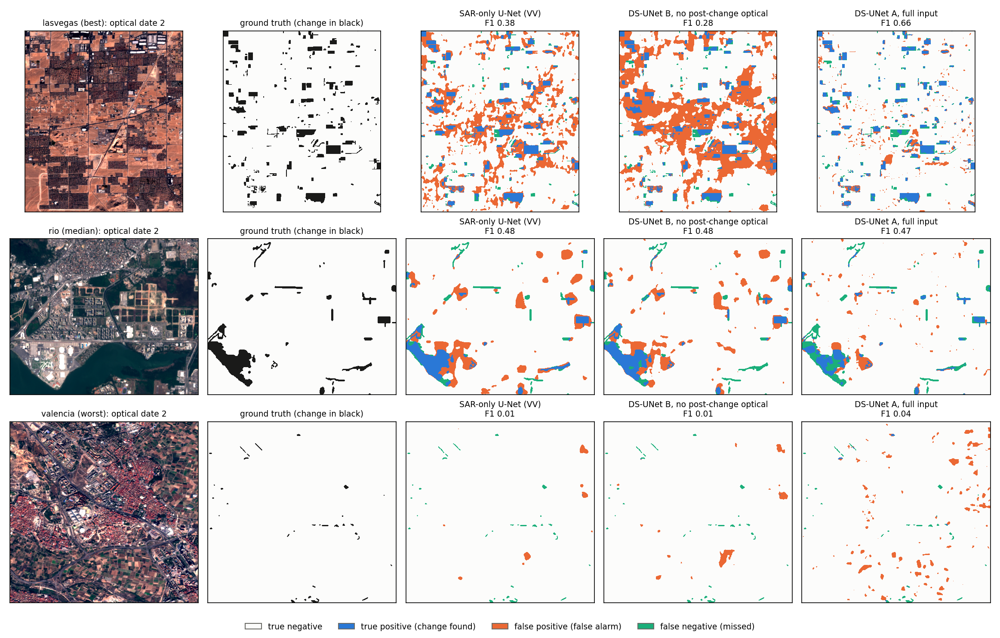
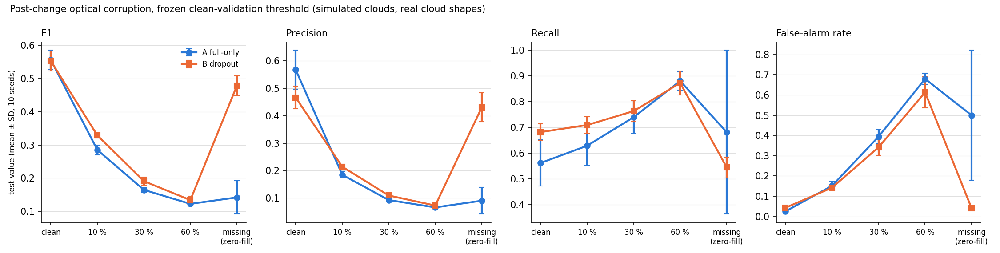
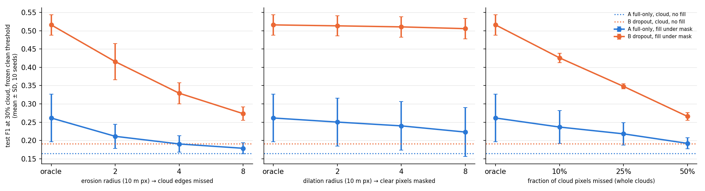

# Multimodal Satellite Change Detection for Urban Development and Environmental Monitoring

**Manish Y. M.**
*[Institution]*
manishym946@gmail.com

*Internal draft for mentor review, 2026-10-25; not for circulation. This manuscript merges the companion study
(`paper/RESEARCH_PAPER_FINAL.md`, now Appendix A) and the robustness study (`paper/ROBUSTNESS_PAPER_DRAFT.md`, now §5) and
adds Steps 6–8. Every number is taken from the audited reports in `experiments/robust/` (Phases 2–5, Steps 6–8), the error-map
record `experiments/robust/error_maps/selection.json` or, for Appendix A, `experiments/paper_statistics.json`, and is checked
by `paper/check_final_paper_numbers.py` (every number occurs in a source) and `paper/check_final_paper_tables.py` (every
results-table cell matches its source value). Items marked [verify] or [author] need action before submission.*

---

## Abstract

SAR–optical change detectors are usually trained and evaluated with Sentinel-1 and Sentinel-2 images at both dates, but the
post-change optical image is often missing or cloudy. Following a research requirement document with five questions, we
evaluate the official dual-stream U-Net (DS-UNet) and U-Net baselines on the OSCD urban change benchmark under one shared
protocol: 10 paired training seeds, validation-only selection, an internal pre-registration and an independent audit for
every step. With full input, DS-UNet beats SAR-only, optical-only and input-fusion U-Nets (test F1 0.556 against 0.418,
0.498 and 0.495; RQ4). Without the post-change optical image, adding the pre-change (historical) optical image to
bitemporal SAR gives no detectable gain over a SAR-only U-Net, either in a modality-dropout DS-UNet (+0.013) or in a DS-UNet
trained only on SAR and historical optical (−0.016; RQ1). Replacing that image by Sentinel-2 scenes taken 1 to 18 months
before the post-change date shows no detectable effect of its age (slope +0.0083 F1 per year, p = 0.105), and at no age
does it beat SAR alone (RQ2); a recent image may already show the change, which this design cannot separate from age. For a
SAR-only U-Net, adding VH to VV lowers F1 (−0.044) and VH alone lowers it more (−0.070); with optical input, polarisation
makes no detectable difference (RQ3). By land cover, the historical optical image lowers the false-alarm rate detectably
only in shrubland, 1.3% of the pixels (RQ5). A seven-step robustness study shows that modality dropout handles a missing
post-change image but not a partly cloudy one, that zero-filling cloud pixels recovers most of the loss for the dropout
model, and that unmasked cloud pixels are the main remaining error. All results concern one benchmark with 10 test cities;
seeds are training replicates, not geographic replicates.

**Keywords:** change detection, SAR–optical fusion, Sentinel-1, Sentinel-2, missing modality, historical optical imagery,
temporal gap, polarisation, cloud cover, OSCD, pre-registration, reproducibility

---

## 1. Introduction

Optical satellite images carry the spectral and semantic information that makes urban change easy to recognise, but they
are often unusable on the date a change must be assessed, because clouds cover part or all of the scene. Synthetic aperture
radar (SAR) is unaffected by cloud, which motivates SAR–optical fusion for change detection [1]. Most fusion models,
however, are trained and evaluated with SAR and optical images at both dates. Song et al. [2] showed that, for one change
type in one region, historical optical images can stand in for the missing post-change image as semantic context for a
SAR-based detector, and that their usefulness falls as they age. Whether this holds for urban change on a public benchmark,
whether a second SAR polarisation helps, and where historical optical imagery reduces false alarms, are open.

This paper answers the five research questions of the project's Research Requirement Document (RRD), word for word:

- **RQ1:** Can historical Sentinel-2 optical information improve Sentinel-1 SAR-based change detection when synchronous
  post-change optical imagery is unavailable?
- **RQ2:** How does the temporal gap between historical optical imagery and the target SAR observation affect change
  detection performance?
- **RQ3:** Can additional SAR information, particularly VV and VH polarization, improve discrimination between meaningful
  urban development and environmental or agricultural pseudo-changes?
- **RQ4:** How does the proposed asynchronous multimodal approach compare with SAR-only, optical-only, conventional fusion
  and dual-stream approaches?
- **RQ5:** Under what temporal and environmental conditions does historical optical information provide the greatest
  benefit?

We answer them with the official DS-UNet code [1] on OSCD [3] enriched with Sentinel-1, in a measurement study rather than
with a new method. The answers, in short: RQ4, the dual-stream design beats every U-Net baseline with full input; RQ1, the
historical optical image gives no measurable gain over bitemporal SAR alone; RQ2, its age has no detectable effect, and
recent images are, if anything, the least useful; RQ3, VH does not help, and for SAR alone it hurts; RQ5, the historical
image changes false alarms detectably in only one small land-cover class. A seven-step robustness study (§5) adds that a
partly cloudy post-change image is a different and worse problem than a missing one, and measures how far cloud masking
with zero-fill repairs it.

**Contributions.** (i) A controlled, multi-seed answer to RQ1–RQ5 on a public urban benchmark under one audited protocol,
including null results. (ii) A test of the temporal-gap and VH findings of Song et al. [2] in a different setting, with the
confound between an image's age and the change it already shows stated explicitly. (iii) A separation of the *missing* and
*partly cloudy* post-change cases, with the asymmetric cost of cloud-mask errors and a real-detector test on composite
clouds. (iv) A preliminary single-protocol study (Appendix A) showing that single-seed rankings on OSCD can reverse.

Because OSCD is small (24 cities), every result uses 10 paired seeds, 95% confidence intervals and Holm-corrected tests
[4]; every checkpoint and threshold is selected on validation cities only; and the 10 seeds are treated as training
replicates on one fixed test set, not as independent geographic samples.

## 2. Related Work

**SAR–optical change detection.** Siamese fully convolutional networks established bitemporal change detection on optical
images [5], with U-Net [6] variants as common backbones; reviews [7] cover the field. Hafner et al. [1] fuse Sentinel-1 VV
and Sentinel-2 in a dual-stream U-Net with decision-level fusion and report that it beats unimodal U-Nets and input-level
fusion on OSCD enriched with Sentinel-1; they used VV only because VH was not available for early acquisitions. Ebel et al.
[8] fuse co-registered Sentinel-1 and Sentinel-2 in Siamese networks for supervised change detection, Saha et al. [9] study
self-supervised change detection across different sensors, and DSNUNet [10] combines Sentinel-1 and Sentinel-2 for forest
change. All of these assume both modalities at the dates compared, or address a different task.

**Historical optical guidance and temporal gap.** Song et al. [2] monitor construction-ready bare land in Guangzhou with
Sentinel-1 VH change screening and a historical cloud-free Sentinel-2 image instead of a synchronous one. Varying the age
of that image (1, 3, 6 and 12 months before the target date) lowered F1 from 83.99% to 78.31% (their §5.4); they chose VH
over VV from backscatter physics rather than from a model ablation (§5.1). [verify: whether the gap results are single
runs.] Our RQ2 and RQ3 experiments test these two findings for urban change on a public benchmark.

**Missing modalities and clouds.** Modality dropout, randomly removing an input modality during training, was introduced
for gesture recognition [11]. Hafner and Ban [12] address multi-temporal urban mapping with a partly missing optical
modality by reconstructing optical features from SAR, and report gains over zero-fill and SAR-only models. SAR-guided cloud
removal reconstructs cloud-free Sentinel-2 images [13]. Real cloud masks are available in the Sentinel-2 Cloud Mask
Catalogue [14]; operational detectors such as s2cloudless [15] are imperfect, and an intercomparison of cloud-masking
algorithms documents large differences between methods and reference datasets [16].

**Evaluation practice.** Seed variance can reverse model rankings on small benchmarks [17]; Appendix A shows this on OSCD.

## 3. Data and Methods

### 3.1 Data and split

**OSCD.** OSCD [3] provides 24 bitemporal Sentinel-2 L1C image pairs with pixel-level urban change labels. We use the 13
bands, divided by 10000 and clipped to [0, 1], and a holdout protocol: 10 of the 14 official training cities for training,
the other 4 (aguasclaras, beihai, bercy, paris) for validation, and the 10 official test cities (brasilia, montpellier,
norcia, rio, saclay_w, valencia, dubai, lasvegas, milano, chongqing) for testing. Test cities never enter training or
validation, which is asserted in code and re-checked in every run file. The change prevalence on the test cities is 0.052,
and a detector that labels every pixel as change has F1 0.098.

**Sentinel-1 VV (Steps 2–6, 8).** The VV rasters released with DS-UNet [1], one or more relative orbits per city, resized
to the label grid by cubic interpolation; training samples an orbit at random and evaluation uses the first listed orbit.

**Sentinel-1 VV and VH (Step 7).** A new Google Earth Engine [18] export of Sentinel-1 GRD (IW mode) with DS-UNet's own
recipe: the same relative orbits, the mean of the 3 months before OSCD date 1 and after date 2, low values masked,
unit-scaled and clamped; VV range [−25, 5] dB as in DS-UNet, VH range [−30, 0] dB (fixed before download). The exported VV
equals the released DS-UNet VV raster pixel for pixel in all 102 files, so the existing VV models serve as the VV arms. VH
is empty (no scene in the window) only for dubai_166_t1, lasvegas_166_t1 and lasvegas_173_t1; Las Vegas, a test city whose
evaluated orbit has no VH at date 1, is therefore excluded from the Step 7 analysis set (9 test cities).

**Historical Sentinel-2 images (Step 8).** For each city, one Sentinel-2 L1C scene (COPERNICUS/S2_HARMONIZED) at OSCD's
own date-1 acquisition day (`gee_t1`, a same-date control of the processing chain) and one at each target date 2 − g,
g ∈ {1, 3, 6, 12, 18} months. Rule, fixed before any model saw a scene: within ±45 days of the target, full coverage and a
cloud-probability image required; the day nearest the target with cloud fraction ≤ 0.02 over the city box, else the
clearest day. All 144 city × date scenes exist. The primary city set is the 9 test cities whose scene has cloud fraction ≤
0.10 at every gap (Chongqing is excluded: cloud 0.977 at 3 months). An alignment control on all 24 cities against OSCD's own
date-1 bands gives median band correlation 0.940 and median shift 0.27 px, every city below 1 px. At 1–6 months no primary
city's image precedes OSCD date 1; at 18 months, 4 of the 9 do.

**Land cover (Steps 7–8).** ESA WorldCover 2020 v100 [19] on the same grid, resized to the label grid by nearest
neighbour. It post-dates OSCD date 2, so "built-up" includes new construction; it is used as a stratification, not as a
label. OSCD has no labels that separate urban change from agricultural or seasonal change, so RQ3 and RQ5 are answered
through where false alarms occur by land-cover class, not why they occur.

### 3.2 Models and training recipe

The network and loss are the official DS-UNet files (`networks.DualStreamUNet`, topology [64, 128, 256, 512], decision-level
fusion by 1×1 convolution; `jaccard_like_loss`), loaded at run time from commit 8bfa4be [1]. The U-Net baselines are the
official DS-UNet single-stream U-Net with the same recipe. Training: Adam, learning rate 5e-5, weight decay 5e-4, batch 64,
32×32 importance crops (20 candidates weighted by changed pixels + 5), random flips and 90° rotations, 2500 steps,
validation every 25 steps. The step budget was chosen on validation score only (390 steps: 0.354; 1000: 0.382; 2500:
0.405; mean of 3 seeds; Appendix C, item 1). Training is bitwise deterministic on our hardware (PyTorch 2.5.1+cu124, cuDNN
deterministic, one RTX 4060 laptop GPU). As a reference point, the official 390-step protocol on all 14 training cities
gives test F1 0.557 ± 0.035 (10 seeds), below the published 0.600 [1]; we could not establish whether 0.600 is a single run
or a mean, so our conclusions concern differences between arms under one shared protocol.

### 3.3 Arms

| arm | network | input channels per date | training conditions | step |
|---|---|---|---|---|
| A | DS-UNet | VV + 13 optical | full input | Phase 2 |
| B | DS-UNet | VV + 13 optical | full 0.50; post-change optical zero (`no_o2`) 0.25; both optical dates zero (`no_opt`) 0.25 | Phase 2 |
| C | DS-UNet | VV + 13 optical | full 0.50; post-change optical zero under a cloud-shaped mask 0.25; `no_o2` 0.125; `no_opt` 0.125 | Step 4B |
| async | DS-UNet | VV + 13 optical | `no_o2` only (SAR at both dates + historical optical) | Step 6 |
| SAR-only | U-Net | VV | full input | Step 6 |
| optical-only | U-Net | 13 optical | full input | Step 6 |
| input fusion | U-Net | VV + 13 optical, stacked | full input | Step 6 |
| VH, VV+VH | U-Net and DS-UNet | VH or VV+VH (+ 13 optical for DS-UNet) | full input | Step 7 |

Each arm is trained with seeds 1–10. B is the "asynchronous multimodal approach" of RQ1 and RQ4 in its most practical form:
one network that serves both the full-input and the missing-post-change-optical case. The async arm is the dedicated
alternative, trained only on SAR and the historical optical image. In the `no_o2` setting, the "historical optical image"
is OSCD's own date-1 Sentinel-2 image (Steps 6, 7) or one of the Step 8 scenes placed in the pre-change optical slot (Step 8);
the post-change optical input is zero.

**Selection (validation cities only).** Checkpoint: the step with the highest mean validation F1 over the conditions the arm
trains on. Threshold: the validation-F1 argmax over {0, 0.01, …, 1} for the selected checkpoint and input condition; it is
frozen and applied unchanged on test.

### 3.4 Statistics and integrity

F1, precision, recall, IoU and false-alarm rate (FP / (FP + TN)) are computed from pooled pixel counts over the analysed
test cities. Each step has one primary family of paired comparisons over seeds 1–10 (two-sided paired t-test, Holm
correction [4]), reported with the mean difference, its 95% CI, d_z, the number of seeds with a positive difference, and a
Holm-corrected Wilcoxon signed-rank test (smallest attainable p with n = 10 is 0.0020). Secondary analyses form their own
Holm families. Labels are "X better/lower" if Holm p < 0.05 with that sign, otherwise "no detectable difference"; a null is
not evidence of equivalence. With 10 pairs, the minimum detectable effect at 80% power is about 1.00 SD of the paired
differences at α = 0.05 and 1.14 SD at α = 0.05/2. The intervals and p-values describe variation across training seeds on
fixed test cities; they do not include the sampling variability of the cities themselves.

**Pre-specification.** For each step, a pre-registration file (hypotheses, conditions, primary family, decision rule and
sha256 hashes of code and inputs) was written before the step's first test evaluation. These are internal repository files,
not public registrations. For Steps 4B–8 the file was committed to version control before the test evaluation (Steps 6 and
7 before training); for Phases 2–4A-bis the evidence is file times and the code hashes recorded in every run file. Each
evaluation enforces anchors, for example that re-evaluated test counts equal the counts stored at training time exactly,
and an independent audit script recomputes every reported statistic from raw counts (Step 6: 1046 checks; Step 7: 994;
Step 8: 235; earlier steps in §5; all with 0 failures). Deviations are listed in Appendix C.

## 4. Results by research question

### 4.1 RQ4: comparison with SAR-only, optical-only, conventional fusion and dual-stream approaches

Full input, test F1 at the validation-selected threshold, 10 test cities (Step 6; primary family A − each baseline, Holm
over 3):

| arm | F1 | precision | recall | IoU | false-alarm rate |
|---|---|---|---|---|---|
| DS-UNet A | 0.556 ± 0.029 | 0.568 ± 0.071 | 0.562 ± 0.090 | 0.385 ± 0.028 | 0.025 ± 0.013 |
| DS-UNet B (modality dropout) | 0.553 ± 0.030 | 0.466 ± 0.041 | 0.682 ± 0.032 | 0.382 ± 0.028 | 0.043 ± 0.007 |
| SAR-only U-Net | 0.418 ± 0.043 | 0.312 ± 0.051 | 0.648 ± 0.027 | 0.265 ± 0.035 | 0.081 ± 0.020 |
| optical-only U-Net | 0.498 ± 0.056 | 0.588 ± 0.080 | 0.451 ± 0.101 | 0.333 ± 0.048 | 0.019 ± 0.012 |
| input-fusion U-Net | 0.495 ± 0.026 | 0.556 ± 0.063 | 0.452 ± 0.047 | 0.329 ± 0.023 | 0.020 ± 0.006 |

| contrast | mean Δ | 95% CI | d_z | Δ > 0 | Holm p | label |
|---|---|---|---|---|---|---|
| A − SAR-only | +0.138 | [+0.094, +0.181] | +2.26 | 10/10 | 1.6e-04 | DS-UNet better |
| A − optical-only | +0.058 | [+0.004, +0.112] | +0.77 | 8/10 | 0.0370 | DS-UNet better |
| A − input fusion | +0.061 | [+0.033, +0.089] | +1.54 | 9/10 | 0.0017 | DS-UNet better |

The dual-stream design is better than all three U-Net baselines. In a secondary family, input fusion is not distinguishable
from optical alone (Δ −0.003, 95% CI [−0.045, +0.039]), and both beat SAR alone (+0.077 and +0.079, Holm p 0.0102):
stacking SAR at the input adds nothing measurable to optical input, and only the dual-stream design gains from SAR. The
modality-dropout model B matches A on full input (Δ −0.003, 95% CI [−0.037, +0.031]; §5.1), so the approach that also works
without the post-change image gives up no detectable full-input accuracy. Validation-selected thresholds matter: at a fixed
0.5 threshold, full-input F1 is 0.513 for A, 0.427 for B and 0.357 for the SAR-only U-Net, and the selected thresholds of
the U-Net baselines range from 0.58 to 0.99.

**Answer to RQ4.** With full input, the dual-stream DS-UNet outperforms SAR-only, optical-only and input-fusion U-Nets
under one shared protocol, which agrees with Hafner et al. [1]. Without the post-change optical image, the comparison is
RQ1's.

### 4.2 RQ1: historical optical without post-change optical, against SAR alone

Setting `no_o2` (SAR at both dates, OSCD's own date-1 optical image, post-change optical zero), against the SAR-only
U-Net, 10 test cities (Step 6; primary family, Holm over 2):

| contrast | F1 | mean Δ | 95% CI | d_z | Δ > 0 | Holm p | label |
|---|---|---|---|---|---|---|---|
| B@no_o2 − SAR-only | 0.431 ± 0.034 | +0.013 | [−0.015, +0.040] | +0.33 | 6/10 | 0.6576 | no detectable difference |
| async@no_o2 − SAR-only | 0.402 ± 0.059 | −0.016 | [−0.059, +0.026] | −0.27 | 5/10 | 0.6576 | no detectable difference |

The F1 column is the first term; the SAR-only U-Net scores 0.418 ± 0.043. Neither the modality-dropout model nor the model
trained only on SAR and historical optical is detectably better than SAR alone. In a secondary family, async − B at `no_o2`
(Δ −0.029) and, within B, the historical image present minus absent (Δ −0.010, 95% CI [−0.026, +0.007]) are not detectable
either. Descriptively, the async model, trained only with the historical image, scores 0.463 ± 0.028 when that image is
also removed and 0.402 ± 0.059 with it. Step 8 repeats the comparison with images of different ages (§4.3): B is never
detectably better than SAR alone, and the source control shows that the Earth Engine copy of OSCD's date-1 image gives the
same result as OSCD's own (Δ +0.000).

The companion study (Appendix A) had reported 0.309 for its missing-optical model against 0.241 for SAR alone under a
weaker protocol; under the shared protocol the SAR-only U-Net reaches 0.418, and the margin does not survive.

**Answer to RQ1.** Under this protocol, historical Sentinel-2 optical information gives no measurable improvement over
bitemporal Sentinel-1 VV when the post-change optical image is unavailable. The minimum detectable effect is about 1.14 SD
of the paired differences, so a small benefit cannot be excluded.

### 4.3 RQ2: temporal gap between the historical optical image and the target date

B, setting `no_o2`, test F1 at the frozen `no_o2` threshold, 9 primary cities, mean ± SD over 10 seeds (Step 8):

| arm | OSCD date 1 | Earth Engine date 1 | 1 month | 3 months | 6 months | 12 months | 18 months |
|---|---|---|---|---|---|---|---|
| B dropout | 0.420 ± 0.039 | 0.420 ± 0.039 | 0.389 ± 0.044 | 0.422 ± 0.038 | 0.409 ± 0.035 | 0.417 ± 0.037 | 0.412 ± 0.033 |
| async | 0.405 ± 0.067 | 0.407 ± 0.066 | 0.349 ± 0.059 | 0.416 ± 0.061 | 0.370 ± 0.072 | 0.422 ± 0.057 | 0.383 ± 0.066 |

The SAR-only U-Net scores 0.406 ± 0.048 on the same cities. **Primary test:** per seed, the least-squares slope of B's F1
against the gap; the mean slope is +0.0083 F1 per year (95% CI [−0.0021, +0.0187]), positive in 8 of 10 seeds, t-test p
0.105: **no detectable effect of the gap**. The exact Wilcoxon test on the same slopes gives p 0.049; the registered test is
the t-test, so the slope's sign is suggestive, not established. The all-city sensitivity analysis (10 cities) agrees
(+0.0042 per year, p 0.057). For the async model the slope is +0.0161 per year (p 0.051), also not detectable.

Against SAR alone, B shows no detectable difference at any gap (mean Δ from −0.017 to +0.016, smallest Holm p 1.00). The
async model is lower than SAR alone at 1 month (Δ −0.058, 95% CI [−0.093, −0.022], Holm p 0.027) and not detectably
different at 3–18 months.

**The confound.** OSCD labels mark change between date 1 and date 2. An image taken 1–6 months before date 2 lies after date
1 and may already show part of the labelled change, which the pre-change slot would then hide. The 1-month image gives the
lowest F1 for both B and async, which is consistent with this confound, but how much change each image shows was not
measured, so the design cannot separate the image's age from it.

**Answer to RQ2.** On OSCD, the decline with age reported by Song et al. [2] (F1 83.99% at 1 month to 78.31% at 12 months,
for construction-ready bare land) is not reproduced: the age of the historical optical image has no detectable effect on
F1 between 1 and 18 months, and at no age does the image beat SAR alone. If anything, the most recent image is the least
useful, plausibly because it already contains part of the change.

### 4.4 RQ3: VV and VH polarisation

Full input, test F1 at the frozen threshold, 9 test cities with VH at both dates (Step 7):

| arm | F1 | precision | recall | IoU | false-alarm rate |
|---|---|---|---|---|---|
| SAR-only U-Net, VV | 0.452 ± 0.011 | 0.367 ± 0.017 | 0.590 ± 0.029 | 0.292 ± 0.009 | 0.049 ± 0.005 |
| SAR-only U-Net, VH | 0.383 ± 0.029 | 0.346 ± 0.048 | 0.442 ± 0.069 | 0.237 ± 0.022 | 0.042 ± 0.016 |
| SAR-only U-Net, VV+VH | 0.408 ± 0.031 | 0.405 ± 0.040 | 0.424 ± 0.081 | 0.257 ± 0.024 | 0.031 ± 0.010 |
| DS-UNet, VV | 0.501 ± 0.024 | 0.523 ± 0.067 | 0.500 ± 0.089 | 0.335 ± 0.021 | 0.024 ± 0.013 |
| DS-UNet, VH | 0.484 ± 0.043 | 0.511 ± 0.030 | 0.462 ± 0.061 | 0.320 ± 0.036 | 0.021 ± 0.002 |
| DS-UNet, VV+VH | 0.511 ± 0.019 | 0.571 ± 0.029 | 0.465 ± 0.036 | 0.344 ± 0.017 | 0.017 ± 0.003 |

| contrast | mean Δ | 95% CI | d_z | Δ > 0 | Holm p | label |
|---|---|---|---|---|---|---|
| SAR-only: VV+VH − VV | −0.044 | [−0.065, −0.023] | −1.49 | 1/10 | 0.0011 | VV+VH lower |
| SAR-only: VH − VV | −0.070 | [−0.091, −0.048] | −2.32 | 0/10 | 8.8e-05 | VH lower |
| DS-UNet: VV+VH − VV | +0.010 | [−0.016, +0.036] | +0.27 | 7/10 | 0.4125 | no detectable difference |
| DS-UNet: VH − VV | −0.017 | [−0.039, +0.004] | −0.59 | 3/10 | 0.1925 | no detectable difference |

The first two rows are the primary family (Holm over 2), the last two a secondary family. For SAR alone, VV scores best and
VH worst, and adding VH to VV lowers F1. With optical input, polarisation makes no detectable difference.

**Discrimination of pseudo-change.** By WorldCover class (secondary family, Holm over 7 classes), the SAR-only VV+VH model
has a lower false-alarm rate than VV in tree cover, built-up, bare and water, and no detectable difference in shrubland,
grassland and cropland. But its recall is lower than VV's in every class and overall (0.424 ± 0.081 against 0.590 ± 0.029),
while precision rises (0.405 ± 0.040 against 0.367 ± 0.017): the VV+VH model flags less change everywhere. This is a shift
of operating point, not evidence that VH separates urban development from environmental or agricultural pseudo-change.

Including Las Vegas, whose VH band at date 1 is all zero, the VV+VH SAR-only model drops to F1 0.224 ± 0.032 (false-alarm
rate 0.194 ± 0.051) on 10 cities, against 0.418 ± 0.043 for VV. A model trained with a second polarisation depends on that
band being present.

**Answer to RQ3.** Under this protocol, VH does not improve SAR-based urban change detection on OSCD, alone or with VV, and
it does not improve the discrimination of pseudo-change as measured by false alarms per land-cover class. This does not test
the physical argument of Song et al. [2] for VH on bare land.

### 4.5 RQ5: conditions in which historical optical information helps most

**Temporal conditions.** From §4.3: no gap between 1 and 18 months gives B a detectable gain over SAR alone, and the
1-month image scores lowest. For images older than OSCD date 1 (4 of the 9 primary cities at 18 months), the design cannot
separate age from city.

**Environmental conditions.** False-alarm rate by WorldCover class, B with OSCD's date-1 image minus the SAR-only U-Net, 9
primary cities (Step 8; Holm over the 7 classes with ≥ 1% of the pixels):

| class | pixel share | mean Δ | 95% CI | Δ > 0 | Holm p | label |
|---|---|---|---|---|---|---|
| tree cover | 15.6% | −0.001 | [−0.003, −0.000] | 3/10 | 0.0973 | no detectable difference |
| shrubland | 1.3% | −0.006 | [−0.010, −0.003] | 1/10 | 0.0127 | B lower |
| grassland | 7.7% | +0.002 | [−0.002, +0.006] | 5/10 | 0.9703 | no detectable difference |
| cropland | 8.0% | −0.015 | [−0.034, +0.004] | 2/10 | 0.5354 | no detectable difference |
| built-up | 40.6% | −0.004 | [−0.015, +0.008] | 4/10 | 0.9804 | no detectable difference |
| bare | 24.6% | −0.025 | [−0.077, +0.027] | 4/10 | 0.9703 | no detectable difference |
| water | 1.7% | +0.001 | [−0.008, +0.011] | 4/10 | 0.9804 | no detectable difference |

The historical optical image lowers the false-alarm rate detectably only in shrubland, a class covering 1.3% of the
pixels; in built-up areas, the largest class, there is no detectable difference. The mean differences in cropland and bare
land are negative but not detectable.

**Error maps.** Figure 1 shows, for seed 1, the SAR-only U-Net, B without the post-change optical image, and A with full
input on the best, median and worst test city, ranked by A's per-city F1 averaged over the 10 seeds (rule committed before
any map was drawn; every map reproduces that city's registered counts). In Las Vegas both SAR-based models produce large
false-alarm regions over desert and bare ground (F1 0.38 for SAR-only and 0.28 for B, against 0.66 for A); in Rio the three
are close (0.48, 0.48, 0.47); in Valencia, whose labelled changes are small and thin, every model misses nearly all of them
(0.01, 0.01, 0.04). These maps illustrate the results; they are not evidence for any research question.

**Answer to RQ5.** Within the conditions tested (image ages of 1–18 months, seven land-cover classes, OSCD urban change),
historical optical information gives no detectable benefit in F1 under any temporal condition, and its only detectable
effect on false alarms is a small reduction in shrubland. We found no condition in which it helps materially.

## 5. Robustness to a missing or cloudy post-change optical image

The RRD's premise is that the post-change optical image is often unavailable. In practice it is often present but partly
cloudy. This section reports the seven-step robustness study with the arms A, B and C (§3.3).

**Test conditions.** All corruptions act on the post-change Sentinel-2 image only. *Missing* (`no_o2`): set to zero.
*Copy-forward* (`o2_copy`): replaced by the pre-change image. *Cloud* (c10 / c30 / c60): a real CLOUD mask from the Cloud
Mask Catalogue [14], one per city and level, adjusted to cover exactly 10 / 30 / 60% of the city's pixels; inside it, all 13
bands are replaced by a fixed opaque cloud spectrum (per-band median of 400,000 thick-cloud pixels from 8 catalogue scenes);
clouds are uniform, hard-edged and shadowless. *Oracle zero-fill* (z10 / z30 / z60): the cloud pixels are set to zero under
the true mask. *Imperfect masks* (Step 4A-bis): the true mask eroded by 2 / 4 / 8 px (missed cloud edges), dilated by 2 / 4 /
8 px (over-masked clear pixels), or with 10 / 25 / 50% of whole clouds dropped (missed clouds). *Dilated imperfect masks*
(Step 5S): each under-masking mask dilated by one radius chosen on validation cities only (r* = 16 px, the largest in the
grid). *Composite clouds and a real detector* (Step 5): real catalogue cloud pixels pasted into the post-change images (126
composites; validation and test never share a scene), masked by s2cloudless 1.7.3 [15] at operating points chosen on
validation composites only: **rb95** (the most precise point with cloud recall ≥ 0.95), **bal** (highest mask F1) and the
fallback **rb99**. From Phase 3 on, the threshold is each checkpoint's frozen clean-validation threshold, since a deployed
model does not know the cloud level. Zero is the fill value used here, not an intrinsic missing-data token. Audits: Phase 2,
579 checks; Phase 3, 167; Step 4A-bis, 1338; Step 4B, 432; Step 5S, 826; Step 5, 731; all with 0 failures (Step 4A has no
audit of its own; Step 4A-bis re-checks its per-seed F1).

### 5.1 Whole-modality dropout handles a missing image at no detectable full-input cost (Phase 2)

Test F1 at the validation-selected threshold (mean ± SD over 10 seeds; primary family B − A, Holm over 4):

| condition | A full-only | B dropout | Δ (B − A) | 95% CI | B > A | Holm p |
|---|---|---|---|---|---|---|
| full | 0.556 ± 0.029 | 0.553 ± 0.030 | −0.003 | [−0.037, +0.031] | 5/10 | 0.8449 |
| post optical missing (`no_o2`) | 0.190 ± 0.068 | 0.431 ± 0.034 | +0.241 | [+0.176, +0.305] | 10/10 | 5.8e-05 |
| copy-forward (`o2_copy`) | 0.314 ± 0.034 | 0.438 ± 0.038 | +0.124 | [+0.087, +0.160] | 10/10 | 9.5e-05 |
| no optical (`no_opt`) | 0.397 ± 0.106 | 0.440 ± 0.027 | +0.043 | [−0.036, +0.123] | 5/10 | 0.4964 |

B is better with the post-change image missing and with copy-forward imputation, which neither arm saw in training. The
`no_opt` difference is not supported; it comes mostly from one collapsed A seed. On full input there is no detectable cost
at the validation-selected threshold, although differences below about 0.035 F1 cannot be excluded. At a fixed threshold of
0.5, B is lower on full input (−0.086, secondary): B's probabilities shift upward, so the dropout model needs its threshold
chosen on validation data.

### 5.2 Partial cloud is a different failure, and dropout does not fix it (Phase 3)

Test F1 at the frozen clean threshold (B − A, Holm over 4):

| condition | A full-only | B dropout | Δ (B − A) | Holm p | B > A |
|---|---|---|---|---|---|
| clean | 0.556 ± 0.029 | 0.553 ± 0.030 | | | |
| c10 | 0.285 ± 0.015 | 0.329 ± 0.008 | +0.044 | 9.6e-05 | 10/10 |
| c30 | 0.165 ± 0.007 | 0.191 ± 0.012 | +0.026 | 0.0010 | 10/10 |
| c60 | 0.123 ± 0.002 | 0.134 ± 0.011 | +0.011 | 0.0144 | 10/10 |
| missing | 0.142 ± 0.050 | 0.478 ± 0.030 | +0.336 | 9.5e-08 | 10/10 |

B degrades significantly less than A at every cloud level, but the advantage is small next to the damage. Ten percent cloud
cover costs A about 0.27 F1 and B about 0.22 F1; at 30–60% both are close to the all-change F1 of 0.098. **For B, a partly
cloudy post-change image is far worse than none:** 0.329 F1 at 10% cover against 0.478 with the image missing. (The
`missing` value differs from Phase 2's 0.431 only because Phase 3 uses the frozen clean threshold.) At the clean threshold,
almost every pixel under a cloud is predicted as change: the false-alarm rate inside the mask rises from about 0.03–0.05 to
0.96–1.00 for both arms, and false alarms spill into nearby clear pixels (outside-mask false-alarm rate for A 0.025 → 0.058 /
0.134 / 0.199 at c10 / c30 / c60; for B 0.042 → 0.052 / 0.075 / 0.095). Dropout taught B to ignore zero-filled optical input,
not cloud-valued optical input.

### 5.3 Zero-filling under the cloud recovers most of the loss, mainly for the dropout model (Step 4A)

Replacing the cloud values by zero under the true mask improves F1 for both arms at every level (Holm p < 0.05 for all 6
tests, 10/10 seeds), but by very different amounts:

| arm | level | F1 cloud | F1 zero-fill | Δ | recovery of the cloud loss |
|---|---|---|---|---|---|
| A | 10% | 0.285 | 0.393 | +0.108 | 0.403 ± 0.189 |
| A | 30% | 0.165 | 0.261 | +0.097 | 0.249 ± 0.168 |
| A | 60% | 0.123 | 0.192 | +0.069 | 0.161 ± 0.132 |
| B | 10% | 0.329 | 0.539 | +0.210 | 0.939 ± 0.016 |
| B | 30% | 0.191 | 0.516 | +0.325 | 0.899 ± 0.033 |
| B | 60% | 0.134 | 0.499 | +0.365 | 0.872 ± 0.041 |

For B, the false-alarm rate inside the mask returns to its clean value (≈ 0.05) and the spill-over disappears; B at 60%
cover with the oracle mask (0.499) is above B with the whole image missing (0.478). A reads the zero-filled region as change
too (false-alarm rate inside the mask ≈ 0.51). The remedy works well only together with dropout training. B's remaining gap
is lost evidence rather than false alarms: its recall inside the mask falls from about 0.73 to 0.55–0.61.

### 5.4 With synthetic mask errors, the mask should err toward over-masking (Step 4A-bis)

For B at 30% cover, each imperfect mask against the oracle mask (Holm over 9); every error type costs F1 (Holm p < 0.05,
worse than the oracle in 10/10 seeds), but the costs are very unequal:

| mask | missed cloud | over-masked clear | B F1 | Δ vs oracle | 95% CI | retained gain |
|---|---|---|---|---|---|---|
| oracle (z30) | 0 | 0 | 0.516 | | | |
| dilate2 | 0.000 | 0.051 | 0.513 | −0.003 | [−0.003, −0.002] | 0.99 |
| dilate4 | 0.000 | 0.107 | 0.511 | −0.005 | [−0.006, −0.005] | 0.98 |
| dilate8 | 0.000 | 0.214 | 0.506 | −0.010 | [−0.012, −0.009] | 0.97 |
| erode2 | 0.116 | 0.000 | 0.416 | −0.100 | [−0.141, −0.060] | 0.70 |
| erode4 | 0.232 | 0.000 | 0.329 | −0.187 | [−0.220, −0.153] | 0.43 |
| erode8 | 0.431 | 0.000 | 0.273 | −0.243 | [−0.272, −0.213] | 0.26 |
| miss10 | 0.100 | 0.000 | 0.426 | −0.090 | [−0.103, −0.077] | 0.73 |
| miss25 | 0.250 | 0.000 | 0.348 | −0.168 | [−0.188, −0.149] | 0.49 |
| miss50 | 0.500 | 0.000 | 0.266 | −0.250 | [−0.276, −0.225] | 0.23 |

Retained gain = (F1_mask − F1_cloud) / (F1_oracle − F1_cloud), with F1_cloud = 0.191. Over-masking is almost free for B:
masking 21% of the clear pixels costs 0.010 F1. Under-masking is expensive whatever its shape; on missed-cloud pixels, B's
false-alarm rate is 0.909–0.962 for every missed-cloud and erode4/8 variant. Over-masking does hurt the full-input model A:
its false-alarm rate on over-masked clear pixels rises from ≈ 0.024 to 0.385–0.497. An exploratory partition by the true
mask shows that a thin rim of unmasked cloud brings back the Phase 3 spill-over: for B with erode4, the false-alarm rate on
clear pixels outside the cloud is 0.073, the same as with no fill (0.075), against 0.045 with the oracle mask.

### 5.5 Spatial dropout training does not add robustness (Step 4B)

C − B test F1 at the frozen clean threshold (Holm over 7):

| condition | B | C | Δ (C − B) | 95% CI | C > B | Holm p |
|---|---|---|---|---|---|---|
| clean | 0.553 ± 0.030 | 0.564 ± 0.034 | +0.011 | [−0.024, +0.046] | 7/10 | 1.0 |
| z10 | 0.539 ± 0.028 | 0.553 ± 0.033 | +0.014 | [−0.019, +0.048] | 7/10 | 1.0 |
| z30 | 0.516 ± 0.028 | 0.529 ± 0.032 | +0.013 | [−0.020, +0.047] | 6/10 | 1.0 |
| z60 | 0.499 ± 0.030 | 0.508 ± 0.028 | +0.009 | [−0.024, +0.041] | 6/10 | 1.0 |
| c30, erode4 | 0.329 ± 0.029 | 0.312 ± 0.034 | −0.018 | [−0.050, +0.015] | 2/10 | 1.0 |
| c30, dilate4 | 0.511 ± 0.028 | 0.522 ± 0.030 | +0.011 | [−0.021, +0.043] | 6/10 | 1.0 |
| c30, miss25 | 0.348 ± 0.007 | 0.341 ± 0.006 | −0.007 | [−0.015, +0.001] | 3/10 | 0.55 |

All 7 primary comparisons are "no detectable difference", and C shows no clean regression. C halves B's whole-image dropout,
so the contrast mixes spatial masks with less whole-image dropout; descriptively, C is lower than B on `no_opt` (−0.028) and
`o2_copy` (−0.039), and C still calls almost every unmasked cloud pixel change (false-alarm rate under the cloud with no fill
0.994, against 0.961 for B).

### 5.6 Dilation repairs missed edges, not missed clouds (Step 5S)

B at 30% cover, test F1 with each under-masking mask P and with P dilated by r* = 16 px (Holm over 6), and the remaining
difference from the oracle mask after dilation (secondary):

| mask | B F1, P | B F1, P dilated by r* | Δ | 95% CI | Δ > 0 | Holm p | Δ vs oracle at r* |
|---|---|---|---|---|---|---|---|
| erode2 | 0.416 ± 0.050 | 0.500 ± 0.027 | +0.085 | [+0.044, +0.125] | 10/10 | 0.0041 | −0.016 |
| erode4 | 0.329 ± 0.029 | 0.500 ± 0.027 | +0.171 | [+0.138, +0.204] | 10/10 | 4.3e-06 | −0.016 |
| erode8 | 0.273 ± 0.018 | 0.468 ± 0.020 | +0.194 | [+0.172, +0.216] | 10/10 | 6.0e-08 | −0.048 |
| miss10 | 0.426 ± 0.013 | 0.424 ± 0.015 | −0.002 | [−0.005, +0.001] | 4/10 | 0.2382 | −0.092 |
| miss25 | 0.348 ± 0.007 | 0.348 ± 0.008 | +0.000 | [−0.001, +0.002] | 5/10 | 0.7405 | −0.168 |
| miss50 | 0.266 ± 0.010 | 0.267 ± 0.011 | +0.002 | [+0.001, +0.003] | 9/10 | 0.0261 | −0.249 |

Dilation is better for all three eroded masks, with every seed improving, and afterwards they are within 0.048 F1 of the
oracle. For missed whole clouds it makes no practical difference: miss50 meets the label "dilation better" with an effect of
0.002 F1 that the Holm-corrected Wilcoxon test does not support (p 0.059). Dilation can only reach a missed cloud that lies
near a detected one. The validation score was still rising at r* = 16 px, the edge of the grid.

### 5.7 A real cloud detector on composite clouds: recall bias helps, partly by discarding the image (Step 5)

These composites are not real cloudy acquisitions: thin cloud carries the foreign surface from its source scene, there are
no matching shadows, and the atmosphere outside the cloud is unchanged. Primary family: B, test F1 at the frozen clean
threshold, Holm over 9.

| contrast | Δ | 95% CI | Δ > 0 | Holm p | label |
|---|---|---|---|---|---|
| c10: rb95 − bal | −0.009 | [−0.019, +0.001] | 3/10 | 0.0672 | no detectable difference |
| c10: rb95 − oracle | −0.055 | [−0.065, −0.045] | 0/10 | 4.4e-06 | rb95 worse |
| c10: rb95 − cloud | +0.036 | [+0.017, +0.055] | 10/10 | 0.0056 | rb95 better |
| c30: rb95 − bal | +0.023 | [+0.008, +0.037] | 9/10 | 0.0119 | rb95 better |
| c30: rb95 − oracle | −0.053 | [−0.067, −0.039] | 0/10 | 6.7e-05 | rb95 worse |
| c30: rb95 − cloud | +0.150 | [+0.125, +0.175] | 10/10 | 2.1e-06 | rb95 better |
| c60: rb95 − bal | +0.057 | [+0.037, +0.078] | 10/10 | 5.6e-04 | rb95 better |
| c60: rb95 − oracle | −0.020 | [−0.024, −0.016] | 0/10 | 6.8e-06 | rb95 worse |
| c60: rb95 − cloud | +0.257 | [+0.223, +0.291] | 10/10 | 3.4e-07 | rb95 better |

**Detector masks on the test composites and B's mean test F1 (descriptive).** Cloud recall and the fraction of clear pixels masked
are computed against the true mask with no change model; rb99 is the flagged fallback mask.

| level | rb95 cloud recall | rb95 clear masked | bal cloud recall | bal clear masked | B cloud | B bal | B rb95 | B rb99 | B oracle | rb95 retained gain |
|---|---|---|---|---|---|---|---|---|---|---|
| c10 | 0.892 | 0.596 | 0.532 | 0.069 | 0.447 | 0.492 | 0.483 | 0.478 | 0.538 | 0.35 ± 0.21 |
| c30 | 0.837 | 0.615 | 0.555 | 0.087 | 0.315 | 0.442 | 0.465 | 0.478 | 0.518 | 0.74 ± 0.06 |
| c60 | 0.963 | 0.673 | 0.747 | 0.094 | 0.217 | 0.417 | 0.474 | 0.478 | 0.494 | 0.93 ± 0.02 |

The recall-biased mask beats the most accurate one at 30% and 60% cover and beats no fill at every level, but stays below
the oracle mask. It retains 0.740 of the oracle gain at 30% cover, just below the pre-specified 0.75, so no pre-specified
decision branch applies exactly. Three results qualify the gain: the detector misses more cloud on test than on validation
(11–16% of test cloud pixels reach the model at 10% and 30% cover); rb95 reaches its recall by masking 0.596–0.673 of the
clear pixels and costs B 0.054 F1 on clean images; and rb99, which masks almost the whole post-change image, gives 0.478 at
every level, above rb95 at 30% cover. The gain over bal is therefore consistent with B falling back on SAR and the
pre-change image, not evidence that the detector locates cloud well. For A, rb95 is worse than bal at every level (−0.148,
−0.083, −0.032; Holm p < 0.05).

## 6. Discussion

**What the historical optical image does and does not do.** In this setting the post-change information comes from SAR,
and the pre-change optical image adds no measurable change evidence: B scores the same with and without it, the model
trained only with it scores higher, descriptively, when it is removed, and neither beats a SAR-only U-Net trained with the same recipe
(RQ1). Its age does not matter between 1 and 18 months (RQ2). Two explanations fit, and the design cannot separate them:
OSCD's urban changes may be visible in the bitemporal SAR at least as clearly as their context is in the pre-change optical
image, or the dual-stream network with decision-level fusion may not exploit optical context without a post-change optical
image. The comparison with Song et al. [2] differs in change type, region, sensor configuration and architecture, so our null
result does not contradict their finding for construction-ready bare land; it shows that it does not transfer to OSCD
urban change under this protocol.

**Why the most recent image scores lowest.** An image taken one month before the post-change date usually lies after the
pre-change date and may already show part of the change. In the pre-change slot such an image tells the model that the
change was already there. This is a property of the task definition (labels between OSCD's two dates), not of the
satellite: a historical image is useful as context only if it precedes the change. A study of the gap that avoids the
confound needs labels dated at the historical image or images that all precede the change.

**Polarisation.** The polarisation result is clear for SAR alone: VV carries the urban change signal in OSCD, and adding VH,
with its lower backscatter and range, makes the SAR-only model more conservative and less accurate (RQ3). With optical
input the difference vanishes. VH is also a robustness risk: one city with a missing VH acquisition nearly halved the pooled
F1 of the VV+VH model.

**Dual-stream fusion with full input.** The dual-stream gain over input fusion (RQ4) and the absence of any input-fusion
gain over optical alone agree with Hafner et al. [1]: SAR helps only when it is encoded separately.

**Missing and cloudy are different problems.** Robustness to a missing image does not transfer to a partly corrupted one: a
dropout-trained model learns that a zero-filled optical image carries no information, not that a bright, flat,
cloud-valued patch is not a change. Zero-filling cloud pixels turns the cloud problem back into the missing-data problem,
and the outcome then depends on the direction of the mask error: a mask that covers 21% of the clear scene costs B 0.010
F1, a mask that misses a quarter of the cloud costs 0.168. With a real detector on composites, the recall-biased mask helps
B mainly by discarding most of the post-change image. Combined with RQ1, this gives a simple practical reading: for this
architecture on OSCD, a cloudy post-change optical image is best removed, and a model that falls back on bitemporal SAR
loses little relative to what the historical image could add.

**Operating point.** Dropout-trained and U-Net baseline models shift their output probabilities and need their decision
threshold chosen on validation data (B loses 0.086 F1 on full input at 0.5; baseline thresholds range from 0.58 to 0.99).
Deployments should calibrate the threshold on held-out data from the target region.

## 7. Limitations and threats to validity

- **One benchmark, few cities.** OSCD has 24 cities; results use 9 or 10 test cities and 4 validation cities. The 10 seeds are
  training replicates on the same test cities; they measure training variability, and the p-values do not support claims
  about other regions, sensors or seasons.
- **Power.** Effects below about 1.00–1.46 SD of the paired differences (roughly 0.035–0.07 F1, depending on the family) can be
  missed; every "no detectable difference" is a null, not equivalence.
- **No pseudo-change labels.** OSCD does not label agricultural, seasonal or environmental change. RQ3 and RQ5 are answered
  through false-alarm rates by WorldCover class; WorldCover (2020) post-dates OSCD date 2, so classes are a stratification,
  not ground truth for the cause of a false alarm.
- **Temporal-gap confound.** In Step 8 the image's age is confounded with how much of the labelled change it already shows;
  frozen models trained with OSCD's own date-1 image were evaluated with older images, and no model was trained on them.
- **One architecture and one recipe.** All arms use the official DS-UNet or its U-Net with one recipe and one dropout mixture
  per arm; attention-based or reconstruction-based models [2, 12] may behave differently. The U-Net baselines are not tuned
  separately. Checkpoint selection rules differ between arms by design.
- **SAR input.** VV comes from DS-UNet's released rasters (Step 7 showed our export reproduces them exactly); VH is a 3-month
  mean with a range fixed before download; Las Vegas has no VH at date 1. The SAR–optical co-registration is inherited from
  [1].
- **Simulated and composite clouds.** In §5 the clouds are opaque, uniform and shadowless (Phases 3–5S) or pasted from other
  scenes (Step 5); only the post-change date is corrupted. None of these results measures performance on real cloudy
  acquisitions. Mask errors are synthetic except in Step 5, which tests one detector with threshold-plus-dilation operating
  points and zero-fill.
- **Grid-boundary selections and resumed composites.** Step 5S's r* and Step 5's rb99 lie at the edge of their grids; 89 of the
  126 composites were kept from interrupted builds and verified by mask, shape, data type and value range, not byte for byte.
- **Internal pre-registration.** The pre-registrations are repository files, not public registrations, and for Phases 2–4A-bis
  their timing rests on file times.
- **Baseline gap.** Our reproduction of the official DS-UNet protocol (0.557 ± 0.035) is below the published 0.600 [1].
- **Not studied.** Small-change analysis, broader transitions such as demolition and urban renewal, InSAR coherence and other
  SAR features listed in the RRD are outside this study.

## 8. Conclusion

Under one audited, multi-seed protocol on OSCD: (RQ4) the dual-stream DS-UNet outperforms SAR-only, optical-only and
input-fusion U-Nets with full input; (RQ1) without the post-change optical image, a historical optical image gives no
measurable gain over bitemporal SAR alone; (RQ2) its age between 1 and 18 months has no detectable effect, and the most
recent image, which may already show the change, scores lowest; (RQ3) VH does not help, and for SAR alone it lowers F1; (RQ5)
the historical image changes false alarms detectably only in shrubland. The robustness study adds that a partly cloudy
post-change image is worse than a missing one, that zero-fill under a cloud mask with modality-dropout training recovers most
of the loss, and that unmasked cloud pixels are the main remaining error. For urban change on OSCD, the practical
configuration is a modality-dropout DS-UNet with a validation-calibrated threshold, which matches the full-input model when
the post-change optical image is present and falls back on SAR when it is missing or masked. Whether historical optical
imagery helps for other change types, with labels dated to avoid the temporal confound, or on real cloudy acquisitions, are
the main open questions.

## Declarations

**Data availability.** OSCD [3] and the Cloud Mask Catalogue [14] are public; the Sentinel-1 VV rasters are from the public
DS-UNet repository [1]; Sentinel-1, Sentinel-2 and ESA WorldCover [19] were exported from Google Earth Engine [18] with the
scripts in the repository. Code, pre-registrations, run files, analysis tables, audits and reports are in the project
repository (branch `robust-phase4`); checkpoints and raw count arrays are listed with sha256 hashes in
`experiments/robust/ARTIFACT_SHA256_*.txt`. [author: the repository is not yet public; state where it will be released.]

**Ethics.** The study uses public satellite imagery and labels only; no human participants or personal data are involved.

**Author contributions (CRediT).** [author: to be agreed with the mentor. Draft: Manish Y. M.: conceptualization,
methodology, software, investigation, formal analysis, data curation, visualization, writing (original draft and editing);
Soumen Mukherjee: supervision, writing (review).]

**Conflict of interest.** [author: confirm.] The author declares no conflict of interest.

**Funding.** [author: confirm.] No external funding.

**Use of AI tools.** An AI assistant (Claude, Anthropic) helped write analysis and evaluation code, audit scripts and report
builders, and drafted parts of the text. All results come from the code and audited outputs in the repository; the author
checked and is responsible for the content.

## References

[1] Hafner, S., Nascetti, A., Azizpour, H., & Ban, Y. (2022). Sentinel-1 and Sentinel-2 data fusion for urban change detection using a dual stream U-Net. *IEEE Geoscience and Remote Sensing Letters, 19*, 4019907. https://doi.org/10.1109/LGRS.2021.3119856

[2] Song, Lv, Ding, Hong, & Qi (2026). A dual-modal framework integrating SAR-based change screening and optical-scene-informed identification for high-frequency monitoring of construction-ready bare land. *Remote Sensing, 18*(8), 1103. https://doi.org/10.3390/rs18081103 [verify: authors' initials]

[3] Daudt, R. C., Le Saux, B., Boulch, A., & Gousseau, Y. (2018). Urban change detection for multispectral earth observation using convolutional neural networks. In *Proc. IEEE IGARSS*, 2115–2118. https://doi.org/10.1109/IGARSS.2018.8518015

[4] Holm, S. (1979). A simple sequentially rejective multiple test procedure. *Scandinavian Journal of Statistics, 6*(2), 65–70.

[5] Daudt, R. C., Le Saux, B., & Boulch, A. (2018). Fully convolutional siamese networks for change detection. In *Proc. IEEE ICIP*, 4063–4067. https://doi.org/10.1109/ICIP.2018.8451652

[6] Ronneberger, O., Fischer, P., & Brox, T. (2015). U-Net: Convolutional networks for biomedical image segmentation. In *MICCAI*, LNCS 9351, 234–241. https://doi.org/10.1007/978-3-319-24574-4_28

[7] Shafique, A., Cao, G., Khan, Z., Asad, M., & Aslam, M. (2022). Deep learning-based change detection in remote sensing images: A review. *Remote Sensing, 14*(4), 871. https://doi.org/10.3390/rs14040871

[8] Ebel, P., Saha, S., & Zhu, X. X. (2021). Fusing multi-modal data for supervised change detection. *International Archives of the Photogrammetry, Remote Sensing and Spatial Information Sciences, XLIII-B3-2021*, 243–249. https://doi.org/10.5194/isprs-archives-XLIII-B3-2021-243-2021

[9] Saha, S., Ebel, P., & Zhu, X. X. (2022). Self-supervised multisensor change detection. *IEEE Transactions on Geoscience and Remote Sensing, 60*, 4405710. https://doi.org/10.1109/TGRS.2021.3109957

[10] Jiang et al. (2022). DSNUNet: An improved forest change detection network by combining Sentinel-1 and Sentinel-2 images. *Remote Sensing, 14*(19), 5046. https://doi.org/10.3390/rs14195046 [verify: full author list]

[11] Neverova, N., Wolf, C., Taylor, G. W., & Nebout, F. (2016). ModDrop: Adaptive multi-modal gesture recognition. *IEEE Transactions on Pattern Analysis and Machine Intelligence, 38*(8), 1692–1706.

[12] Hafner, S., & Ban, Y. (2023). Multi-modal deep learning for multi-temporal urban mapping with a partly missing optical modality. In *Proc. IEEE IGARSS*, 6843–6846. https://doi.org/10.1109/IGARSS52108.2023.10281626

[13] Ebel, P., Meraner, A., Schmitt, M., & Zhu, X. X. (2021). Multi-sensor data fusion for cloud removal in global and all-season Sentinel-2 imagery. *IEEE Transactions on Geoscience and Remote Sensing, 59*(7), 5866–5878. https://doi.org/10.1109/TGRS.2020.3024744

[14] Francis, A., Mrziglod, J., Sidiropoulos, P., & Muller, J.-P. (2020). Sentinel-2 Cloud Mask Catalogue (Version 1). Zenodo. https://doi.org/10.5281/zenodo.4172871

[15] Zupanc, A. (Sentinel Hub). Improving cloud detection with machine learning (s2cloudless). Sentinel Hub blog. https://medium.com/sentinel-hub/improving-cloud-detection-with-machine-learning-c09dc5d7cf13 (software: s2cloudless 1.7.3). [verify: publication year]

[16] Skakun, S., Wevers, J., Brockmann, C., et al. (2022). Cloud Mask Intercomparison eXercise (CMIX): An evaluation of cloud masking algorithms for Landsat 8 and Sentinel-2. *Remote Sensing of Environment, 274*, 112990. https://doi.org/10.1016/j.rse.2022.112990 [verify: full author list]

[17] Bouthillier, X., Delaunay, P., Bronzi, M., Trofimov, A., Nichyporuk, B., Szeto, J., et al. (2021). Accounting for variance in machine learning benchmarks. In *Proceedings of Machine Learning and Systems (MLSys), 3*.

[18] Gorelick, N., Hancher, M., Dixon, M., Ilyushchenko, S., Thau, D., & Moore, R. (2017). Google Earth Engine: Planetary-scale geospatial analysis for everyone. *Remote Sensing of Environment, 202*, 18–27. https://doi.org/10.1016/j.rse.2017.06.031

[19] Zanaga, D., et al. (2021). ESA WorldCover 10 m 2020 v100. Zenodo. https://doi.org/10.5281/zenodo.5571936

[20] Dosovitskiy, A., Beyer, L., Kolesnikov, A., Weissenborn, D., Zhai, X., Unterthiner, T., et al. (2021). An image is worth 16×16 words: Transformers for image recognition at scale. In *International Conference on Learning Representations (ICLR)*.

[21] Bandara, W. G. C., & Patel, V. M. (2022). A transformer-based Siamese network for change detection. In *Proc. IEEE IGARSS*, 207–210. https://doi.org/10.1109/IGARSS46834.2022.9883686

[22] Chen, H., Qi, Z., & Shi, Z. (2022). Remote sensing image change detection with transformers. *IEEE Transactions on Geoscience and Remote Sensing, 60*, 1–14. https://doi.org/10.1109/TGRS.2021.3095166

[23] Van Etten, A., Hogan, D., Martinez Manso, J., Shermeyer, J., Weir, N., & Lewis, R. (2021). The multi-temporal urban development SpaceNet dataset. In *Proc. IEEE/CVF CVPR*, 6398–6407.

[24] Schmitt, M., Hughes, L. H., Qiu, C., & Zhu, X. X. (2019). SEN12MS – A curated dataset of georeferenced multi-spectral Sentinel-1/2 imagery for deep learning and data fusion. *ISPRS Annals of the Photogrammetry, Remote Sensing and Spatial Information Sciences, IV-2/W7*, 153–160. https://doi.org/10.5194/isprs-annals-IV-2-W7-153-2019

---

## Appendix A: Preliminary study under a simpler protocol

Before the shared protocol of §3, a preliminary study trained re-implemented models with a simpler recipe (BCE loss, Adam
1e-4, 50 epochs, no augmentation or importance sampling, threshold 0.5) and 3–5 seeds per model on the same split. Its
dual-stream model is a re-implementation, not the official DS-UNet; its missing-optical models are dual-stream networks
trained without the post-change optical image (dropping those channels, "clean", or zero-filling them, "naive"); and it
includes two lightweight Transformers [20] (1.16–1.36M parameters), motivated by Transformer change detectors [21, 22]. Its
results are superseded by §4 and are reported for completeness.

**Table A1: OSCD test results of the preliminary study (10 test cities, τ = 0.5; mean ± sample SD over n seeds)**

| Model | Loss | n | F1 | Precision | Recall | IoU | FAR |
|---|---|---|---|---|---|---|---|
| SAR-only U-Net | pw=1 | 5 | 0.241 ± 0.101 | 0.221 ± 0.152 | 0.342 ± 0.074 | 0.140 ± 0.065 | 0.112 ± 0.106 |
| Optical-only U-Net | pw=1 | 3 | 0.204 ± 0.055 | 0.393 ± 0.176 | 0.167 ± 0.101 | 0.114 ± 0.035 | 0.021 ± 0.022 |
| Early Fusion U-Net | pw=1 | 3 | 0.376 ± 0.022 | 0.343 ± 0.081 | 0.439 ± 0.070 | 0.232 ± 0.017 | 0.050 ± 0.021 |
| Sync Dual-Stream CNN | pw=1 | 5 | 0.459 ± 0.061 | 0.420 ± 0.079 | 0.518 ± 0.074 | 0.299 ± 0.051 | 0.041 ± 0.017 |
| Naive Missing-Optical CNN | pw=1 | 3 | 0.297 ± 0.089 | 0.307 ± 0.132 | 0.324 ± 0.141 | 0.177 ± 0.061 | 0.047 ± 0.035 |
| Clean Missing-Optical CNN | pw=1 | 5 | 0.309 ± 0.095 | 0.428 ± 0.154 | 0.254 ± 0.075 | 0.186 ± 0.066 | 0.023 ± 0.019 |
| Transformer Self-Attn (original) | pw=41 | 3 | 0.199 ± 0.048 | 0.117 ± 0.029 | 0.679 ± 0.178 | 0.111 ± 0.030 | 0.283 ± 0.070 |
| Transformer Cross-Attn (original) | pw=41 | 3 | 0.275 ± 0.124 | 0.190 ± 0.103 | 0.632 ± 0.116 | 0.163 ± 0.080 | 0.240 ± 0.255 |
| Transformer Cross-Attn (pw=1) | pw=1 | 3 | 0.088 ± 0.012 | 0.053 ± 0.001 | 0.408 ± 0.348 | 0.046 ± 0.007 | 0.399 ± 0.345 |
| Transformer Self-Attn (tuned, wd=1e-4) | pw=41 | 3 | 0.212 ± 0.024 | 0.125 ± 0.017 | 0.695 ± 0.018 | 0.118 ± 0.015 | 0.269 ± 0.047 |
| Transformer Cross-Attn (tuned, wd=1e-4) | pw=41 | 3 | 0.231 ± 0.065 | 0.142 ± 0.048 | 0.723 ± 0.168 | 0.131 ± 0.041 | 0.285 ± 0.201 |

*pw = BCE pos_weight. "Original" Transformers use weight decay 0; "tuned" use weight decay 1e-4 selected on validation F1.*

**Table A2: Pairwise F1 comparisons of the preliminary study (two-sided Welch t-test, Holm over 6)**

| Comparison (F1) | Δ mean | n | p (Welch) | p (Holm) |
|---|---|---|---|---|
| Sync dual-stream − Clean missing-optical | +0.150 | 5 vs 5 | 0.022 | 0.109 |
| Clean missing-optical − SAR-only | +0.069 | 5 vs 5 | 0.302 | 0.604 |
| Sync dual-stream − SAR-only | +0.218 | 5 vs 5 | 0.005 | 0.030 |
| Sync dual-stream − Early fusion | +0.083 | 5 vs 3 | 0.037 | 0.148 |
| Clean − Naive missing-optical | +0.012 | 5 vs 3 | 0.865 | 0.865 |
| Transformer Cross-Attn pw=41 − pw=1 | +0.186 | 3 vs 3 | 0.119 | 0.358 |

Three findings carry over as context. First, **seed variance changes the ranking**: seed-to-seed SDs of 0.06–0.12 F1 were
common, and the first seed alone ranked the clean missing-optical model (0.412) above the synchronous model (0.387), the
opposite of the five-seed mean; this motivated the 10-seed design of §3. Second, under this weaker recipe every baseline
scored far lower than under the shared protocol (SAR-only 0.241 against 0.418 in Step 6), so its RQ1 margin (0.309 against
0.241, not significant) is not evidence. Third, the cross-attention Transformer reached unimodal-CNN-level F1 only with strong
class reweighting (pw=41) and collapsed to predicting no change with pw=1; with one small design per attention type, this is
a finding about these models under this recipe, not about Transformers in general.

## Appendix B: SEN12-MT note

The preliminary study also trained models on one 21-month SAR–optical interval of a pre-packaged Sentinel-1/2 archive
over SpaceNet 7 [23] sites (distinct from SEN12MS [24]), with proxy labels from building footprints and 4 test sites; all
models scored F1 0.08–0.11 with one seed. The archive's provenance and metadata could not be verified, so these results are
not used. RQ2 is answered by Step 8 on OSCD (§4.3).

## Appendix C: Deviations and gaps

1. **Phase 2 step budget.** A 1000-step budget was first proposed after the test F1 of a 3-seed step sweep had been viewed. That
   choice was discarded and the budget re-chosen on validation score (2500 steps). Seeds 1–3 of A share the configuration of a
   sweep run whose test F1 had been seen; they were retrained from scratch, reproduced identically, and no Phase 2 decision
   used them.
2. **Phase 3 masks.** The first mask build used an absolute cloud-fraction tolerance, which could nearly double a small cloud;
   the masks were rebuilt with a relative tolerance before any model saw a mask. A missing `model.eval()` in the Phase 3
   evaluation script was fixed after a validation-only smoke test, before any test evaluation.
3. **Steps 4A and 4A-bis.** Both pre-registrations cite a validation-only smoke test for which no log exists. In Step 4A-bis,
   the evaluation printed per-seed test F1 while running; the analysis crashed on its final console print and was re-run
   unchanged; two source files hashed in every run file were missing from the pre-registration's hash table (unchanged since
   Phase 3). Inside/outside-mask metrics and IoU were added as a labelled exploratory addendum.
4. **Phase 3 report wording.** `PHASE3_REPORT.md` calls the all-change F1 the "change prevalence"; the prevalence is 0.052. The
   correction is in `experiments/robust/PHASE3_REPORT_ERRATA.md`.
5. **Step 4B.** Test F1 was printed at the end of each training run, as pre-specified. The pre-registration says "33"
   evaluation conditions but lists 34; all 34 were evaluated.
6. **Step 5S.** The validation smoke test's script was not committed, so the smoke test cannot be re-run from the repository.
7. **Step 5.** The scene pools were redesigned before any composite was built (arm C reported as flagged); the composite build
   was interrupted twice and resumed (89 files verified, not byte for byte); a float32/float64 comparison in an export check
   was corrected. The rb99 operating point uses the pre-specified fallback.
8. **Step 6.** No deviation. The machine slept once during training; training is deterministic and resumed unchanged.
9. **Steps 7 and 8 (one deviation, `0e49c87`).** The Step 7 and Step 8 evaluators lacked `model.eval()` and cuDNN determinism.
   This was found when Step 8's anchor failed on its first checkpoint, diagnosed on validation cities only, and fixed with the
   author's approval before any Step 7 or Step 8 result was saved or read; nothing else changed.
10. **Steps 7 and 8, interruption.** Both were stopped by the author on 2026-10-23 and resumed the next day. Step 8 was re-run
    from scratch and reproduced the 16 files of the interrupted run byte for byte; in Step 7, 5 completed runs were kept and the
    interrupted run was retrained from scratch, reproducing the interrupted log's last line.
11. **Error maps.** The selection rule was committed (`afa354e`) before the script first ran; no deviation.

## Appendix D: Reproducibility

Each step's pre-registration, report and audit are in `experiments/robust/`: Phases 2–5 (commits `eead015`, `25fe13b`,
`5dfaa17`, `cde5434`, `3c5d85a`, `f56ba71`, `d9e29ff`, `5f5be9c`, `3ed2fb7`); Step 6 (pre-registration `5476ffe`, results
`2c74a73`); Step 7 (`1ff4251`, `6374275`); Step 8 (`7989248`, `f50d73b`); evaluator deviation `0e49c87`; error maps (`afa354e`,
`b49bd87`); preliminary study per-seed results (`7cca91e`). Each pre-registration's hash table can be re-verified with
`verify_prereg_hashes.py`, and each report is rebuilt from its summary by `build_phase{6,7,8}_report.py`, which refuses to
build if a stated claim is not supported. Training is bitwise deterministic on the hardware used.
